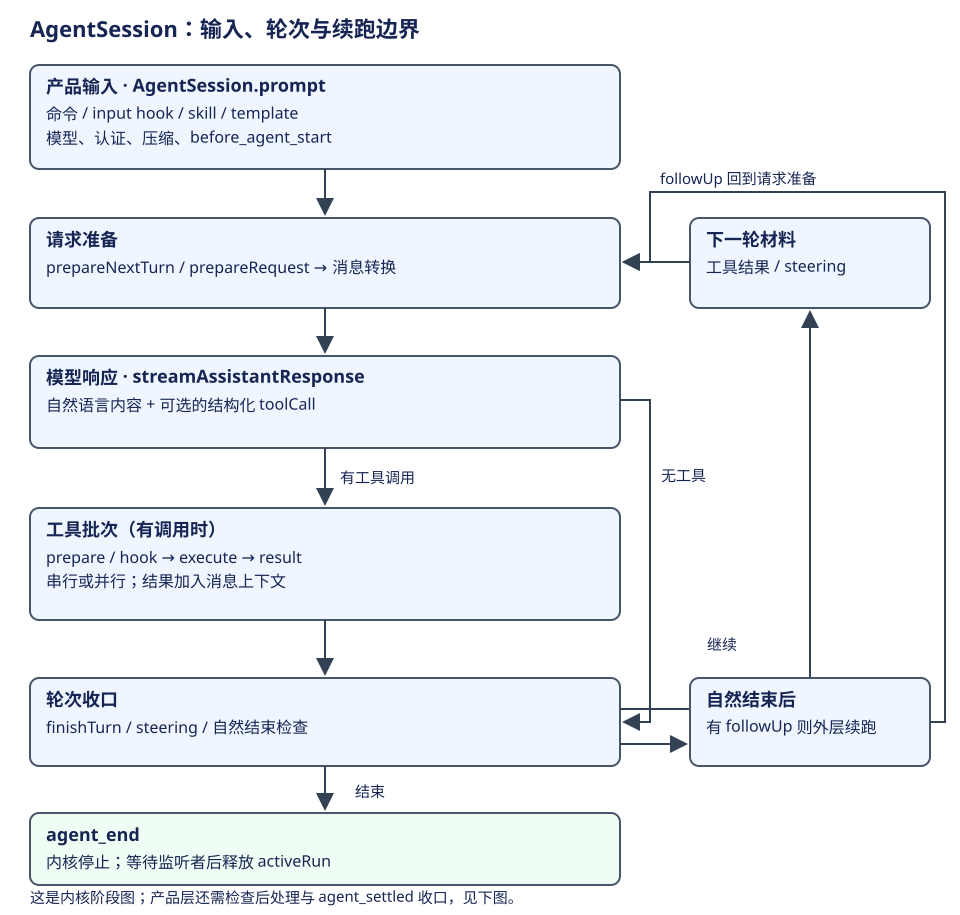
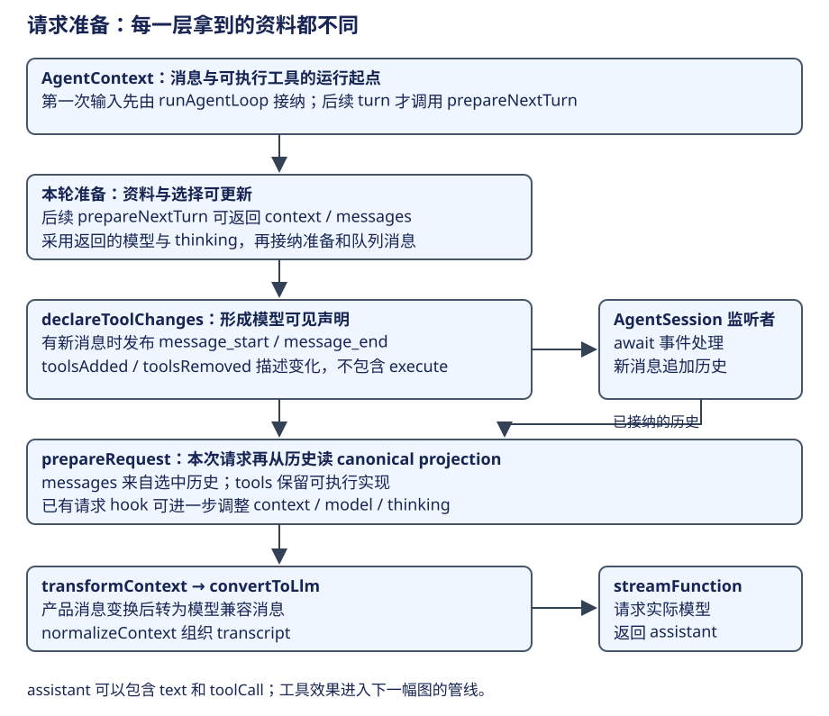
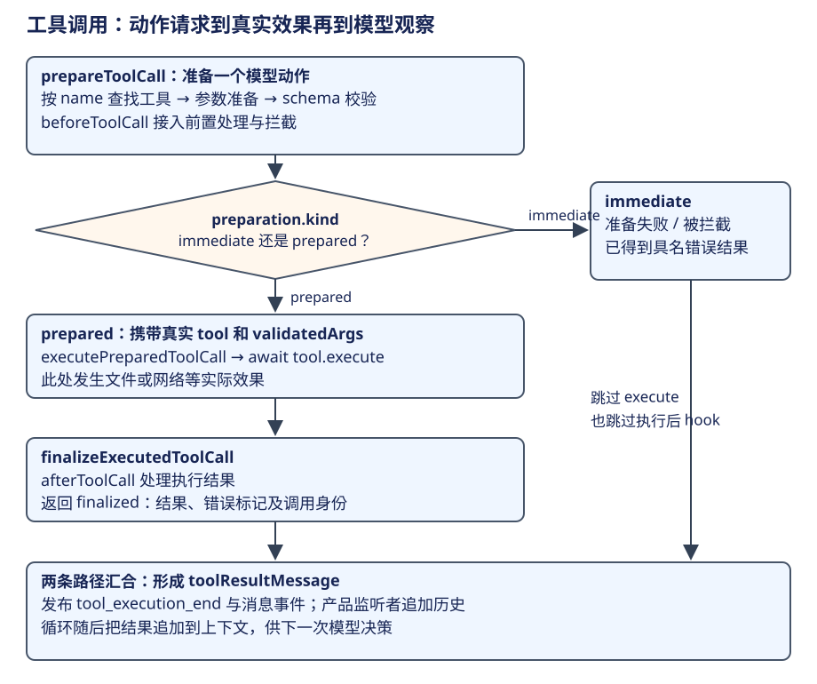
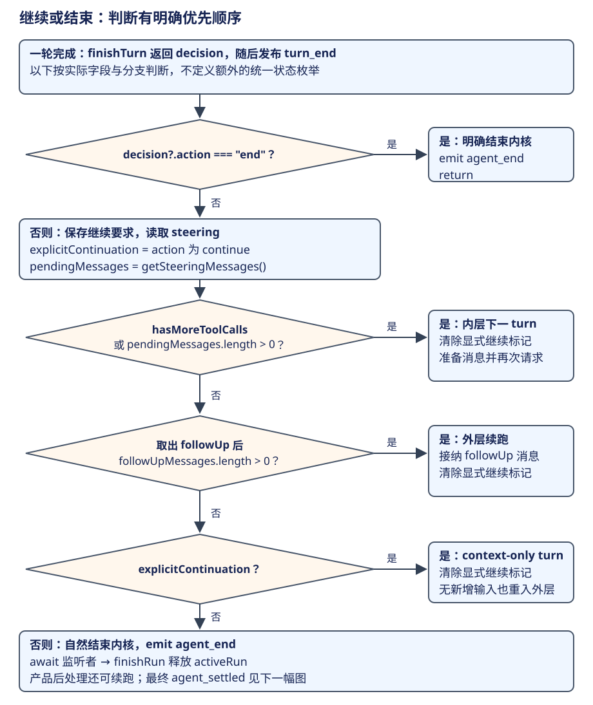
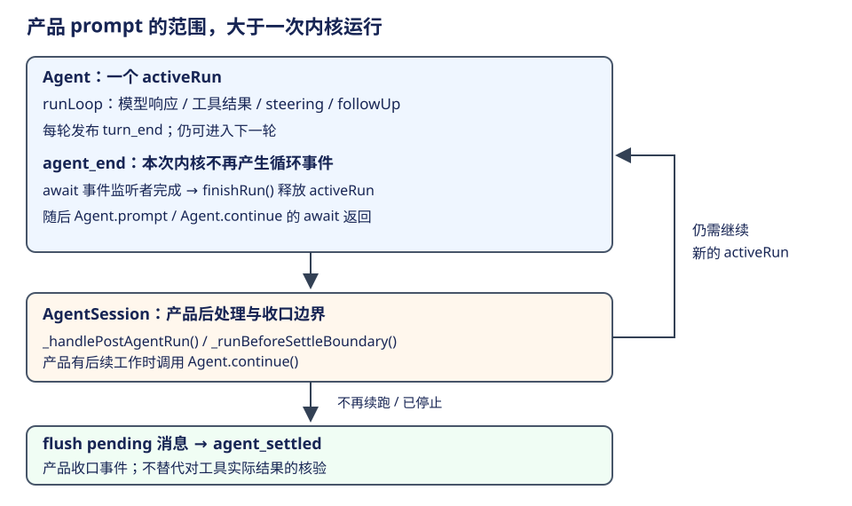

# AgentSession：一次输入到实际执行

Pi 的默认执行方式是模型与工具反馈循环：程序准备一次请求，模型决定回答还是调用工具，程序执行并把结果送回模型。计划可以在同一链路中形成和修订，默认推进依赖模型与工具的反馈。



本章沿五步展开：处理输入、准备请求并取得模型响应、执行工具、将完整消息接回历史、判断继续或收口。需要继续时回到请求阶段；本章末尾再说明规划模式怎样使用这条主线。

## 先确定一次任务跨越哪些时间尺度

贯穿案例是：“读取需求和导出代码，将 CSV 导出调整为正确处理逗号、引号和换行，运行已有验证，并说明结果。”下面是用于解释机制的一条可能轨迹，工具选择和具体轮数由模型与实际资料决定。

| 尺度 | 在案例中是什么 | 源码对应 |
|---|---|---|
| 产品会话 | 这段对话及其历史，可接收很多用户任务 | AgentSession + SessionManager |
| 一次产品 prompt | 接纳输入、内核运行及产品最终收口；可能包含后续 continue | AgentSession.prompt / _runAgentPrompt |
| 一次内核运行 | 执行一轮完整的模型与工具循环，等待事件监听者后释放 | Agent activeRun，包住 runLoop |
| 一个 turn | 一次 assistant 响应，以及它请求的工具结果 | runLoop 的内层推进单位 |

第一个 turn 可以请求 `read` 查看需求和代码；第二个 turn 根据结果调用 `edit`；第三个 turn 调用 `bash` 执行验证；第四个 turn 说明修改与测试结果。它们属于同一用户任务。**模型响应包含两个工具调用时，这两个调用也是同一个 turn 的工具批次，不会自动变成两份用户任务。** [内层与外层循环](https://github.com/earendil-works/pi/blob/f1b2e77f5b13b2a199b1052cb79c235451afe7d7/packages/agent/src/agent-loop.ts#L163)。

## 第一步：产品输入先变成可执行的请求材料

`AgentSession.prompt` 接收文字和图片。输入如果命中扩展命令，可以直接被命令处理；普通输入经过 input handlers 后再展开 skill 命令和 prompt template。这样 `/skill:...` 的内容会在进入模型前展开为具体任务资料。

会话正在运行时，输入按指定行为进入 steer/followUp 队列。空闲时，产品检查模型和认证，按需要先处理上下文压缩，然后调用 `before_agent_start`。这个钩子可以参与模型、Prompt 和工具选择；完成图片规范化后，程序构造 user/custom/system 等消息，并调用 `_runAgentPrompt`。

输入分派的输出是展开后的文字、图片和工具选择，随后作为消息交给 Agent。底层 loop 从这些准备好的资料开始执行。[完整 prompt 准备](https://github.com/earendil-works/pi/blob/f1b2e77f5b13b2a199b1052cb79c235451afe7d7/packages/coding-agent/src/core/agent-session.ts#L1968)。

下面按 AgentSession.prompt 的原顺序整理输入分派骨架，省略 UI 通知和异常文案，用注释标出验证与材料准备的位置：

```ts
const expandPromptTemplates = options?.expandPromptTemplates ?? true;
if (expandPromptTemplates && text.startsWith("/")) {
  const handled = await this._tryExecuteExtensionCommand(text);
  // 扩展命令已经接管输入，这里不再自动发送普通 prompt。
  if (handled) return;
}
// 省略：压缩尚未完成时拒绝新 prompt，避免与上下文修改重叠。
const processedInput = await this._runInputHandlers(
  text, options?.images, options?.source ?? "interactive",
  this.isStreaming ? options?.streamingBehavior : undefined,
);
// input handler 消耗了输入，不再进入 skill/template 展开。
if (!processedInput) return;
const { text: currentText, images: currentImages } = processedInput;
let expandedText = currentText;
if (expandPromptTemplates) {
  expandedText = this._expandSkillCommand(expandedText);
  expandedText = expandPromptTemplate(expandedText, [...this.promptTemplates]);
}
if (this.isStreaming) {
  // 省略：运行中提交必须明确指定 steer 或 followUp，否则报错。
  if (options.streamingBehavior === "followUp") {
    await this._queueFollowUp(expandedText, currentImages);
  } else {
    await this._queueSteer(expandedText, currentImages);
  }
  // 入队后返回，由后续边界消费；这里不并行启动另一个
  // Agent.prompt。
  return;
}
// 省略：先接纳待处理 bash/custom 消息，
// 再校验模型及认证是否可用于请求。
const lastAssistant = this._findLastAssistantMessage();
if (lastAssistant) await this._checkCompaction(lastAssistant, false);
const result = await this._extensionRunner.emitBeforeAgentStart(
  expandedText, currentImages, this._baseSystemPromptOptions,
);
// 省略：协调 hook 的工具选择并规范化图片，
// 然后构造 user/custom 消息。
// 消息创建在 hook 之后，保证本次模型选择与图片处理、
// 工具声明一致。
const updateMessage = this._preparePromptAndToolLoadout(result.systemPromptOptions);
this._runSystemPromptOptions = result.systemPromptOptions;
if (updateMessage) messages.unshift(updateMessage);
await this._runAgentPrompt(messages);
```

读这段时应区分三个出口：命令或 hook 接管后返回；运行中输入入队后返回；空闲输入走到 `_runAgentPrompt`。第三条启动新内核运行；命令接管和排队各自在对应出口结束本次输入处理。[输入与排队](https://github.com/earendil-works/pi/blob/f1b2e77f5b13b2a199b1052cb79c235451afe7d7/packages/coding-agent/src/core/agent-session.ts#L1973)、[请求材料形成](https://github.com/earendil-works/pi/blob/f1b2e77f5b13b2a199b1052cb79c235451afe7d7/packages/coding-agent/src/core/agent-session.ts#L2052)。

## 第二步：组织请求并取得模型响应



进入 Agent 后，程序取得当前消息和工具的快照，创建运行控制。`runLoop` 在后续轮次调用 `prepareNextTurn`，在每次请求前调用 `prepareRequest`；随后 `streamAssistantResponse` 经过 context transform、消息转换和 provider stream 发起模型请求。

### 2.1 进入内核，准备轮次资料

从产品层进入执行层的交接点是 `Agent.runPromptMessages`。下面两个方法是源码节选；运行生命周期包住循环，循环收到的是数组快照和事件回传函数：

```ts
private async runPromptMessages(
  messages: AgentMessage[],
  options: { skipInitialSteeringPoll?: boolean } = {},
): Promise<void> {
  await this.runWithLifecycle(async (signal) => {
    await runAgentLoop(
      messages,
      this.createContextSnapshot(),
      this.createLoopConfig(options),
      (event) => this.processEvents(event),
      signal,
      this.streamFunction,
    );
  });
}

private createContextSnapshot(): AgentContext {
  return { messages: this._state.messages.slice(), tools: this._state.tools.slice() };
}
```

数组快照提供内核起点，之后的 prepareRequest 在每次请求前重新组织历史投影和工具，采用方式见[上下文章的第六步](context.md#第六步-在后续请求边界转换模型协议)。[Agent 到循环](https://github.com/earendil-works/pi/blob/f1b2e77f5b13b2a199b1052cb79c235451afe7d7/packages/agent/src/agent.ts#L432)。

图中的两个准备回调可返回新的上下文与选择，由内核采用。下面节选 `runLoop` 的返回值采用路径，省略 thinkingLevel 到 reasoning 的转换与事件发布：

```ts
let preparedMessages: AgentMessage[] = [];
if (lastCompletedTurn) {
  // 只有已经完成过一轮，才需要准备“下一轮”；
  // 第一次请求不经过这个回调。
  const nextTurnSnapshot = await config.prepareNextTurn?.(lastCompletedTurn);
  if (nextTurnSnapshot) {
    currentContext = nextTurnSnapshot.context ?? currentContext;
    preparedMessages = nextTurnSnapshot.messages ?? [];
    config = {
      ...config,
      model: nextTurnSnapshot.model ?? config.model,
      // 省略：采用返回的 thinkingLevel，
      // 并转换成内核的 reasoning 配置。
    };
  }
}

```

没有返回的新字段沿用旧值，返回的 context、model 和准备消息供后续请求使用。现在先接纳 preparedMessages 和队列消息，再准备具体请求。[轮次准备的采用位置](https://github.com/earendil-works/pi/blob/f1b2e77f5b13b2a199b1052cb79c235451afe7d7/packages/agent/src/agent-loop.ts#L183)。

### 2.2 接纳消息，同步工具声明

准备回调采用上下文后，程序先接纳消息并同步工具声明。context.tools 包含可执行函数，模型使用名称、说明和参数 schema；Pi 将工具声明变化写入 system 消息，随后随 transcript 进入模型适配。请求前的消息追加路径如下，这是内层循环的源码节选：

```ts
for (const message of declareToolChanges(currentContext, [...preparedMessages, ...pendingMessages])) {
  await emit({ type: "message_start", message });
  await emit({ type: "message_end", message });
  currentContext.messages.push(message);
  newMessages.push(message);
}
```

`declareToolChanges` 比较 transcript 已声明的工具与当前可执行集合。下面是其流程骨架，省略 pending system 消息查找与无变化时的快速返回；保留两种采用位置：

```ts
// 省略：找到待接纳的 system 消息，移除其工具意图字段后得到
// baseline。
// 比较的是已声明的工具状态与实际可执行集合，
// 避免重复声明或沿用旧定义。
const changes = getToolStateChanges(
  getCurrentTools([...context.messages, ...baseline]),
  (context.tools ?? []).map(toToolDeclaration),
);
if (pending) {
  // 省略：工具无变化且没有待替换的声明意图时，原样返回
  // pendingMessages。
  return baseline.map((message, index) =>
    index === systemIndex ? withToolChanges(pending, changes) : message);
}
// 省略：工具状态无变化时原样返回，不新增 system 消息。
const update = withToolChanges({ role: "system", content: "", timestamp: Date.now() }, changes);
// 省略：把 update 放到第一条非 system 的待处理消息前，
// 再交给模型请求。
```

`withToolChanges` 把非空的 `toolsAdded`／`toolsRemoved` 附到 system 消息；`toToolDeclaration` 只保留名称、描述、parameters 等声明字段，去掉 execute。模型适配层按 transcript 重放这些变化，取得当次工具声明。这样，“程序能执行什么”和“模型知道能请求什么”才在请求边界对齐。[声明追加](https://github.com/earendil-works/pi/blob/f1b2e77f5b13b2a199b1052cb79c235451afe7d7/packages/agent/src/agent-loop.ts#L210)、[声明差异](https://github.com/earendil-works/pi/blob/f1b2e77f5b13b2a199b1052cb79c235451afe7d7/packages/agent/src/agent-loop.ts#L333)、[transcript 工具重放](https://github.com/earendil-works/pi/blob/f1b2e77f5b13b2a199b1052cb79c235451afe7d7/packages/ai/src/utils/transcript.ts#L58)、[工具声明裁剪](https://github.com/earendil-works/pi/blob/f1b2e77f5b13b2a199b1052cb79c235451afe7d7/packages/ai/src/utils/transcript.ts#L122)。

### 2.3 读取当前请求视图并转换协议

工具声明和待接纳消息已经就位，runLoop 接着调用 prepareRequest，采用当前消息、模型和 thinking 选择。下面节选返回值采用段，省略 thinkingLevel 的具体转换：

```ts
const requestUpdate = await config.prepareRequest?.({
  context: currentContext,
  model: config.model,
  thinkingLevel: config.reasoning ?? "off",
}, signal);
if (requestUpdate) {
  currentContext = requestUpdate.context ?? currentContext;
  config = {
    ...config,
    model: requestUpdate.model ?? config.model,
    // 省略：采用本次请求返回的 thinkingLevel。
  };
}
```

产品在这个回调中读取当前历史投影，已有 prepareRequest 还可以进一步调整请求。[请求准备的采用位置](https://github.com/earendil-works/pi/blob/f1b2e77f5b13b2a199b1052cb79c235451afe7d7/packages/agent/src/agent-loop.ts#L219)。随后进入 streamAssistantResponse：

```ts
let messages = context.messages;
if (config.transformContext) messages = await config.transformContext(messages, signal);
const llmMessages = await config.convertToLlm(messages);
const llmContext = normalizeContext({ messages: llmMessages });
const resolvedApiKey =
  (config.getApiKey ? await config.getApiKey(config.model.provider) : undefined) || config.apiKey;
const response = await streamFunction(config.model, llmContext, {
  ...config, apiKey: resolvedApiKey, signal,
});
// 省略：消费响应流，发布 message_start/update/end；
// 完整响应随后进入工具判断。
```

`transformContext` 仍面对产品消息；`convertToLlm` 转为模型兼容消息；`normalizeContext` 组织 transcript；`streamFunction` 才发出实际模型请求。响应流在后半段解析为完整 assistant 消息，下一步从其中提取工具调用。[请求转换与发出](https://github.com/earendil-works/pi/blob/f1b2e77f5b13b2a199b1052cb79c235451afe7d7/packages/agent/src/agent-loop.ts#L388)。

## 第三步：执行模型提出的工具调用

已经取得完整 assistant 响应，程序接着检查其中的动作请求。一次返回可以同时包含自然语言内容与结构化 toolCall。比如模型说明要先查看代码，并请求读取文件。下面是教学消息，省略 timestamp、usage 等字段：

```json
{
  "role": "assistant",
  "content": [
    { "type": "text", "text": "先查看导出函数和已有用例。" },
    { "type": "toolCall", "id": "call-read", "name": "read",
      "arguments": { "path": "src/export.ts" } }
  ]
}
```

程序依据 `name` 找到工具定义，准备和校验参数，经 `beforeToolCall` 后执行 `tool.execute`，再处理结果。模型提供的是**动作请求**；工具调用的解析、可用性、参数处理和实际执行属于程序。一次工具批次可串行或并行，配置以及工具自己的 executionMode 决定选择。



这里再分成准备、执行和反馈三个阶段。`prepareToolCall` 找到工具后，在正常路径中先转换参数、校验 schema，再调用前置 hook；不存在的工具、无效参数或 block 都返回 `kind: "immediate"`，不会进入真实 execute。[工具准备](https://github.com/earendil-works/pi/blob/f1b2e77f5b13b2a199b1052cb79c235451afe7d7/packages/agent/src/agent-loop.ts#L716)。

准备阶段还负责把原始 toolCall 接到真实工具对象。下面按 `prepareToolCall` 整理关键路径，省略取消检查、try/catch 和 hook 事件字段的展开：

```ts
const tool = tools.find((t) => t.name === toolCall.name);
if (!tool) {
  return { kind: "immediate", result: createErrorToolResult(`Tool ${toolCall.name} not found`), isError: true };
}
const preparedToolCall = prepareToolCallArguments(tool, toolCall);
const validatedArgs = validateToolArguments(tool, preparedToolCall);
if (config.beforeToolCall) {
  const beforeResult = await config.beforeToolCall({
    assistantMessage, toolCall, args: validatedArgs, context: currentContext,
  }, signal);
  // 省略：取消检查；被拦截时返回 immediate，而不是继续执行。
  if (beforeResult?.block) {
    const result = createErrorToolResult(beforeResult.reason || "Tool execution was blocked");
    if (beforeResult.terminate === true) result.terminate = true;
    return { kind: "immediate", result, isError: true };
  }
}
// 省略：最终取消检查；参数或前置处理抛错时 catch
// 返回具名错误结果。
return { kind: "prepared", toolCall, tool, args: validatedArgs };
```

`prepared` 同时携带调用身份、真实 tool 和已校验参数，执行阶段因此无需再从模型文字猜测该调用谁。这是图中准备与效果之间的交接契约；`immediate` 则携带已经形成的结果，直接走反馈路径。[准备结果如何绑定真实工具](https://github.com/earendil-works/pi/blob/f1b2e77f5b13b2a199b1052cb79c235451afe7d7/packages/agent/src/agent-loop.ts#L708)。

下面节选串行工具批次中的分派与发布段；省略 immediate 结果对象的字段展开。并行批次也经过同一准备、执行和结果处理阶段：

```ts
const preparation = await prepareToolCall(currentContext, assistantMessage, toolCall, config, signal);
let finalized: FinalizedToolCallOutcome;
if (preparation.kind === "immediate") {
  // 准备失败或前置 hook 拦截已经产生结果，不再调用 execute
  // 或执行后 hook。
  finalized = { toolCall, result: preparation.result, isError: preparation.isError };
} else {
  const executed = await executePreparedToolCall(preparation, signal, emitToolExecutionUpdate(toolCall, emit));
  finalized = await finalizeExecutedToolCall(
    currentContext, assistantMessage, preparation, executed, config, signal,
  );
}
await emitToolExecutionEnd(finalized, emit);
const toolResultMessage = createToolResultMessage(finalized);
await emitToolResultMessage(toolResultMessage, emit);
finalizedCalls.push(finalized);
messages.push(toolResultMessage);
```

executePreparedToolCall 内部实际调用 `await prepared.tool.execute(prepared.toolCall.id, prepared.args, signal, onUpdate)`；实际源码的 onUpdate 会收集进度事件，等它们发完再返回执行结果。`finalizeExecutedToolCall` 才在这之后执行 `afterToolCall` 等结果处理。之后再形成下方的反馈消息。 [批次阶段](https://github.com/earendil-works/pi/blob/f1b2e77f5b13b2a199b1052cb79c235451afe7d7/packages/agent/src/agent-loop.ts#L549)、[真实 execute](https://github.com/earendil-works/pi/blob/f1b2e77f5b13b2a199b1052cb79c235451afe7d7/packages/agent/src/agent-loop.ts#L831)。

```json
{
  "role": "toolResult",
  "toolCallId": "call-read",
  "toolName": "read",
  "content": [{ "type": "text", "text": "exportCsv 当前直接用逗号连接字段……" }],
  "isError": false
}
```

下一次模型请求携带 call 与 result。程序没有写死“read 后必定 edit”；模型可能改为继续查看测试、澄清要求或修改代码。call ID、工具名、参数和结果角色让程序对齐调用；模型根据自然语言目标和观察决定接下来做什么。[消息转换与真实模型请求](https://github.com/earendil-works/pi/blob/f1b2e77f5b13b2a199b1052cb79c235451afe7d7/packages/agent/src/agent-loop.ts#L381)、[工具批次与策略](https://github.com/earendil-works/pi/blob/f1b2e77f5b13b2a199b1052cb79c235451afe7d7/packages/agent/src/agent-loop.ts#L508)、[工具调用准备](https://github.com/earendil-works/pi/blob/f1b2e77f5b13b2a199b1052cb79c235451afe7d7/packages/agent/src/agent-loop.ts#L708)。

## 第四步：让消息进入产品事件和会话记录

前面输入接纳、模型响应和工具结果都会产生事件。本节把这条贯穿步骤 1 至 3 的记录路径集中说明：Agent 将 message_start/update/end、tool_execution 等事件送回 AgentSession。产品用流更新展示进度，用完整消息事件追加历史，后续请求再从这些记录取得观察。

事件接回持久历史的代码也有明确顺序。下面节选 `_handleAgentEvent` 的发布和普通消息写入路径，省略 custom_message、来源索引及重试状态处理：

```ts
await this._emitExtensionEvent(event);
this._emit(event.type === "agent_end" ? { ...event, willRetry: this._willRetryAfterAgentEnd(event) } : event);
if (event.type === "message_end") {
  // 省略：custom 消息走 appendCustomMessageEntry；
  // 下方展示普通模型消息的保存。
  if (event.message.role === "system" || event.message.role === "user" ||
      event.message.role === "assistant" || event.message.role === "toolResult") {
    entryId = this.sessionManager.appendMessage(event.message);
  }
  // 省略：保存 message 到 entryId 的来源对应，并更新产品状态。
}
```

先 await 扩展事件、再通知公共监听者、随后追加普通消息，是本实现的事件处理顺序。流更新用于显示，message_end 的这一分支才追加完整普通消息。[事件到历史](https://github.com/earendil-works/pi/blob/f1b2e77f5b13b2a199b1052cb79c235451afe7d7/packages/coding-agent/src/core/agent-session.ts#L1139)。

## 第五步：根据反馈决定继续或收口



响应和工具结果已完成，消息也经事件处理接回历史。此时程序检查这一 turn 后面还有没有工作。工具结果会促成下一次请求，steering 可以加入新要求，`finishTurn` 也可以要求继续或结束。先理解正常分支，再看必要的中断条件。

上图按真实控制变量画状态转移：`hasMoreToolCalls` 表示工具批次是否允许自然续跑，`pendingMessages` 暂存本轮待接纳输入，`explicitContinuation` 记录尚未被自然续跑满足的继续要求。图按这些实际字段和条件表示控制流。图中判断顺序比单独记住“有工具就继续”更有用。

| 当前轮次的结果或控制 | 程序走向 | 案例中的含义 |
|---|---|---|
| 有工具调用，工具批次允许继续 | 内层循环进入下一请求 | 读完代码以后让模型决定修改方式 |
| 有 steering 输入 | 内层在规定边界加入消息后继续 | 用户补充“也要处理空字段” |
| 模型自然回答结束，仍有 followUp | 外层取出输入，再进入内层 | 当前修改说明完成，再补一段文档 |
| finishTurn 要求 continue | 保证有后续请求；已有续跑路径可满足 | 扩展需要模型继续完成未收口工作 |
| finishTurn 要求 end | 发布当前 turn 后结束运行 | 已有 finishTurn 回调明确要求结束 |
| 无工具、无队列、无继续要求 | 发布 agent_end，等待事件监听者，然后释放 activeRun | 内核运行结束；产品层继续检查收口 |

steering 不会直接改写正在返回的模型响应。它是在下一请求边界参与决策；followUp 则等当前工作自然可以停止时才消费。外层循环正是为了表达这个差别。[队列消费与 finishTurn](https://github.com/earendil-works/pi/blob/f1b2e77f5b13b2a199b1052cb79c235451afe7d7/packages/agent/src/agent-loop.ts#L280)、[产品队列说明](https://github.com/earendil-works/pi/blob/f1b2e77f5b13b2a199b1052cb79c235451afe7d7/packages/coding-agent/src/core/agent-session.ts#L2202)。

例如工具结果使批次 `terminate=true` 时，内核关闭的是这批工具带来的自然续跑；如果随后仍有 steering、followUp 或 finishTurn 的 continue，程序还会按图判断它们。finishTurn 的 end 分支优先退出内核；产品收口在下一小节继续检查。

### 扩展的轮次处理怎样交给 finishTurn

扩展的 turn_end 处理发生在 finishTurn 回调内。AgentSession 先分发这个边界，让扩展提交上下文编辑和继续要求，再将结果返回内核。内核得到决策后，才发布自己的 turn_end 通知。下面节选产品安装的回调，省略事件去重登记：

```ts
const previousFinishTurn = this.agent.finishTurn;
this.agent.finishTurn = async (turn, signal) => {
  // 省略：登记已经分发过的轮次，避免后续通知重复触发边界。
  const extensionContinue = await this._dispatchTurnEndBoundary(turn.message, turn.toolResults);
  const previousDecision = await previousFinishTurn?.(turn, signal);
  if (previousDecision?.action === "end") return previousDecision;
  if (extensionContinue || previousDecision?.action === "continue") return { action: "continue" };
  return undefined;
};
```

_dispatchTurnEndBoundary 交给 runner.emitBoundary，提交返回的 Entry 草稿，再检查当前上下文能否继续。这样扩展的处理结果先进入会话和继续判断，后续轮次能够采用。[轮次边界分发](https://github.com/earendil-works/pi/blob/f1b2e77f5b13b2a199b1052cb79c235451afe7d7/packages/coding-agent/src/core/agent-session.ts#L846)、[finishTurn 绑定](https://github.com/earendil-works/pi/blob/f1b2e77f5b13b2a199b1052cb79c235451afe7d7/packages/coding-agent/src/core/agent-session.ts#L886)。

### 内核怎样采用继续判断

下面是 `runLoop` 的流程骨架，保留原来的双层循环和分支顺序。轮次准备、请求更新、硬错误退出和工具批次展开用注释省略；这些阶段已在上文解释：

```ts
let currentContext = initialContext;
let config = initialConfig;
let lastCompletedTurn: PrepareNextTurnContext | undefined;
let explicitContinuation = false;
let pendingMessages = (await config.getSteeringMessages?.()) || [];
while (true) {
  let hasMoreToolCalls = true;
  while (hasMoreToolCalls || pendingMessages.length > 0) {
    // 省略：prepareNextTurn 刷新轮次视图，追加准备/队列消息，
    // 再运行 prepareRequest。
    // pendingMessages 已在这个阶段接纳，
    // 下面清空的是本轮暂存列表。
    pendingMessages = [];
    const message = await streamAssistantResponse(currentContext, config, signal, emit, streamFunction);
    newMessages.push(message);
    // 省略：error/aborted 走硬退出，结束当前 turn，发布
    // agent_end 后返回。
    const toolCalls = message.content.filter((c) => c.type === "toolCall");
    const toolResults: ToolResultMessage[] = [];
    hasMoreToolCalls = false;
    if (toolCalls.length > 0) {
      const executedToolBatch = message.stopReason === "length"
        ? await failToolCallsFromTruncatedMessage(toolCalls, emit)
        : await executeToolCalls(currentContext, message, config, signal, emit);
      toolResults.push(...executedToolBatch.messages);
      hasMoreToolCalls = !executedToolBatch.terminate;
      for (const result of toolResults) {
        currentContext.messages.push(result);
        newMessages.push(result);
      }
    }
    lastCompletedTurn = { message, toolResults, context: currentContext, newMessages };
    const decision = await config.finishTurn?.(lastCompletedTurn, signal);
    await emit({ type: "turn_end", message, toolResults });
    if (decision?.action === "end") {
      await emit({ type: "agent_end", messages: newMessages });
      return;
    }
    explicitContinuation = decision?.action === "continue";
    pendingMessages = (await config.getSteeringMessages?.()) || [];
    if (hasMoreToolCalls || pendingMessages.length > 0) explicitContinuation = false;
  }
  const followUpMessages = (await config.getFollowUpMessages?.()) || [];
  if (followUpMessages.length > 0) {
    explicitContinuation = false;
    pendingMessages = followUpMessages;
    continue;
  }
  if (explicitContinuation) {
    explicitContinuation = false;
    continue;
  }
  break;
}
await emit({ type: "agent_end", messages: newMessages });
```

内层负责“这项工作还有工具反馈或介入输入”，外层负责“自然停止后还有 followUp”。`continue` 决策已有工具或队列可以满足时不再额外请求；都没有时，外层重入一次 context-only turn。因此双层循环将当前工作与自然停止后的追加输入分开消费。[双层循环](https://github.com/earendil-works/pi/blob/f1b2e77f5b13b2a199b1052cb79c235451afe7d7/packages/agent/src/agent-loop.ts#L178)。

### 内核结束之后，还有产品收口



`_runAgentPrompt` 位于 AgentSession，包在刚才的内核双层循环之外。下面节选它的运行和收口段，省略初始选择记录及 finally 中的重试清理：

```ts
this._isAgentRunActive = true;
try {
  await this.agent.prompt(messages);
  while (!this._agentRunAbortRequested) {
    if (await this._handlePostAgentRun()) {
      if (this._agentRunAbortRequested) break;
      await this.agent.continue();
      continue;
    }
    if (this._agentRunAbortRequested || !(await this._runBeforeSettleBoundary())) break;
    if (this._agentRunAbortRequested) break;
    await this.agent.continue();
  }
} finally {
  // 省略：清理重试和本次请求配置；finally 仍负责产品最终收口。
  this._flushPendingBashMessages();
  this._flushPendingCustomMessages();
  await this._emitAgentSettled();
}
```

代码中的 _runBeforeSettleBoundary 分发扩展事件 agent_before_settle，提交其 Entry 草稿并接纳消息，确认上下文允许继续后返回继续判断。此时上一个 activeRun 已结束，产品通过 Agent.continue 启动新的运行。[产品收口边界](https://github.com/earendil-works/pi/blob/f1b2e77f5b13b2a199b1052cb79c235451afe7d7/packages/coding-agent/src/core/agent-session.ts#L1893)。

内核 turn_end 通知表示一轮响应及工具批次已结束；agent_end 表示内核停止发后续循环事件，Agent 等监听者完成后释放 activeRun。产品后处理和收口边界还可能产生下一份工作，agent_settled 才表示产品最终收口。因此，一次产品 prompt 可以覆盖多个 activeRun。[产品外层](https://github.com/earendil-works/pi/blob/f1b2e77f5b13b2a199b1052cb79c235451afe7d7/packages/coding-agent/src/core/agent-session.ts#L1822)、[内核释放时机](https://github.com/earendil-works/pi/blob/f1b2e77f5b13b2a199b1052cb79c235451afe7d7/packages/agent/src/agent.ts#L558)、[最终事件](https://github.com/earendil-works/pi/blob/f1b2e77f5b13b2a199b1052cb79c235451afe7d7/packages/coding-agent/src/core/agent-session.ts#L1078)。

## 执行模式：同一循环可以怎样规划

默认链路允许模型在消息中写方案、用工具获取事实，再调整动作。这符合“行动结果反馈下一次决策”的机制。

这里的 **ReAct** 指 Reasoning and Acting：模型根据当前资料决定下一步动作，程序执行工具并返回观察，模型再依据观察调整后续决策。它把推理与行动交替组织，相关概念已在[执行模式比较](../../comparisons/execution-modes.md)展开。Pi 默认实现提供这条工具反馈循环；显式 ReAct 提示格式由具体 Prompt 和模型协议决定。

Pi 仓库还提供 **Plan Mode 示例扩展**。开启后，它关闭内置 edit/write，过滤 bash 调用，注入规划上下文；从 `Plan:` 编号文本提取步骤，再由交互选择是否执行。执行阶段恢复工具，用 `[DONE:n]` 标记追踪进度，并把扩展状态记入会话。这个方案通过 AgentSession 的输入、工具选择和结束事件切换规划与执行，同一 Agent loop 继续推进。[示例说明](https://github.com/earendil-works/pi/blob/f1b2e77f5b13b2a199b1052cb79c235451afe7d7/packages/coding-agent/examples/extensions/plan-mode/README.md)、[工具控制与 Prompt 注入](https://github.com/earendil-works/pi/blob/f1b2e77f5b13b2a199b1052cb79c235451afe7d7/packages/coding-agent/examples/extensions/plan-mode/index.ts#L163)。

这里的规划有两层：模型用文字形成步骤，扩展保存清单并切换行为。若希望“步骤 1 完成后必须由程序派发步骤 2”，还需要显式步骤状态和调度契约。当前示例用文本标记和工具过滤管理模式，步骤的后续推进仍由模型决策。模式概念与选型见[执行模式比较](../../comparisons/execution-modes.md)。

看示例扩展如何消费计划并重新进入同一循环，就能把这个区别落到代码上。下面按源码整理“已有计划、用户选择执行”路径，省略 UI 文案、执行消息文本和其他选项：

```ts
pi.on("agent_end", async (event, ctx) => {
  // 省略：已处于执行模式时，检查清单完成情况、保存状态后返回。
  if (!planModeEnabled || !ctx.hasUI) return;
  const lastAssistant = [...event.messages].reverse().find(isAssistantMessage);
  if (lastAssistant) {
    const extracted = extractTodoItems(getTextContent(lastAssistant));
    if (extracted.length > 0) todoItems = extracted;
  }
  if (todoItems.length === 0) return;
  persistState();
  // 省略：ctx.ui.select 让用户选择执行、
  // 保持规划或继续修改计划。
  if (choice?.startsWith("Execute")) {
    // 省略：确认存在第一项待办，再从规划切换到执行。
    planModeEnabled = false;
    executionMode = true;
    restoreNormalModeTools();
    updateStatus(ctx);
    persistState();
    // 省略：用 todoItems 构造 execMessage，说明剩余步骤及
    // [DONE:n] 标记约定。
    pi.sendMessage(planTodoListMessage, { deliverAs: "followUp" });
    pi.sendMessage(
      { customType: "plan-mode-execute", content: execMessage, display: true },
      { triggerTurn: true, deliverAs: "followUp" },
    );
  }
});
```

控制动作是保存清单、恢复工具、投递 followUp；计划的正文仍进入模型上下文，由同一 Agent loop 决策与执行。注意事件入口是 `agent_end`：这一批 followUp 在内核已经停下后才排入，不能再由刚才退出的内层消费；产品 `_handlePostAgentRun` 发现新队列，再通过 `Agent.continue()` 启动新 activeRun。这正好接回前节的产品收口链路。[计划事件入口](https://github.com/earendil-works/pi/blob/f1b2e77f5b13b2a199b1052cb79c235451afe7d7/packages/coding-agent/examples/extensions/plan-mode/index.ts#L262)、[结束事件后的新队列](https://github.com/earendil-works/pi/blob/f1b2e77f5b13b2a199b1052cb79c235451afe7d7/packages/coding-agent/src/core/agent-session.ts#L1888)。

必要的停止分支包括 error/aborted 的硬退出，以及 length 截断时对工具调用形成失败结果而不执行可能残缺的参数。它们保护循环边界。详细历史与压缩流程见[下一章](context.md)。

学习自检：能否沿本章案例指出每次模型请求的输入新增了什么？用户补充要求由哪一个队列进入？模型的“已完成”、内核的 `agent_end` 和产品的 `agent_settled` 各表达什么，为什么都不能代替工具结果的事实证据？
