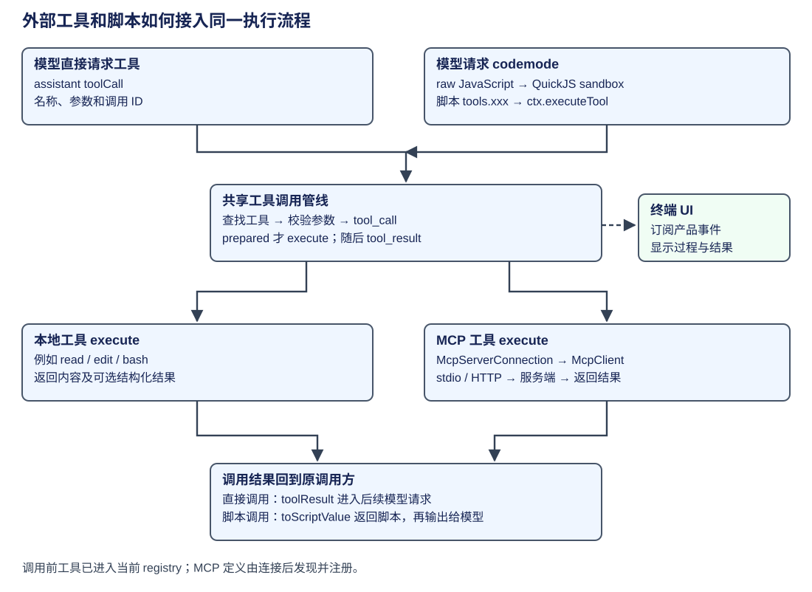
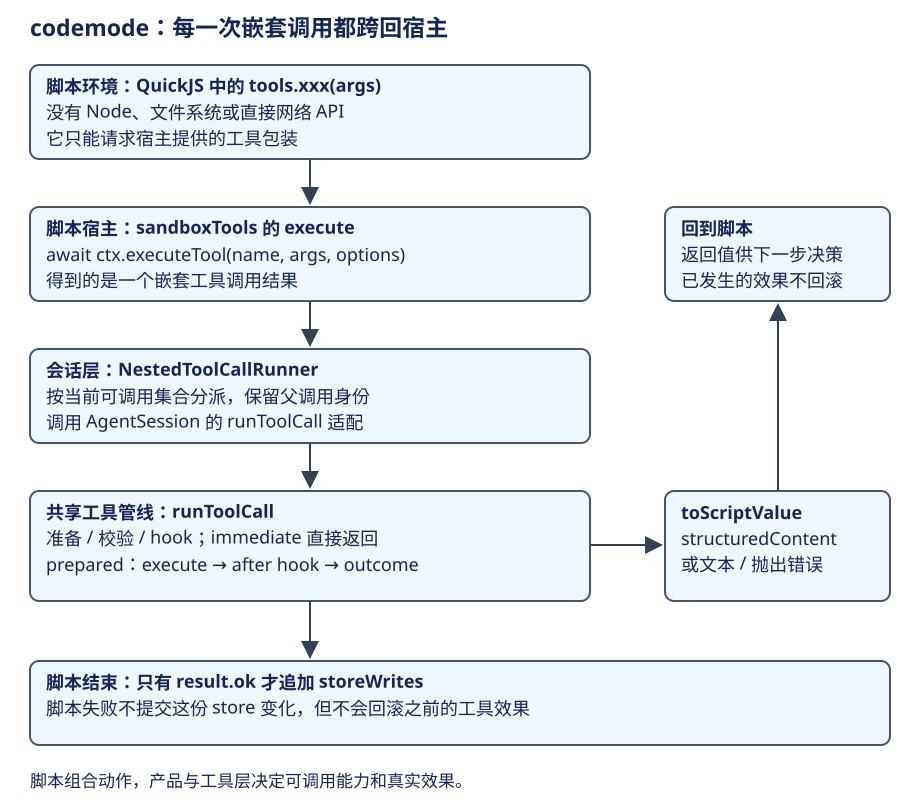

# AgentSession：MCP、codemode 与终端交互

前一章把工具定义和扩展处理器接到了 AgentSession。本章沿一次具体调用继续：工具如果由外部服务提供，Pi 怎样连接和调用它？模型如果要组合多个动作，Pi 又怎样运行它写出的脚本？

**MCP** 是外部工具接入协议：服务端描述可用工具，客户端取得定义并发起调用。**codemode** 是 Pi 的脚本执行工具：模型提交 JavaScript，脚本通过宿主提供的 tools 调用其他工具，还可以筛选和组合结果。这两种能力复用已有的工具执行流程。终端负责接收用户输入、展示过程和结果。



| 阅读顺序 | 本章要解释的交接 |
|---|---|
| 1. 准备 MCP 工具 | 连接服务，取得定义，决定模型怎样发现工具 |
| 2. 执行 MCP 调用 | 模型 toolCall 经现有管线到外部服务，结果回到对话 |
| 3. 用 codemode 组合调用 | 脚本经嵌套入口复用工具管线，结果再交回脚本 |
| 4. 终端呈现 | 产品事件交给 UI，后续用户输入返回 AgentSession |

资源重名发生在加载阶段，放在主调用流程之后单独说明。

## 第一步：连接 MCP 服务并让模型发现工具

MCP 扩展在 session_start 读取配置，对启用的服务发起后台连接。连接取得的工具定义进入当前会话。模型怎样发现这些工具，取决于配置的曝光方式；这里的“曝光”就是工具说明何时进入模型的可见资料。

| 方式 | 模型怎样发现工具 |
|---|---|
| direct | 请求直接带工具名称、说明和参数 schema |
| deferred | 模型先用 tool_search 查询，匹配工具再披露 |
| codemode | 脚本通过搜索与说明接口发现工具，然后调用 |

before_agent_start 会等待 direct 工具所需的服务器准备好，再组织 MCP 的 System Prompt 资料。deferred/codemode 则在相应发现或调用入口等待连接。下面是生命周期处理器的流程骨架，省略配置合并、状态通知和连接错误处理：

```ts
pi.on("session_start", (_event, ctx) => {
  const loaded = (options.loadConfig ?? defaultLoadConfig)(ctx);
  // 省略：合并配置里的 server 和扩展注册的 server，
  // 形成当前连接目标。
  ensureDiscoveryActive(ctx);
  const enabled = servers.filter(isEnabled);
  if (enabled.length === 0) { reportProblems(ctx); return; }
  const runtime = new Promise((resolve) => setImmediate(resolve)).then(() => loadMcpRuntime());
  pending = Promise.all(enabled.map((server) => startConnection(server, runtime)));
  // 省略：观察连接完成或失败，并发布 server 状态变化。
});
pi.on("before_agent_start", async (event, ctx) => {
  await waitForDirectServers(ctx);
  const { sections } = event.systemPromptOptions;
  const section = renderServersSection(servers);
  if (section) sections[MCP_SERVERS_SECTION] = section;
  else delete sections[MCP_SERVERS_SECTION];
});
```

这一顺序让会话开始就能准备外部能力，同时按本次所需工具等待。注册工具后，实际调用仍经过上一章的参数检查和 tool_call hook。[连接起点](https://github.com/earendil-works/pi/blob/f1b2e77f5b13b2a199b1052cb79c235451afe7d7/packages/coding-agent/src/extensions/mcp/index.ts#L1111)、[请求前等待](https://github.com/earendil-works/pi/blob/f1b2e77f5b13b2a199b1052cb79c235451afe7d7/packages/coding-agent/src/extensions/mcp/index.ts#L1175)、[曝光配置](https://github.com/earendil-works/pi/blob/f1b2e77f5b13b2a199b1052cb79c235451afe7d7/packages/coding-agent/docs/mcp.md#L189)。

CLI 内置资源会提供这套扩展；直接使用 SDK 时，调用者需要显式将 MCP、codemode 或 tool-search 加入 ResourceLoader。[SDK 资源加载要求](https://github.com/earendil-works/pi/blob/f1b2e77f5b13b2a199b1052cb79c235451afe7d7/packages/coding-agent/docs/mcp.md#L270)。

## 第二步：从工具 execute 调到 MCP 服务

假设模型已经选到一项 MCP 工具并提交参数。Agent loop 找到定义、完成校验和前置 hook 后，调用它的 execute。MCP 工具在这一刻取得当前连接，再发起协议调用。

下面节选 createMcpToolDefinition 的 execute，省略进度回调：

```ts
async execute(_toolCallId, params, signal, onUpdate) {
  const client = await options.getClient();
  const result = await client.callTool(tool.name, (params ?? {}) as Record<string, unknown>, {
    signal, timeoutMs: options.timeoutMs,
    // 省略：onProgress 接到 MCP 进度通知，
    // 并通过 onUpdate 发布产品工具的进度消息。
  });
  return convertMcpResult(server, tool.name, result, {
    readableResources: options.readableResources?.(),
  });
}
```

options.getClient 提供的是产品连接对象 McpServerConnection。它将 callTool 委托给连接管理，再取得内层协议客户端 McpClient：

```ts
callTool(name: string, args: Record<string, unknown>, options: McpRequestOptions): Promise<CallToolResult> {
  return this.withClient((client) => client.callTool(name, args, options));
}
```

withClient 取得可用连接，McpClient 将请求交给 stdio 或 Streamable HTTP 等 transport，服务端返回的结果经 convertMcpResult 变为 Pi 工具结果。这样，工具定义在调用时使用当前连接，连接更换后也能继续接入原工具流程。[调用时查找连接](https://github.com/earendil-works/pi/blob/f1b2e77f5b13b2a199b1052cb79c235451afe7d7/packages/coding-agent/src/extensions/mcp/index.ts#L425)、[工具 execute](https://github.com/earendil-works/pi/blob/f1b2e77f5b13b2a199b1052cb79c235451afe7d7/packages/coding-agent/src/extensions/mcp/tools.ts#L281)、[连接委托](https://github.com/earendil-works/pi/blob/f1b2e77f5b13b2a199b1052cb79c235451afe7d7/packages/coding-agent/src/extensions/mcp/runtime.ts#L265)。

返回后，原来的 tool_result hook 可以调整反馈，工具结果再进入下一次模型请求。模型据观察选择下一步，MCP 负责这次外部调用。

### 连接失效与登录发生在这一层

调用过程中，withClient 按错误类型处理连接。它对标记 readOnly 的 transient HTTP 错误重试一次；普通工具调用的这类错误会返回调用方。遇到 MCP session expired 时，程序换用新会话重试一次。需要认证时，连接状态更新为 needs-auth 并要求登录。[连接管理条件](https://github.com/earendil-works/pi/blob/f1b2e77f5b13b2a199b1052cb79c235451afe7d7/packages/coding-agent/src/extensions/mcp/runtime.ts#L297)。

需要 OAuth 的 MCP 服务由 createMcpAuthProvider 提供 token 获取、刷新和 401 challenge 回调。登录准备好后，连接使用新凭证重新接入服务。[MCP 认证回调](https://github.com/earendil-works/pi/blob/f1b2e77f5b13b2a199b1052cb79c235451afe7d7/packages/coding-agent/src/extensions/mcp/oauth.ts#L313)。

## 第三步：用 codemode 脚本组合多项工具

前两步一次 toolCall 对应一项工具。处理任务时，模型还可能希望并行读取几份文件、过滤长结果，再把有用部分带回后续决策。codemode 让模型把这段组织逻辑写成 JavaScript，由工具宿主运行；脚本输出进入模型上下文。[codemode 使用说明](https://github.com/earendil-works/pi/blob/f1b2e77f5b13b2a199b1052cb79c235451afe7d7/packages/coding-agent/docs/codemode.md)。

例如 CSV 任务可以在一次脚本里读代码和用例。下面是教学脚本，假定当前会话允许调用 read；裁剪范围只用于展示结果筛选：

```js
const [code, tests] = await Promise.all([
  tools.read({ path: "src/export.ts" }),
  tools.read({ path: "test/export.test.ts" }),
]);
// 只将本次要讨论的片段交回模型；脚本内部仍可处理完整工具结果。
text({ code: code.slice(0, 1200), tests: tests.slice(0, 1200) });
```

脚本运行在 QuickJS sandbox，宿主提供 tools、store/load 和 models 等接口。JavaScript 环境没有 Node、文件系统或直接网络 API；访问文件和外部服务要经会话提供的工具。能访问哪些资料、产生哪些操作，因而由可调用工具及其执行检查决定。



### 3.1 把脚本调用接回已有工具管线

executeCodemode 将当前允许调用的工具包装成 sandboxTools。下面保留这一交接，省略调用记录、计时和返回值转换的细节：

```ts
const callable = ctx ? getCodemodeCallableTools(ctx.tools) : [];
// 省略：把可调用工具渲染成脚本可读的声明，供搜索与选择。
const sandboxTools: CodemodeTool[] = callable.map((tool) => ({
  name: tool.name,
  description: samples.get(tool.name),
  execute: async (args, { signal: callSignal }) => {
    // 省略：登记嵌套调用及其运行状态；实际效果尚未发生。
    if (!ctx) throw new Error("Tool calls need a session");
    const outcome = await ctx.executeTool(tool.name, args, { signal: callSignal });
    // 省略：记录调用身份、耗时及成功/错误，并发布结果。
    return toScriptValue(tool, outcome);
  },
}));
// 省略：把 sandboxTools 注入 CodemodeSandbox，
// 再运行模型给出的脚本。
```

脚本的 tools 调用进入 ctx.executeTool，再到 AgentSession._executeNestedToolCall。NestedToolCallRunner 将调用身份和参数交给共享 runToolCall，代表路径如下，省略 assistantMessage 查找和事件记录：

```ts
return runToolCall(toolCall, {
  tools: this._getCallableTools(),
  assistantMessage,
  context: { messages: this.agent.state.messages, tools: this.agent.state.tools },
  beforeToolCall: (context) => this._beforeToolCall(context, parentId),
  afterToolCall: (context) => this._afterToolCall(context, parentId),
  signal,
  onUpdate,
});
```

因此前置检查、真实 execute 和结果处理仍在原工具管线中。嵌套调用携带父调用身份，扩展可以判断它属于哪次脚本调用。准备阶段若已经形成 immediate 结果，就按执行章的路径直接返回；正常准备完成的调用再执行工具。[sandbox 包装](https://github.com/earendil-works/pi/blob/f1b2e77f5b13b2a199b1052cb79c235451afe7d7/packages/coding-agent/src/extensions/codemode/execute.ts#L441)、[脚本调用入口](https://github.com/earendil-works/pi/blob/f1b2e77f5b13b2a199b1052cb79c235451afe7d7/packages/coding-agent/src/extensions/codemode/execute.ts#L416)、[嵌套调用绑定](https://github.com/earendil-works/pi/blob/f1b2e77f5b13b2a199b1052cb79c235451afe7d7/packages/coding-agent/src/core/agent-session.ts#L748)、[共享调用实现](https://github.com/earendil-works/pi/blob/f1b2e77f5b13b2a199b1052cb79c235451afe7d7/packages/agent/src/agent-loop.ts#L811)。

### 3.2 将工具结果返回脚本

工具完成后，toScriptValue 决定 await tools.xxx 得到什么值。实现很短，可以直接节选：

```ts
function toScriptValue(tool: AgentTool<any>, outcome: AgentToolCallOutcome): unknown {
  const { result } = outcome;
  if (tool.outputSchema && result.structuredContent !== undefined) return result.structuredContent;
  const text = textOf(result);
  if (outcome.isError) throw new Error(text || `Tool "${tool.name}" failed`);
  return text;
}
```

工具有 outputSchema 且返回 structuredContent 时，脚本取得结构化值；否则提取文本，普通错误在此抛出。前面的 read 例子取得文本，因此可以用字符串操作筛选内容。[结果转换函数](https://github.com/earendil-works/pi/blob/f1b2e77f5b13b2a199b1052cb79c235451afe7d7/packages/coding-agent/src/extensions/codemode/execute.ts#L404)。

### 3.3 脚本结束后保存小量会话数据

除局部变量外，脚本还可以通过 store/load 保存 ID、游标或摘要，供后续 codemode 调用使用。成功脚本会将 store 差异写成会话 custom Entry，同一分支后续可读取这些值。采用条件如下，省略输出合并：

```ts
if (result.ok) {
  const { set, delete: deleted } = result.storeWrites;
  if (Object.keys(set).length > 0 || deleted.length > 0) {
    options.appendEntry?.(CODEMODE_STORE_ENTRY_TYPE, { set, delete: deleted });
  }
  // 省略：把脚本返回值合并到 scriptOutput。
}
```

result.ok 才提交 storeWrites；失败时这份差异不提交。已经完成的文件修改或 MCP 调用继续保留其实际结果，脚本错误后可通过新工具调用检查和处理。工具操作发生在 3.1，store 保存发生在脚本成功结束后，两者处于不同时间点。[成功后保存 storeWrites](https://github.com/earendil-works/pi/blob/f1b2e77f5b13b2a199b1052cb79c235451afe7d7/packages/coding-agent/src/extensions/codemode/execute.ts#L503)。

## 第四步：把过程交给终端，并接收后续输入

工具和模型执行会产生产品事件。InteractiveMode 订阅 AgentSession，收到事件后交给 handleEvent 更新 UI。下面是订阅方法，省略渲染分支：

```ts
private subscribeToAgent(): void {
  this.unsubscribe = this.session.subscribe(async (event) => {
    await this.handleEvent(event);
  });
}
```

TUI 以 Component、Container、布局、输入和 renderer 分工组织显示。用户通过终端继续提交输入时，仍回到执行章讲过的 AgentSession.prompt 路径。[终端订阅入口](https://github.com/earendil-works/pi/blob/f1b2e77f5b13b2a199b1052cb79c235451afe7d7/packages/coding-agent/src/modes/interactive/interactive-mode.ts#L3400)、[组件公共接口](https://github.com/earendil-works/pi/blob/f1b2e77f5b13b2a199b1052cb79c235451afe7d7/packages/tui/src/index.ts)。

显示可以采用 main-screen 或 alt-screen。前者保留终端滚动历史，后者使用受控视口。createInteractiveTui 按 tuiMode 选择 renderer，省略搜索、复制和滚动配置：

```ts
const terminal = options.terminal ?? new ProcessTerminal();
if (options.tuiMode === "fullscreen") {
  return new TuiAltScreen(terminal, options.showHardwareCursor, options.logDirectory, {
    // 省略：全屏显示的搜索、复制、鼠标与滚动配置。
  });
}
return new TuiMainScreen(terminal, options.showHardwareCursor, options.logDirectory);
```

两种显示对象都订阅现有产品会话。会话记录继续由 SessionManager 保存。[终端显示策略选择](https://github.com/earendil-works/pi/blob/f1b2e77f5b13b2a199b1052cb79c235451afe7d7/packages/coding-agent/src/modes/interactive/tui-renderer.ts#L22)。

## 加载阶段的补充：资源重名怎样处理

前面的工具调用依赖已加载定义。若用户和项目提供了同名资源，ResourceLoader 要决定采用项并记录来源。规则随资源类型变化：PromptTemplate 和 Theme 保留先出现项并产生 collision diagnostics；扩展 tools/flags 冲突写入 errors，扩展定义继续保留，最终采用次序由加载和注册处理。命令、skill、路径及可替换内置扩展还有各自规则。

dedupePrompts 的正常路径如下，省略诊断中的来源字段：

```ts
const seen = new Map<string, PromptTemplate>();
const diagnostics: ResourceDiagnostic[] = [];
for (const prompt of prompts) {
  const existing = seen.get(prompt.name);
  if (existing) {
    // 省略：记录 collision 诊断，
    // 标出已采用项和被忽略项的来源路径。
    // 不覆写 seen，因而保留先出现的同名 prompt。
  } else {
    seen.set(prompt.name, prompt);
  }
}
return { prompts: Array.from(seen.values()), diagnostics };
```

seen 保存先出现的 prompt，后续重名项只记录诊断。addExtensionConflictDiagnostics 则将 detectExtensionConflicts 的结果追加到 extensionsResult.errors，保留 extensionsResult.extensions。遇到重名时，应根据资源类型查实际采用项及来源。[扩展冲突诊断](https://github.com/earendil-works/pi/blob/f1b2e77f5b13b2a199b1052cb79c235451afe7d7/packages/coding-agent/src/core/resource-loader.ts#L795)、[Prompt/Theme 去重](https://github.com/earendil-works/pi/blob/f1b2e77f5b13b2a199b1052cb79c235451afe7d7/packages/coding-agent/src/core/resource-loader.ts#L1160)。
