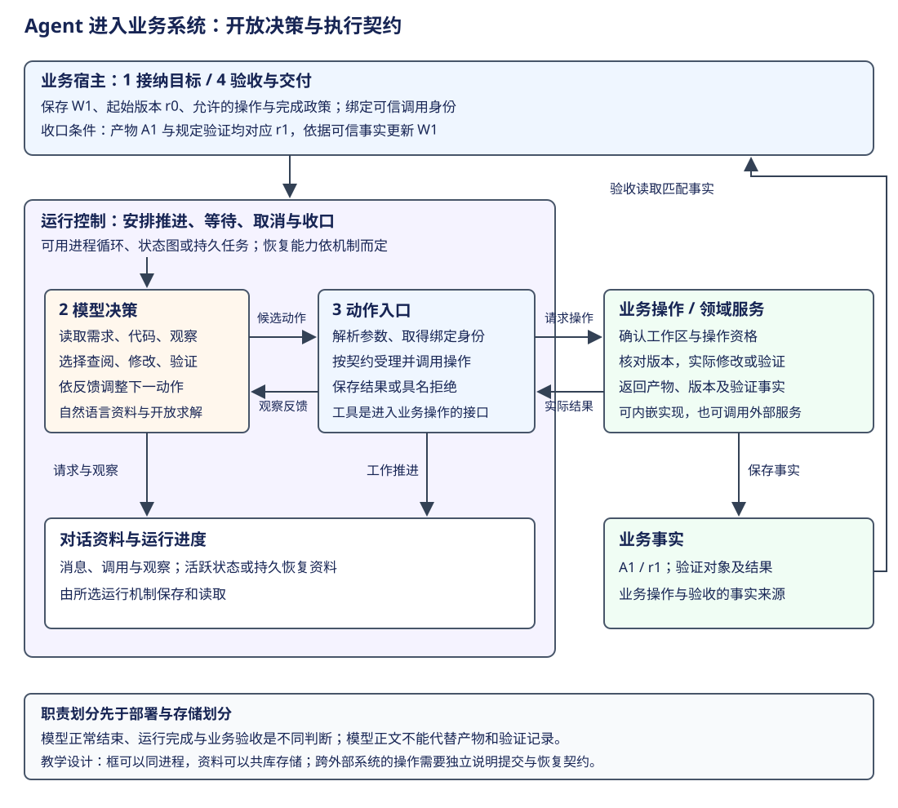

# 从 Agent 循环到业务系统：架构归纳与设计取舍

前面的横向专题分别解释了决策、上下文、状态、工具和交付。现在将它们放回一个完整产品：用户提交需求，Agent 查阅资料并采取行动，业务系统保存结果，再接受后续工作。此时需要回答的问题是：**哪些选择可以交给模型，哪些事实由程序确认，进行中的工作又由谁持续推进？**

本章的判断是：模型的开放决策可以嵌入有明确契约的业务过程。反馈循环负责让模型根据观察调整行动，运行机制负责推进与恢复，业务服务负责自己的规则和事实。它们可以在同一个进程中实现，也可以分别部署；先划分职责和交接，再决定代码与部署形态。



这是一张教学职责图，不要求每个框都有独立类或服务。沿图走完一项工作，需要四次交接：接纳目标并取得身份，组织模型可见资料，将模型动作转成受理后的操作，最后依据真实结果决定业务是否完成。本章先演算这条正常路径，再用代表实现解释控制方式的选择。

## 从修复代码，到提供一项修复服务

沿用全书的任务：“读取需求与 CSV 导出代码，修复字段转义，运行验证并说明结果。”在终端里，用户可以自己检查修改并判断任务是否完成。现在把它作为服务提供：用户提交仓库及需求，服务返回修复产物和验证结果，用户稍后还可以查询同一项工作。

案例约定工作身份为 W1，起始代码版本为 r0。验收要求包括逗号、引号和换行字段的转义；例如两个字段 `hello,world` 与 `say "hi"`，预期输出为 `"hello,world","say ""hi"""`。服务允许在指定工作区生成修复，完成条件是已保存修复产物，并且规定的验证覆盖同一份产物版本。这里的 W1、r0、字段和验收政策均为教学定义，不是任何框架内置的业务协议。

| 主线步骤 | 当前掌握的资料 | 本步产生什么 | 下一消费者 |
|---|---|---|---|
| 接纳 | 需求、仓库、调用者身份 | W1、r0、允许的操作和完成条件 | 运行宿主 |
| 求解 | 需求、源码及已有观察 | 查阅、修改、验证或回答的候选动作 | 动作入口 |
| 执行与反馈 | 动作参数、可信调用身份和当前版本 | 实际修改、验证结果或具名拒绝 | 模型与业务服务 |
| 验收 | 修复产物、同版本验证记录 | W1 的业务结果 | 查询接口与用户 |

因此，一次模型回答和一项业务工作有不同的终点。模型可以说“已修复”，运行循环也可以结束，但服务仍需读取产物和验证事实，才能按案例政策将 W1 标记完成。这个区别来自产品对结果的承诺，不能只靠增加一句“请认真检查”的提示词建立。

## 第一步：给业务工作身份，再组织模型输入

接纳时，宿主保存 W1 的目标、工作区引用与验收政策，然后选择运行方式。W1 可以与一次运行直接对应，也可以经历失败后的再次运行；两者的关系由产品定义，不能直接把一个模型请求 ID 当作业务工作 ID。

模型收到的资料应当足以决定下一步，例如需求文本、当前源码、允许的工具和此前观察。宿主用于授权的调用者身份、工作区绑定和执行凭据则通过可信调用环境传给程序。模型可以在参数中引用文件和产物，动作入口仍要校验它们是否属于当前工作，不能因模型写出了一个身份就接受它。

这时已经出现两类不同的“非结构化”。一类是需求、代码说明和工具输出中的自然语言信息，需要选择、组织并形成请求；另一类是模型的开放决策，它可以先读测试，也可以先读实现，再根据发现改变后续动作。前者对应[上下文组织](context-compaction.md)，后者对应[执行模式](execution-modes.md)。结构化工具参数只是动作表达格式，不能据此推断模型的整个决策路径已经固定。

## 第二步：允许动态求解，在动作交接处建立契约

拿到 W1 后，模型可能先查看导出函数与测试，发现代码直接拼接字段，再提出补丁。程序固定“调用、执行、反馈”的配合方式，模型选择这一轮调用什么、参数是什么。若测试暴露换行遗漏，模型可以继续修改；正常任务不需要预先穷举全部读取与修改顺序。

模型提出的动作随后进入程序契约。以修改为例，动作入口需要解析参数、确认文件属于绑定工作区，并按案例规则核对预期版本。通过检查后，实际修改由工作区操作执行，返回新的产物身份与版本；拒绝则返回具名原因，供模型修订动作。

下面是案例的教学伪代码，表示业务宿主、可信调用环境与工具实现的关系。它不是目标框架 API；省略持久化和错误表示的具体类型。`expected_revision` 来自动作参数，授权环境由宿主提供：

```python
async def apply_patch_tool(args, call_context):
    # 工作身份和权限来自宿主绑定；模型提供的路径仍需受理。
    workspace = await workspaces.authorize(
        work_id=call_context.work_id,
        principal=call_context.principal,
        path=args.path,
    )
    # 业务操作负责校验版本、落地修改并返回产物事实。
    return await workspace.apply_patch(
        expected_revision=args.expected_revision,
        patch=args.patch,
    )
```

执行后若得到 `{artifact: "A1", revision: "r1"}`，这份观察进入下一次模型请求；同一产物记录也供验收读取。模型可以继续请求验证，但没有因为补丁成功就自动满足“验证通过”的完成条件。

将 Agent 嵌入业务循环，落点就在这些可解释的交接处：模型决定尝试什么，动作入口按契约受理，业务操作产生事实，事实再反馈给模型。权限检查可以与业务操作在同一模块内实现，职责清楚比代码框的数量更重要。

## 第三步：分别保存对话、运行和业务事实

动作已经发生，接下来必须明确保存的是什么。以下三类状态都服务 W1，但回答的问题不同：

| 状态职责 | W1 中的例子 | 谁据此决定后续行为 |
|---|---|---|
| 对话资料 | 需求、读取结果、模型调用和工具观察 | 请求构建器与模型 |
| 运行进度 | 等待哪个工具、从哪个节点或阶段继续、是否已取消 | 循环、图驱动器或任务调度器 |
| 业务事实 | 产物 A1 对应 r1、验证了哪个版本、W1 是否验收完成 | 业务操作、验收与查询接口 |

这是职责区分，不要求使用三套数据库。应用可以在 durable 的 Document 或图状态中保存业务数据，也可以把外部服务作为事实源；选择后要明确谁有权修改，谁依据它推进。如果消息中说“r1 测试通过”，而业务验证记录只覆盖 r0，验收应按实际记录判断。

durable 提供了一个有解释力的例子：Entry 表达历史贡献，Task 保存工作推进资料，Document 承载结构化状态；同一事务可共同修改这些记录。它让运行与应用数据有机会在一个提交边界对齐。[Session 提交实现](https://github.com/earendil-works/pi/blob/f1b2e77f5b13b2a199b1052cb79c235451afe7d7/packages/durable/src/session/session.ts#L403)的主要顺序可以概括为：

```typescript
// 按源码整理的流程骨架；省略事务构造、失败处理与类型细节。
const writes = await tx.settleSuccess();
const seq = await storage.commit(writes, context);
const documents = tx.adopt(seq);
publish(seq, writes, documents, context);
```

先提交，再采用，再发布，观察者读到的是已经采用的状态。这个事务覆盖 Session 内的写入；如果 A1 存在外部制品服务，外部上传与 Document 更新仍需单独设计交接。具体工具结果及回放边界见[Pico5 架构](../agents/pi-durable/architecture.md)，应用数据的历史与分支语义见[Document](../agents/pi-durable/documents.md)。

## 第四步：依据验收事实收口，再交付结果

模型随后请求验证 A1，得到 `{artifact: "A1", revision: "r1", suite: "csv-export", passed: true}`。案例约定此验证套件覆盖前述转义要求，并要求记录由可信验证操作生成。模型可以据此给出结果说明，运行机制也可以结束当前工作。

业务宿主最后读取 W1、A1 与验证记录：工作区和产物归属匹配，产物版本为 r1，规定验证同样针对 r1，记录表明通过，才按本例政策保存完成结果。下面继续使用教学伪代码，判断由确定的业务代码执行：

```python
artifact = await artifacts.for_work("W1")
verification = await checks.for_artifact(artifact.id)
if (verification.revision == artifact.revision
        and verification.suite == "csv-export"
        and verification.passed):
    await works.complete("W1", artifact.id, verification.id)
```

模型回答作为说明与结果一起提供给用户；它能解释改动与验证，却不承担覆盖事实记录的权力。如果模型正常结束时缺少匹配记录，宿主按产品规则保留未完成状态，并决定补做验证、重新请求 Agent 或交给人工。本例无需把这些旁路全部展开，主线已经说明“运行结束”如何交接到“业务完成”。

这里的验收也有适用范围。通过规定测试只表示满足这项服务定义的完成条件，不能推导任意输入都正确。业务若要求人工审查，再把审查结果接到验收；无需为了展示架构预先添加没有实际需求的阶段。

## 从代表实现看：控制方式如何选择

前四步确定了职责，现在才能选择推进机制。本节用 AgentSession、Pico5、LangGraph 与 DeerFlow 四种代表说明取舍；它们分别涉及交互产品、持久内核、图执行与产品宿主，不能视作四个完全同层的替代品。其他对象继续见各横向专题，本节不重复能力总表。

### AgentSession：直接控制适合明确的交互生命周期

AgentSession 将会话操作与 Agent 反馈循环接在一起。SDK 构造 Agent，再构造 AgentSession；运行时沿模型和工具结果继续推进。会话历史可以重建上下文，进行中的调用则与进程执行有关。[构造入口](https://github.com/earendil-works/pi/blob/f1b2e77f5b13b2a199b1052cb79c235451afe7d7/packages/coding-agent/src/core/sdk.ts#L411)与[完整循环](../agents/pi/loop.md)说明了这种直接关系。

如果 CSV 服务始终有人交互，失败后允许重新发起修复，这种表示便于实现与排查。应用仍可在外面提供 HTTP、业务记录和验收；增加服务入口并不强制更换内部循环。若后来要求自动延续中断的工具工作，就需要补充明确的恢复记录与政策。

### Pico5：把工作阶段交给持久任务调度

Pico5 的 generation、工具和摘要分别有任务定义；调度器处理通用状态，各定义解释自己的 checkpoint。恢复时，遗留的 running 可以回到 pending 并保留 checkpoint，再由当前 Registry 中的代码继续推进。[恢复启用](https://github.com/earendil-works/pi/blob/f1b2e77f5b13b2a199b1052cb79c235451afe7d7/packages/durable/src/harness/scheduler.ts#L238)与[任务阶段](../agents/pi-durable/loop.md)提供了实际路径。

这适合 W1 跨进程重启继续、后台工作不依附读连接等要求。代价是任务输入与 checkpoint 成为持久契约，代码升级要处理旧记录的版本；通用调度机制也不会自动理解 CSV 的验收条件。它为业务应用提供底座，具体领域规则仍由应用建立。

### LangGraph：显式安排计算与状态交接

LangGraph 用节点、通道和超步表达推进。节点可以调用模型并作开放决策，图再根据状态与条件路由安排下一节点。主线代码保留了“选任务、执行、合并、按配置等待 checkpoint”的顺序：

```python
# 按源码整理的流程骨架；省略缓存输出、流事件与清理。
while loop.tick():
    await run_selected_tasks(loop.tasks)
    loop.after_tick()
    if durability_ == "sync":
        await loop._put_checkpoint_fut
```

这里的 `run_selected_tasks` 是对 `runner.atick` 的教学概括，不是上游函数。[真实超步循环](https://github.com/langchain-ai/langgraph/blob/bfcfea554ed5c7f7be562cebf8825e911b493ab1/libs/langgraph/langgraph/pregel/main.py#L3504)与[图执行分册](../frameworks/langgraph/architecture.md)说明了更新如何进入下一超步。

若 CSV 产品希望明确安排独立验证、人工审查或并行分析，可以将它们组织为节点；某个节点内部仍可运行模型工具循环。代价是状态 schema、合并规则、节点重跑和后端配置成为应用契约。显式图表示与开放模型决策可以组合，不能仅看“有图”就判定为固定流程。

### DeerFlow：产品宿主与图运行各自收口

DeerFlow 提供另一种观察角度：Gateway 的 RunManager 管准入、执行归属与 run 终态，产品工厂装配模型、工具和 middleware，worker 才调用图。图 checkpoint 与产品事件分别服务恢复及读取。[产品构图](https://github.com/bytedance/deer-flow/blob/b842e06be19f04280a9e5e12f90da04d0c6f09a5/backend/packages/harness/deerflow/agents/lead_agent/agent.py#L1391)与[worker 图调用](https://github.com/bytedance/deer-flow/blob/b842e06be19f04280a9e5e12f90da04d0c6f09a5/backend/packages/harness/deerflow/runtime/runs/worker.py#L1425)展示了交接：

```python
# 按源码整理，两个步骤分别发生在产品工厂与 worker 中。
graph = create_agent(model=chat_model, tools=final_tools,
                     middleware=bound_middlewares,
                     system_prompt=system_prompt,
                     state_schema=state_schema, context_schema=dict)
stream = agent.astream(input_payload, config=stream_config,
                      stream_mode=lg_modes, subgraphs=subgraphs)
```

这说明产品运行身份与模型反馈循环可以分开管理。一次 run 中有多次模型调用，图结束后还要完成平台收口。应用若增加本章的产物验收，仍要明确该政策接在哪里；DeerFlow 的 run success 本身不自动等于 W1 满足新增业务政策。[Run 归属与收口](../agents/deerflow/runtime.md)进一步解释了平台这一层负责什么。

| 代表 | 权威状态与所有者 | 构造与生命周期 | 实际推进方式 | 适合补足的职责 | 需要承担的成本 |
|---|---|---|---|---|---|
| AgentSession | 会话管理器持历史，Agent 持活动执行 | SDK 绑定 Agent 与会话 | 进程内模型、工具反馈 | 直接交互与会话操作 | 持久历史与活工作恢复分别设计 |
| Pico5 | Session 保存 Task/Entry/Document；Registry 提供代码 | Harness 打开存储，调度器认领工作 | 按 checkpoint 推进任务 | 长任务、后台工作及阶段恢复 | 持久契约、定义版本和存储要求 |
| LangGraph | channels、checkpoint 与 pending writes | compile 定义，每次调用创建 Loop | 超步执行与状态合并 | 显式计算依赖、路由及图恢复 | reducer、节点重跑与后端契约 |
| DeerFlow Gateway | RunManager/RunStore 管执行身份；图保存自身状态 | 产品工厂构图，worker 调用与收口 | 宿主管 run，图内模型工具反馈 | 接入、运行归属及产品读取 | 宿主、图和效果之间的责任交接 |

表中没有跨层次总分。持久任务机制可以承载开放循环，图节点也可以调用一个完整反馈循环；实际组合需要实现输入输出与生命周期的适配，不能仅凭两边都有 Task 或 Session 就认定现成兼容。

## durable 带来的启示与适用边界

Pi 的架构演进让上述问题集中显现。AgentSession 从交互会话出发；Lane 已经用 Operation 保存阶段，并提供恢复与提交机制；Pico5 进一步把通用调度与任务专属行为分开。详细依据与三者取舍见[Pi 架构演化](../history/pi-lane/evolution.md)。从专用 Operation 转向通用任务降低扩展耦合，是本书根据模型划分作的工程判断，不是对作者全部决策动机的还原。

官方对 durable 的定位是走出终端、支持更长工作和不同交互入口，同时保留 coding agent 自身的定位。[发布说明](https://earendil.com/posts/pi-1-0/)与[设计说明](https://earendil.com/posts/pi-durable/)支持这些目标。它们让本章可以提出一个更一般的设计认识：Agent 应用可以沿软件服务熟悉的职责建立运行保障，同时把开放求解交给模型。

这种认识有三项具体后果。首先，模型换一种执行模式，不应迫使业务服务改写自己的事实定义。其次，运行时支持恢复，不代表外部操作自动恰好一次；例如外部修改已成功、工具结果尚未保存就中断，仍需幂等、结果查询或具名不确定处理。最后，运行数据与业务数据如果分属两个存储，就要明确跨存储交接，不能把框架内的事务扩大成全系统事务。[工具的安全重放判断](https://github.com/earendil-works/pi/blob/f1b2e77f5b13b2a199b1052cb79c235451afe7d7/packages/durable/src/harness/tool.ts#L104)给出了实际边界。

因此，把 Agent 产品理解成 SaaS/PaaS 的一种应用形态是有用的设计视角，但 durable 本身仍是运行底座。业务规则、用户隔离和对外服务承诺由产品建立。一个只有前台交互需求的程序，可以继续使用直接循环；长期运行需求出现以后，再选择能承担这些职责的控制与持久机制。

## 将这些认识带入各对象分册

接下来阅读真实实现时，先找开放决策与确定执行的交接：模型依据什么资料提出动作，程序在哪里受理，谁保存工作进度，哪些事实决定完成。随后再看该对象选择函数循环、状态图还是持久任务，以及这些选择带来了什么成本。

架构趋同仍是一项研究假设。共同职责能够解释多套实现，并不表示它们已经具有相同保证，更不表示所有产品都会选择同样的分层。读者要获得的是在真实约束下划分职责、选择机制并解释代价的能力；各对象的独有设计则用来检验和修正这套认识。

## 设计练习与参考解答

**练习一：** 模型回答“r1 已通过验证”，运行状态为 completed，但验证记录的 revision 为 r0。W1 能否完成？

参考解答：按案例政策不能。需要针对 A1/r1 的验证事实；模型正文和运行终态都不能补出缺失记录。宿主按政策补做验证或保留未完成状态。

**练习二：** 产品只要求保存历史，失败后由用户重新发起。是否必须引入持久 Task？

参考解答：不必。直接循环可以结合历史存储与业务记录满足这组要求。若以后要求无人值守恢复进行中的工作，再核对恢复单元、存储和副作用政策。

**练习三：** 在 LangGraph 节点中运行开放工具循环，外层图安排验证节点。整个产品是固定流程还是动态 Agent？

参考解答：分别解释两层。节点内部由模型根据反馈选动作；外层图定义何时进入验证及后续走向。是否动态路由还要看边的条件，不能给整个产品只贴一个互斥标签。

**练习四：** 将 W1 的业务事实放进 durable Document，是否就自动获得外部操作恰好一次？

参考解答：没有。Document 可以与 Session 内其他记录同批提交；外部操作是否可重复、结果能否查询，以及与记录如何交接，仍需由工具和业务契约说明。
