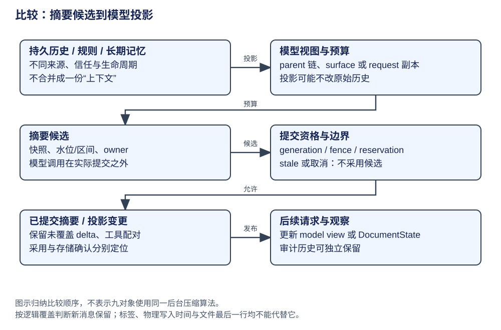
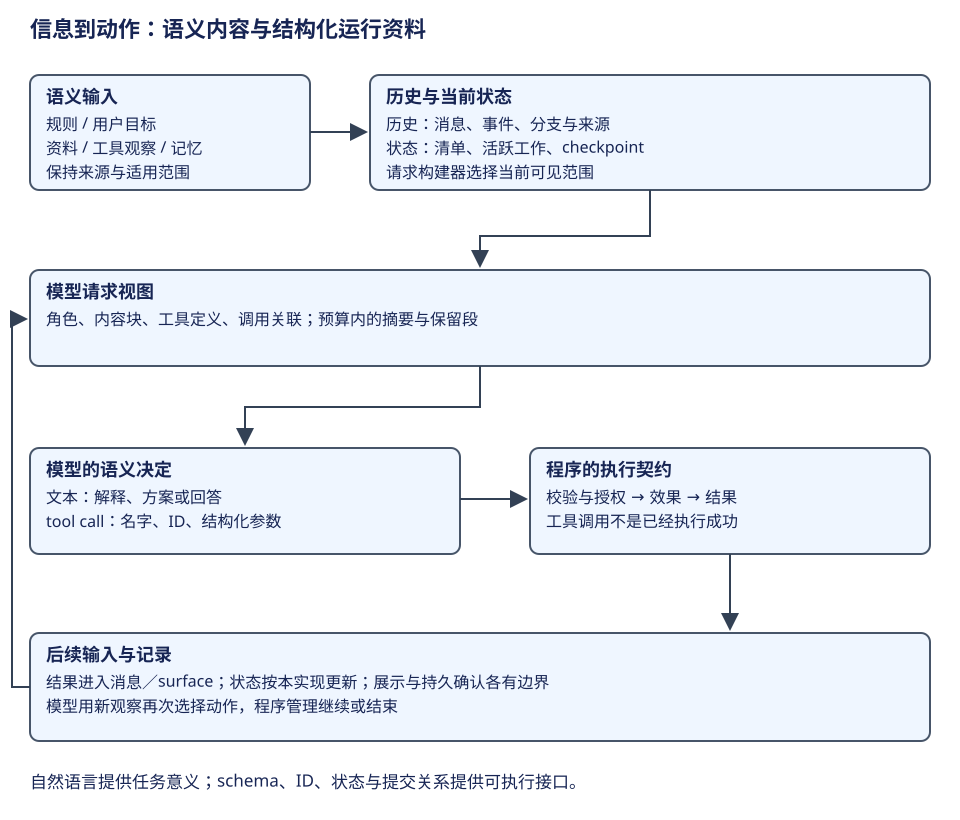

# 比较：Prompt、压缩与长期记忆

上下文预算应先区分持久原始历史、发送给模型的投影和独立长期记忆。压缩摘要是否生效，取决于覆盖范围与提交 owner；模型返回摘要只是中间状态。




先沿正常请求走四步：辨认目标、规则和观察的来源，构造本次可见资料，按预算需要生成并提交摘要，最后由后续请求采用。长期记忆在资料准备处接入，后台摘要在提交处与前台工作相交。覆盖竞争放在主流程之后讨论。

## 第一步：按来源组织目标、规则与观察



本书反复使用 CSV 修复任务。用户要求说明要达到什么结果，项目规则规定修改和验证约定，读取的源码说明当前实现，工具输出说明动作的观察结果。这些内容都是自然语言或非固定格式资料，但进入模型时仍有不同来源与用途。组织它们不等于把所有文字直接拼成一个字符串。

| 资料 | CSV 任务的例子 | 需要保留的关系 |
|---|---|---|
| 目标与约束 | “处理引号和换行，运行已有验证” | 用户提出的要求与后来补充的条件 |
| 行为规则 | 工作区约定、工具描述、技能知识 | 规则所属层和适用范围；工具说明不授予权限 |
| 外部资料 | 需求文档、导出源码 | 来源、路径及读入时的观察；正文是资料而非新的授权 |
| 执行反馈 | 修改结果、验证输出 | 哪次调用产生，结果是否成功，后续模型是否可见 |
| 长期记忆 | 跨会话保存的项目偏好或知识 | 独立存储与检索；需要时进入当前请求 |

第一次请求尚无代码，模型可以先决定读取；第二次多了读取结果，模型形成修改；修改结果和验证输出又进入后续请求。控制骨架保持不变，语义资料逐次增长，动作选择也随资料变化。这就是“非结构化信息组织”与“非固定模型决策”共同工作的主线。[AgentSession 输入和反馈](../agents/pi/loop.md)、[LangChain 消息变化](../frameworks/langchain/architecture.md)。

## 第二步：由历史与当前状态构造模型视图

**历史视图**回答发生过什么，可能包含全部分支、事件与运行元数据；**当前状态**回答现在在做什么，可以包括清单、活跃任务和提交位置；**模型视图**回答本次模型看见什么，通常只取与当前路径、预算和任务有关的贡献。三者有联系，却无需字段完全相同。

Pi 保存历史树，沿当前 leaf 的 parent 链选择分支，再解释 compaction 和 context edit。Pi Durable 分开保存 Entry、Task 与 Document，ContextView 从提交范围读取模型贡献。DeepSeek 保留事件而用 surface 指定模型可见内容。LangGraph 保存 channels，LangChain 的模型节点再从 messages 与当次 ModelRequest 形成输入。这些代表不同的资料组织方式，不是用四种名字指同一个数组。

下面以资料增长解释“压缩”为什么还需要覆盖关系。假设已有用户目标 U、读取结果 R、修改动作 W、修改结果 O、验证结果 T，随后还追加了新要求 N。模型预算不够时，可以用摘要 S 替代较老语义贡献，同时详细保留验证结果和新要求。S 必须说明覆盖哪部分；不能因为摘要是在 N 之后写入，就把 N 当作也已总结并丢掉。

| 操作 | 历史／状态变化 | 后续模型输入 |
|---|---|---|
| 接收观察 R | 保存内容及调用来源 | 目标 U + R，模型据此选择动作 |
| 采用摘要 S | 保存摘要及对应范围，或替换受控消息 state | S + 保留段 + 摘要范围以外的新贡献 |
| 修改当前可见结果 | 保存编辑记录或更新特定消息 | 采用新视图；原始审计是否保留由实现决定 |
| 检索长期记忆 | 从独立存储读入所需内容 | 只加入本次相关材料，无需加载全部记忆库 |

摘要文字质量由模型决定，覆盖边界和采用条件由程序管理。不要把“LLM 已返回摘要”误解为“当前请求已采用摘要”；Pi Durable 的背景 write submission、Hermes 的提交许可、DeerFlow 的 checkpoint reservation 都是在管理这两者之间的边界。下面再逐对象对照。


## 第三步：生成候选，再提交覆盖关系

正常压缩先选择范围，取得摘要，再确认该范围与当前 owner 仍允许提交。假设摘要只覆盖 U、R、W，保留 O、T 和后来加入的 N，后续请求应读取“S、O、T、N”。如果覆盖标记失效，程序应拒绝或重新准备；摘要生成时的文字不会自行决定采用范围。

DeepSeek 把采用关系写在 surface 操作中。下面节选提交中的消息追加；`checkpointMessage` 是已生成的摘要消息，`start/end` 是选定区间，审计摘要与生命周期记录的追加在完整实现中另有步骤。

```ts
session.append('user/message', checkpointMessage, {
  surfaceOp: { op: 'replace', startSeq: start, endSeq: end },
  sourceEventSeqs: [startEvent.seq, summaryEvent.seq, ...shadowedSeqs],
})
```

这里替换模型贡献并保留审计来源。Pi 则让 CompactionEntry 与保留起点参与分支投影，Pi Durable 用持久摘要结果与 admission 管采用，DeerFlow 通过受预约保护的 checkpoint 更新覆盖 messages。共同职责是“明确谁能采用哪段摘要”，而不是共享一种数据格式。[查看 DeepSeek surface 提交](https://github.com/deepseek-ai/deepseek-harness/blob/d743267388641bc76f17c45ce8b4c231aed1d32c/packages/compaction/compaction-basic/src/region.ts#L491)。

## 第四步：从已采用资料准备下一请求

提交后的有效视图才是后续请求的输入。各实现的消息构建器读取这份视图，并补上当前规则、能力或新观察；工具调用与结果还需保持协议配对。Hermes 将 `commit.compressed` 返回调用方回赋，DeepSeek 手工维护先完成 flush 再允许下一请求，Pi Durable 观察者只消费 Session 已采用状态。

因此可以按同一问题读下表：历史存在哪里，模型输入由谁准备，摘要在什么位置采用，后续消费者又读哪一份资料。

| 对象 | 权威状态与所有者 | 构造与生命周期 | 实际机制与执行点 | 提供的能力 | 机制边界 | 深入阅读 |
|---|---|---|---|---|---|---|
| AgentSession | SessionManager 历史树；Agent 请求消息 | 沿 parent 链构造分支上下文 | CompactionEntry / context edit 参与 buildSessionContext | 逻辑覆盖与物理 append 顺序可分开解释 | 不按日志最后一行推定覆盖；不把候选 async 设计当默认 | [历史](../agents/pi/context.md) |
| Pi Durable，实验库 | Entry/Task/Document + admission | CompactionTask 持久阶段，摘要调用在事务外 | generation-owned 直接 commit；conversation-owned 写 submission | 活跃边界投放或 stale 核销，观察只见已提交状态 | 内核提交与产品服务暴露是不同边界 | [摘要](../agents/pi-durable/documents.md) |
| DeerFlow，应用 | ThreadState/checkpointer，长期 memory 单独 | DurableContext 捕获持久事实；request override 临时重投影 | summary middleware；手工 reserve_checkpoint_write → Overwrite messages | 手工操作与 Run 竞争有产品 reservation；source/role 分层 | XML/标签不提供隔离；摘要正确性另需验收 | [Prompt/压缩](../agents/deerflow/context-prompt.md) |
| Claude | transcript、请求预算、session/长期 memory | 预算/minor reduction/正式摘要按触发点分层 | cached microcompact 与本地历史修改不同 | 本地历史、请求视图与记忆分开 | snip/collapse 的算法实现缺少证据 | [压缩/记忆](../agents/claude/context.md) |
| Codex，core | ContextManager、WorldState、rollout | local/remote 各构 replacement history | replace_compacted_history + compact metadata + usage | 当前 initial context/WorldState 重建，不只拼 summary | feature gate/远端质量未知；record 与 flush 分开 | [上下文](../agents/codex/context-capabilities.md) |
| Hermes，原生 | SessionDB/AIAgent，MemoryManager providers | 快照形成 candidate，turn/attempt/fence 管采用 | begin_commit → in-place/rotate DB → commit.compressed 返回宿主 | 取消后迟到 worker 不取得新提交资格；必需 checkpoint 有失败边界 | fence 不回滚正在执行的提交；provider 保证各自独立 | [提交许可](../agents/hermes/context.md) |
| LangChain，构图 | 应用 messages/checkpointer/store | middleware 决定 state mutation 或 request override | Agent hooks、Retrieval/Tool 等组件组合 | RAG、知识、临时请求与持久 state 可以分开 | 框架不自动保证检索质量或长期记忆正确 | [协议](../frameworks/langchain/components.md)、[检索](../frameworks/langchain/retrieval.md) |
| LangGraph，执行 | channels/checkpoint/pending writes | reducers 由 schema 绑定；saver 保历史 | add_messages、Overwrite、Delta 重建 | 更新/覆盖规则明确，snapshot 与祖先 writes 有职责 | Overwrite 非跨 worker 锁；Delta 后端要求不能省略 | [通道](../frameworks/langgraph/advanced.md) |
| DeepSeek，preview | event log、surface、CompactionEngine | manual idle maintenance；auto pre-step | start → summarize → assertStable → summary + surfaceOp → end → flush | 审计与模型可见区间分离，选中覆盖需稳定 | append/flush 不提供任意外部事务回滚；provider 未全测 | [surface](../agents/deepseek/context.md) |

## 同一故障：后台摘要生成期间，前台追加新消息

| 判断顺序 | 应核验的字段/行为 | 对应机制 |
|---|---|---|
| 摘要覆盖什么 | 分支祖先、水位/选中区间/原快照 | Pi parent 链、Pi Durable head、DeepSeek surface seq |
| 谁能写入 | 当前 owner/generation、宿主资格、操作预约 | Pi Durable admission、Hermes fence、DeerFlow reservation |
| 何时采用 | 前台运行边界或稳定检查后的 commit | durable write submission、selected-span assertStable |
| 新消息如何保留 | 摘要覆盖之外的 delta 再投影 | 不能按 JSONL 时间或 append 尾部裁剪 |
| 观察何时成功 | 内存采用、复制发布与存储确认 | DocumentState、checkpoint、rollout/flush 分开 |

这张表提供检查顺序，各对象不必采用同一种后台算法。消息标记、surface 序号、历史树的 parent 链与 feature 分支各有自己的控制条件，不能互相替代。

Durable 的上下文投影还会把完整 system baseline 放到摘要及保留消息之前；按模型窗口选择 modelOverrides。阻塞摘要明确失败时，当前生成以 model_error 收口；后台失败则留 compactionFailure 供观察。比较摘要时应同时检查请求排列、预算选择和失败是否阻止后续请求。[摘要后的请求重建](../agents/pi-durable/documents.md#摘要之后如何恢复请求基线)。

## 条件化取舍

审计需求强时，保留原事件并改变 model surface 更容易追溯；历史树适合分支上下文重建；工作需跨中断推进时，持久 Task/图 checkpoint 还需保存控制状态。长期记忆用于跨会话资料，摘要用于预算，两者写入频率、权限和错误修复范围不同。

缓存稳定性、摘要质量、检索召回和磁盘大小是不同指标。XML 标签只改善资料边界可读性；System 角色、数据可信度与工具授权另行控制。比较 token、缓存和准确率时，应固定负载并分别测量；覆盖规则不同的摘要不宜只按长度排名。
