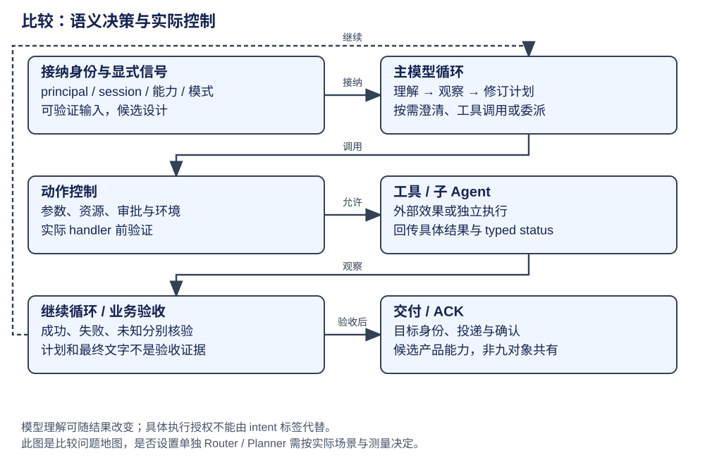

# 比较：理解、规划、委派与控制

开放任务的理解会随工具结果改变；身份、会话和具体效果授权则需要在确定的位置执行。因此接纳输入、模型决策、计划更新、子 Agent 委派和工具授权应分别追踪，不能用一个 Planner 概念覆盖它们。




本章沿一次委派走四步：父工作识别可交出的子目标，准备子上下文和能力，子执行器推进自己的工作，再把结果交回父工作。执行授权贯穿具体效果，父目标的验收留在父层。先用同一项覆盖调查理解交接资料，再对照各实现的身份与恢复条件。

执行策略的概念和支持入口先读[执行模式比较](execution-modes.md)，再进入本章的接纳、委派与控制。九个对象的定位见 [对象矩阵](matrix.md)。下表比较谁决定动作、谁拥有活动工作，以及结果回到哪里；具体行为仍受所选配置约束。

## 第一步：界定子目标与父层需要的结果

“增加子 Agent”没有改变模型—动作—观察的基本闭环；它把某项工作交给另一份执行器，并让父工作等待或接收结果。最先要解释的不是有几个 Agent，而是父子之间交接什么。

在 CSV 任务中，父执行者可以把“检查现有验证覆盖”交给子执行者。以下字段是教学契约：

```json
{
  "parent_work": "csv-fix",
  "child_goal": "检查现有验证是否覆盖逗号、引号、换行",
  "context": ["需要保持导出接口", "实现位置已定位为 src/export.ts"],
  "resources": ["tests/export.test.ts"],
  "result_expected": "覆盖事实、缺少的样例及对应来源位置"
}
```

子目标应有可以解释的完成范围，context 提供已知事实，resources 定义当前资料范围，result_expected 说明父执行者要消费什么。子执行者可以有自己的模型与工具循环，但父工作仍负责决定这个结果怎样影响整体修复。

一个有用的子结果可以包含：

```json
{
  "child_status": "completed",
  "facts": ["现有验证覆盖普通字段和逗号，未发现换行样例"],
  "sources": ["tests/export.test.ts"],
  "suggested_next": "增加换行与内部双引号的样例"
}
```

这只是本章的结果形态，不强制所有框架用 child_status。typed status、事实、来源和仍需处理的问题比一段“任务已完成”的文字更容易被父工作正确解释。子 Agent 返回建议，不等于已经获得修改或发布权限；父执行者还需要按目标与效果边界决定下一步。

## 第二步：准备独立上下文与实际效果环境

给子 Agent 新 messages 可以减少无关历史，并明确子目标。它不自动表示文件系统、工具客户端或数据库也隔离。反过来，一个子进程也可能通过共享服务访问同一工作区。

因此每种委派至少核对三项关系：消息范围、效果环境、执行归属。DeerFlow 的 task 工具为子执行器另建图，不带相同的父 checkpointer；Hermes delegate 构造子 AIAgent；Codex 子线程有自己的身份与准入；DeepSeek 又区分 child 持久身份与在线 activation。它们都有父子合作，却不是同一种共享或恢复契约。

## 第三步：选择执行载体，并接回结果

如果任务只是确定顺序的几个处理步骤，可以用程序或图节点组合，不必把每个节点包装成 Agent。若子任务需要独立的模型循环、明确上下文范围或不同能力配置，子执行者才有直接作用。

当任务依赖前一步观察，简单并行也不能代替依赖交接。例如读取需求与读取代码可以分别进行；按规则修改必须取得相应事实；验证又要观察实际修改结果。委派拓扑、依赖结构和物理调度应分别说明。

**演算。** 子 Agent 完成了验证覆盖分析，父工作是否应该直接结束？

参考解答：不应仅凭这个状态结束。子目标是覆盖分析，父目标还包括修复与验证。父工作要消费返回事实，再决定修改、增加样例或收口；两种工作粒度和完成条件不同。


## 第四步：父工作消费观察，继续自己的目标

子目标完成后，父层用返回的覆盖事实决定加样例、继续修改或结束。子结果需要保留状态、事实和来源；父工作不会因为一个子执行器终止就自动满足所有验收条件。

DeerFlow 的具体交接展示了执行载体的范围：executor 为子工作新建 Agent 图，再将结果交回 task_tool。下面节选 `_create_agent`，省略模型准备与工具集合构造。

```python
agent = create_agent(
    model=model,
    tools=bound_tools,
    middleware=middlewares,
    system_prompt=None,
    state_schema=ThreadState,
    checkpointer=False,
)
```

SystemMessage 已由子任务 initial state 提供；这份图有独立上下文，默认不带 Lead 的 checkpointer。执行后 task_tool 包装 ToolMessage／Command，父图再把它作为观察消费。因此独立模型循环、共享文件环境、持久恢复是三个可分别配置的关系。[查看子图构造和输入](https://github.com/bytedance/deer-flow/blob/b842e06be19f04280a9e5e12f90da04d0c6f09a5/backend/packages/harness/deerflow/subagents/executor.py#L1153)。

下表按相同交接问题对照其他实现。

| 对象 | 权威状态与所有者 | 构造与生命周期 | 实际机制与执行点 | 提供的能力 | 机制边界 | 深入阅读 |
|---|---|---|---|---|---|---|
| AgentSession | Session 的模式/扩展，Agent 当前循环 | SDK 装配 active tools；扩展绑定会话 | 输入 hook → 模型循环 → 工具；扩展按需加 plan/委派 | 自然语言和工具反馈在同一循环消费 | core 不因 plan 示例存在就变成强制 Planner；未穷举子扩展 | [循环](../agents/pi/loop.md)、[扩展](../agents/pi/extensions.md) |
| Pi Durable，实验库 | Submission/Task 的持久归属 | Harness Registry 提供当前代码，scheduler 恢复任务 | generation → tool child Task → outcome → generation | 工作身份与推进恢复点显式 | 历史 parent 与工作 owner 分开；产品验收仍由应用定义 | [Task](../agents/pi-durable/architecture.md) |
| DeerFlow，应用 | Lead 图、RunManager 与子执行器 | Lead 按入口持有；子 Agent 另建图 | task_tool → executor → create_agent(checkpointer=False) | child 输出通过工具/Command 回父，不混同 Lead checkpoint | 子图不提供同等持久恢复；prompt 规约不等同执行授权 | [子 Agent](../agents/deerflow/capabilities.md)、[Run](../agents/deerflow/runtime.md) |
| Claude | 主 query、异步子 Agent/团队各自状态 | 隔离上下文，执行环境可以共享 | Task、团队通知与工具 executor 分层 | 命令、子 Agent 与团队协作粒度不同 | in-process 分配经消息进入 query；跨崩溃确认未证 | [架构](../agents/claude/architecture.md)、[能力](../agents/claude/capabilities.md) |
| Codex，core | Thread/AgentControl/registry | 父身份、容量、驻留先准入，再启动子线程 | spawn_agent_internal → reserve slot → inherit environment → publish | 子线程有独立身份与准入，fork/resume 与 Git 分开 | V1/V2/source 分支不同；不代替任务验收 | [子线程](../agents/codex/context-capabilities.md) |
| Hermes，原生 | 宿主 prompt 排队、AIAgent 与 delegate child | ACP 同会话认领 turn；delegate 新 AIAgent | slash/queue → run_conversation；child 返回 typed status | transport 与对话工作分层，child 结果具名 | 后台任务的恢复与交付由各宿主/provider 分别承担 | [ACP/委派](../agents/hermes/capabilities.md) |
| LangChain，构图 | create_agent 配置与 AgentState | hooks 在建图期组合，模型调用期消费 | 模型/工具循环 + middleware 控制 | 提供可组合决策循环，不要求统一 Planner | 产品路由、身份和多 Agent 由应用实现 | [构图](../frameworks/langchain/architecture.md) |
| LangGraph，执行 | 图边、channels 与 task | compile 注册节点；每超步调度 | static edge + conditional + Command；子图 namespace | 显式状态/路由，动态 goto 可和静态边并存 | 子图不天然是独立 Agent；END 不取消所有兄弟工作 | [图控制](../frameworks/langgraph/advanced.md) |
| DeepSeek，preview | SubagentManager、parent catalog、activation | Profile 选 provider；先保留父归属与容量 | 本地 continuable child 或 external run；delivery parent/caller | 区分持久 child 与一次在线 activation，避免重复父通知 | unknown 可发现不代表可继续；外部一次执行不自动多轮 | [子执行](../agents/deepseek/capabilities.md) |

Durable 的前台子 Agent 示例只设工作 owner，不设历史 parent：它有独立上下文，取消与收口仍归发起工具 Task 管。后台示例另建 background anchor，让普通父层取消与空闲等待不穿过该边界。多历史根可以服务同一业务任务；判断协作时，应同时追历史、工作所有权和效果环境。[会话关系](../agents/pi-durable/glossary.md#会话历史与工作归属是两种关系)。

## 同一输入：任务先查资料，随后发现需要修改

| 时点 | 应承担的判断 | 错误合并的后果 |
|---|---|---|
| 请求到达 | 确认 principal、session、资源引用与显式模式 | 一次自然语言分类可能丢失复合目标 |
| 首次模型调用 | 理解目标、缺口与当前可行路径 | 强制额外分类模型不自动提高准确性 |
| 读完资料 | 修订计划，决定继续、澄清或委派 | 冻结 intent 标签会阻止纠错 |
| 具体写操作 | 检查当前参数、资源、授权和环境 | “最初只读”或“低风险”标签无法阻断新效果 |
| 收到 child 结果 | 区分已完成、中断、失败与可继续身份 | 最终文字不证明文件或外部写入已确认 |
| 请求结束 | 业务验收，再确认投递 | 图/turn 完成不代替接收方 ACK |

## 显式路由与独立规划的取舍

以下是**候选设计**，不是九对象共有实现或本仓库待实现功能。确定性接纳层可以保存 request_id、principal、session、channel、原输入、resource references、显式模式、能力快照引用和 deadline；只有出现真实交付动作时才增加 publish target 与幂等键。不要求所有输入都有固定 intent_class。

开放目标与已观察事实属于可修改的任务状态。显式路由适合处理显式命令、已解析资源类型或明确能力选择；它不能从正文内容猜权限。独立 Planner 适合必须审核计划、重复执行明确流程或有可观测收益的场景；普通交互可由主循环按需规划，减少两份语义判断的同步成本。

评估是否增加 Router，可以在同一模型、环境和任务集下比较主循环、显式路由与额外语义模型。分别记录任务成功、误路由、澄清、授权违规、延迟和成本，才能判断增加一层判断是否值得。
