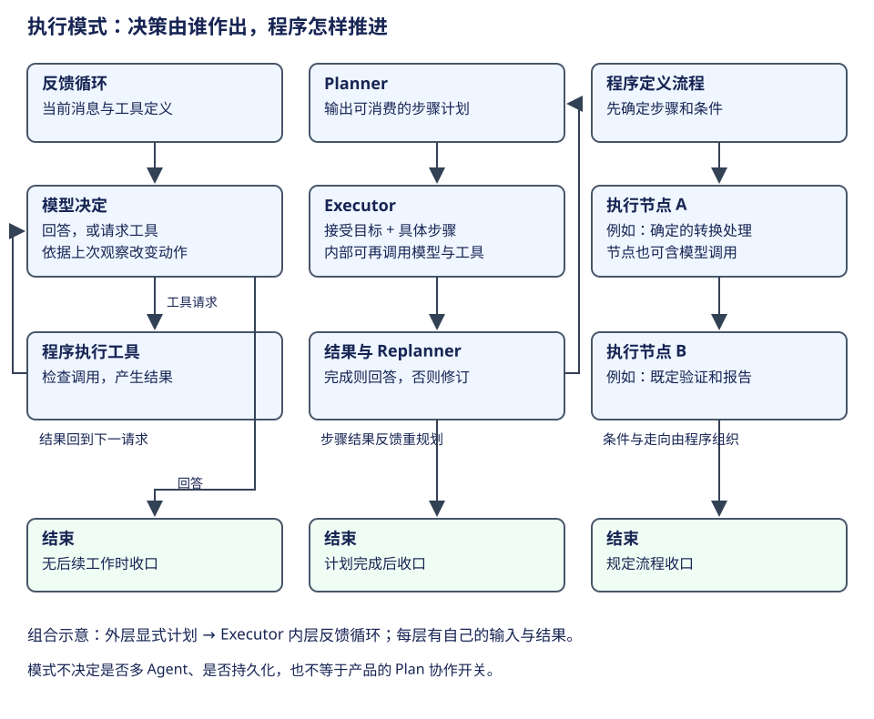
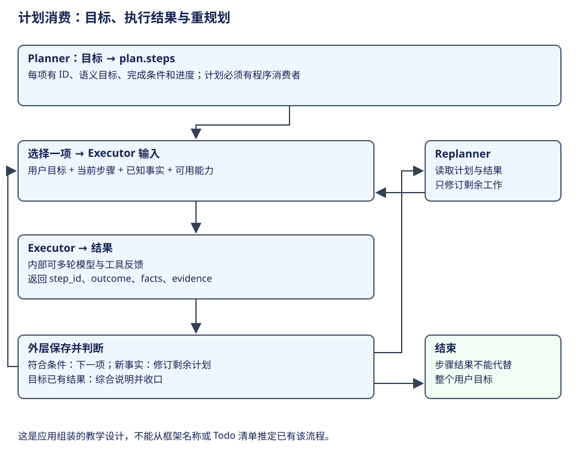

# 比较：执行模式与模型决策

研究 Agent 的执行模式，先看**谁决定下一步、计划用什么形式保存、程序怎样推进**。同样写着“Plan”的功能，可能只是提示要求，也可能保存清单，还可能拥有独立的规划与执行流程。对象名称不能代替调用链。




比较按四层递进：先复盘同一任务的不同走法，再确定“计划”被谁消费，随后完整演算 Planner、Executor 与结果回传，最后对照各对象的实际支持。这个顺序让产品模式、协作拓扑和持久机制都能找到位置，而不依赖功能名称作判断。

## 从同一项任务开始

本章任务是：“读取需求和 CSV 导出代码，修复逗号、引号和换行的转义，运行已有验证，并说明结果。”任务目标相同，推进方法可以不同。以下轨迹用于说明模式，不是某次实测日志。

**反馈循环**先读取代码，观察工具结果，再决定修改什么；修改后再决定验证方式；验证失败时重新选择动作。程序提供循环和工具协议，模型根据当前材料选择下一步。流程顺序在任务开始时并未完全固定。

**Plan & Execute**先形成显式步骤，例如“定位要求、实现转义、运行验证、说明结果”；Executor 接受一个具体步骤去完成，返回结果；Planner/Replanner 结合已完成步骤与新事实决定剩余计划或结束。这里计划是被后续代码消费的接口，而不只是供人阅读的一段文字。这个概念参照 [LangChain 官方规划架构说明](https://www.langchain.com/blog/planning-agents)；具体产品是否这样实现，仍需要源码证据。

**固定编排**由程序确定步骤，例如解析输入、调用确定的转换程序、执行既定测试、生成报告。模型可以参与某个节点，但节点间顺序由图或程序规定。它适合步骤明确的工作；遇到预想之外的需求，扩展能力取决于既有分支或内嵌的动态执行器。

## ReAct 与工具反馈循环的关系

ReAct 指推理与行动交错，并用环境观察影响后续判断的方式。论文采用相应推理／行动轨迹；现代工具调用协议可以把动作表达为结构化 tool call，程序执行后再返回结果。两者在反馈机制上可以对照，但不应仅凭“存在工具调用”就认定某产品完整复现论文方法。[ReAct 论文](https://arxiv.org/abs/2210.03629)。

本书把已核验的常见骨架称为**模型—工具反馈循环**。模型可以在其中先形成计划，也可以批量请求工具；请求次数不必等于工具个数。是否暴露推理文字、使用什么 Prompt、能否在一轮执行多个调用，是具体实现选择。

| 模式中的决定 | 模型承担 | 程序承担 |
|---|---|---|
| 理解目标与新事实 | 解释用户要求、资料和工具结果 | 提供角色、来源、当前消息范围 |
| 选择下一动作 | 请求工具、提出方案、回答或澄清 | 限定可调用定义与执行边界 |
| 形成计划 | 产生步骤与可能的修订 | 如需显式编排，解析、保存并消费计划 |
| 实际效果 | 提交工具调用请求 | 校验、授权、派发、收集结果 |
| 继续与停止 | 给出回答或结束建议 | 根据工具、队列、钩子、图边及取消决定推进 |

这里也包含“非结构化”的两个方面：语义内容不需要先归入有限的 intent 标签；动作选择也可以随观察变化。程序仍需结构化字段承载角色、call ID、参数、计划状态和结果。灵活的语义与明确的执行契约可以同时存在。

## 先确定计划的消费者

假设模型写出“先读代码，再改，再测”，这段文字能帮助思考和沟通，但程序可能完全没有解析它。若调用 Todo 工具，程序保存了 pending/in_progress/completed 清单，读者能看到进度；下一步仍可能由同一个模型循环自由选择。只有当代码读取步骤并明确派发、等待和更新计划，才能讨论计划作为编排输入。

Plan Mode 还可能用于改变协作约定：当前先探索和商定方案，随后再实施。它可以影响 Prompt、工具集合和特定 handler，而无需新增 Planner 进程。**判断独立 Plan & Execute，要找到计划产物、Executor 输入以及结果回到重规划的链路。**

| 看到的证据 | 可以说明 | 还不能说明 |
|---|---|---|
| Prompt 要求先计划 | 有规划行为约定 | 存在独立规划节点 |
| Todo 工具保存清单 | 有结构化进度资料 | 程序强制按清单派发 |
| Plan 协作模式 | 有产品模式及相应行为入口 | 已切成 Planner/Executor 两个执行器 |
| 明确 plan schema、步骤派发、结果与重规划边 | 有显式规划执行编排 | 一定比反馈循环更快或更准确 |

## 让 Plan & Execute 真正成为可消费的流程



上面的三个名词只说明角色。要把它们变成运行机制，还需要回答：计划的哪一项被执行，执行器拿到什么，结果怎样改变剩余工作。下面的字段由本书为 CSV 任务定义，是**应用组装的教学设计**，不把它当作九对象共同的内置 schema。

### 计划必须表达目标、步骤和完成条件

假设 Planner 产出：

```json
{
  "goal": "修复 CSV 字段转义并完成验证",
  "steps": [
    {"id": "inspect", "objective": "读取项目规则与实现",
     "done_when": "获得具体规则及需要修改的位置", "status": "pending"},
    {"id": "change", "objective": "按项目规则修复导出",
     "done_when": "得到实际修改结果", "status": "pending"},
    {"id": "verify", "objective": "验证逗号、引号和换行字段",
     "done_when": "得到对应检查结果", "status": "pending"}
  ]
}
```

objective 描述语义工作；id 让程序能关联输入与返回；status 记录进度；done_when 提供判断结果是否满足该项的依据。这里的字段有明确消费者：外层控制选择下一项，把它交给 Executor，保存返回结果，再决定后续。

如果只是把这段文字发给同一个主模型，却没有代码消费 steps，它依然可能是有计划提示的反馈循环。**是否显式规划执行，取决于消费关系，不取决于计划用了 JSON 还是 Markdown。**

### Executor 输入不应只有一句子任务

第一项执行器读取规则和代码，返回有关字段转义的观察。第二项需要使用这些事实；若启动一份新上下文，却只交一句“修复 CSV”，之前获取的项目约定就可能丢失。

```json
{
  "goal": "修复 CSV 字段转义并完成验证",
  "step": {"id": "change", "objective": "按项目规则修复导出"},
  "observations": [
    {"source": "docs/csv-rules.md", "fact": "特殊字段整体加引号，内部引号翻倍"},
    {"source": "src/export.ts", "fact": "当前实现直接拼接字段"}
  ],
  "allowed_tools": ["read_source", "apply_patch", "run_checks"]
}
```

allowed_tools 是本例传递的能力约定，实际执行政策还要在工具路径生效。Executor 可以使用一份模型—工具反馈循环，也可以在某步调用确定程序。一个 plan step 因此可能包含多个 tool call；“执行了一个步骤”不等于“只调用了一次工具”。

### 结果不是一段完成宣告

执行器返回后，应让外层知道它完成了哪一项、获得什么事实、产生什么结果。在本设计中，一个正常返回可以表达为：

```json
{
  "step_id": "change",
  "outcome": "completed",
  "facts": ["已修改字段转义函数"],
  "evidence": [
    {"kind": "tool_result", "call_id": "edit-1", "source": "src/export.ts"}
  ],
  "remaining_question": "特殊字段的验证尚未执行"
}
```

outcome 是本应用的步骤结果，不是 Pi Durable TaskOutcome 或 DeerFlow RunStatus。evidence 将说明联系到具体观察；它的内容仍需按步骤完成条件解释，不能仅因为字段存在就认定已完成整个用户目标。

外层此时更新 change 进度，并继续 verify。若验证发现仍缺换行处理，执行器给出对应验证事实，外层可以将该结果交给 Replanner。Replanner 修订的是**剩余工作**，不能把已经保存的观察当作没发生过。

### 继续、修订和结束分别需要条件

| 当前结果 | 外层动作 | 为什么 |
|---|---|---|
| inspect 获得规则与位置 | 选择 change，交接规则和代码观察 | 完成条件满足，后续输入已具备 |
| change 修改已完成 | 选择 verify，并保留修改事实 | 用户目标仍要求验证 |
| verify 发现具体遗漏 | 修订剩余步骤，例如补处理再验证 | 新事实改变了原计划的适用性 |
| 全部目标有相应结果 | 综合说明并收口 | 计划结束与目标结果对齐 |
| 某项缺必要输入 | 澄清或具名阻塞 | 不用一段模糊回答掩盖缺口 |

参考控制骨架为：

```python
plan = planner(goal, initial_facts)
while plan.has_remaining_work():
    step = plan.select_next()
    result = executor(goal, step, plan.observations)
    plan.record_result(step.id, result)
    decision = decide_progress(plan, result)
    if decision.kind == "revise":
        plan.replace_remaining(replanner(goal, plan, result))
    elif decision.kind == "finish":
        break
return explain_result(goal, plan.results)
```

这一伪代码没有指定使用哪个框架，也没有把每次重规划都规定为额外模型调用；具体策略要说明谁判断、依据哪些资料。它教的是角色间的交接契约。用 LangGraph 组织外层节点、用 create_agent 构造 Executor，是一种可行的组装思路，不能当作 create_agent 默认已经内置这种外层计划。

[Microsoft 的规划课程](https://github.com/microsoft/ai-agents-for-beginners/blob/4c9a2759522679611635efbddcde3f8dfc3e40ee/07-planning-design/README.md)用结构化子任务展示交接；本书进一步把执行结果和重规划条件接进同一案例。实际对象怎样支持仍见下表。

## 将协作拓扑放回计划的执行位置

可以让一个 Executor 自己完成计划项，也可以将它委派给子 Agent；可以串行推进，也可以在依赖允许时并行。它们分别改变执行载体与调度方式，不必改变 plan 的语义。

例如一个协调者生成三个子任务，再用普通 for 循环调用三个 worker，职责上已经有协调与委派，执行上却仍是串行。不能看到角色名 Orchestrator 或 Workers 就推断并行，更不能由并行反推存在计划恢复。[Anthropic 的角色交接示例](https://github.com/anthropics/claude-cookbooks/blob/9c1e493ddd2b82df399d2a61b9c806c539e18be6/patterns/agents/orchestrator_workers.ipynb)。

还可以加入评估与改进循环：先得到候选产物，依据明确标准评估，再把不足反馈给执行者。这种反馈可以改善任务推进，但“模型自评通过”“结构化校验通过”“工具验证通过”是不同证据。程序要说明采用哪一种判断，不能把名叫 critic 的模型直接当成业务验收。

共同架构允许这些组合：外层定义目标、分工和收口，内层继续用模型—动作—观察推进。读者应在每层标出输入、结果与推进 owner，而不是给整个系统贴一个词后就停止分析。

### 本节演算

给出上面 change 的 completed 结果，用户目标是否已经完成？

参考解答：没有。已知的是修改观察，remaining_question 也明确指出验证未执行；外层应该按目标条件继续 verify。若外层忽略该条件，仅按 outcome=completed 结束，就是把计划项结果误当整个目标结果。


## 各对象怎样支持

下表的“默认”指本书分析的主链路，具体配置仍可能改变行为。扩展／框架组装表示可在相应机制上构建，不能当作已内置的完整产品模式；未证实独立 Planner 也不意味着没有规划能力。

| 对象 | 主链路执行方式 | 其他模式及入口 | 支持方式 | 计划与决策放在哪里 | 程序怎样控制执行 | 源码与深入阅读 |
|---|---|---|---|---|---|---|
| Pi AgentSession | 模型—工具反馈循环 | Plan Mode 示例扩展：工具选择、规划文本提取、进度跟踪 | 主循环内置；Plan 为扩展示例 | 主模型消息；扩展保存计划清单 | loop、工具 hooks、steer/followUp、finishTurn | [循环与模式](../agents/pi/loop.md) |
| Pi Durable | generation→tool child→下一 generation 的反馈循环 | 自定义 Task/Document 可组织规划；codemode 可组织局部工具程序 | 主链路内置；独立规划是应用组装方向 | Entry 语义内容；应用可定义计划 Doc | Task 状态机、checkpoint、提交与接纳边界 | [生成状态机](../agents/pi-durable/loop.md) |
| DeerFlow | Lead 的模型／工具图循环 | is_plan_mode 增加 Todo 与有限次数的续跑提醒；task 可委派 | 主循环内置；Todo 可配置启用 | Lead 消息与 Todo 状态；不是固定的独立 Planner 图 | middleware、Todo 续跑控制、工具策略和图执行 | [模式装配源码](https://github.com/bytedance/deer-flow/blob/b842e06be19f04280a9e5e12f90da04d0c6f09a5/backend/packages/harness/deerflow/agents/lead_agent/agent.py#L358)、[中间件](../agents/deerflow/middleware.md) |
| Claude Code | 主 query 的模型／工具循环 | 历史研究包含 Plan、Todo、Task 等工具；独立 P&E 链路未由本书证据确认 | 主线固定源码；具体 Plan 模式仍按实际分支 | query 消息与相应任务／工具资料 | executor、权限与循环条件 | [历史 query 分析](../agents/claude/architecture.md) |
| Codex core | 一份 Turn 内多次模型 Step 与工具反馈 | Plan collaboration mode；另有 update_plan 清单工具 | 主循环和协作模式内置 | 模式说明进入上下文；清单产生 PlanUpdate 事件 | turn/step、ToolRouter、具体 handler 与执行控制 | [模式上下文](https://github.com/openai/codex/blob/2351d9e1b608e6f9d9a3699b71d7eb39ee41cfa4/codex-rs/core/src/context/world_state/collaboration_mode.rs#L25)、[Plan handler](https://github.com/openai/codex/blob/2351d9e1b608e6f9d9a3699b71d7eb39ee41cfa4/codex-rs/core/src/tools/handlers/plan.rs#L65) |
| Hermes 原生 | conversation_loop 多次 API iteration 和工具反馈 | scripted prelude 可在模型前执行；delegate 可嵌套另一循环；未证实原生独立 P&E 为主线 | 原生循环内置；脚本前奏和委派按入口组合 | 消息、Prompt 与宿主资料 | 分阶段循环、preflight、工具轮次、预算与 interrupt | [原生循环](https://github.com/NousResearch/hermes-agent/blob/8bff64d6ed3414a66976bfa8ab72c14b6bca2a6f/agent/conversation_loop.py#L1547)、[分层](../agents/hermes/architecture.md) |
| LangChain | create_agent 组装模型与 tools 循环 | middleware、模型调用和工具可参与 Planner/Executor 组装 | 默认构图内置；P&E 属于应用组合 | AgentState/messages；应用自行定义计划接口 | model/tools 节点、hooks 与路由 | [create_agent 构图](https://github.com/langchain-ai/langchain/blob/34489d61433cbf5044a630de2e7797e361672900/libs/langchain_v1/langchain/agents/factory.py#L1723)、[架构](../frameworks/langchain/architecture.md) |
| LangGraph | 执行用户定义的状态图，本身不规定语义策略 | 可连接 plan、execute、replan 节点，也可执行反馈循环或固定流程 | 框架组装能力 | channels/state + 应用定义的节点输入输出 | 图边、条件路由、Command、超步与 checkpoint | [图调度](../frameworks/langgraph/architecture.md)、[路由](../frameworks/langgraph/advanced.md) |
| DeepSeek Harness | ReactLoopAgent 的 turn/step 反馈循环 | 插件 pre-step、工具 conclude、profile 与子 Agent 组合 | 驱动器内置；其他编排由插件组合 | Session 事件及 surface 派生消息 | inbox、pre-step、工具执行和 step/turn 收口 | [驱动器](https://github.com/deepseek-ai/deepseek-harness/blob/d743267388641bc76f17c45ce8b4c231aed1d32c/packages/core/agent-loop/src/agent.ts#L298)、[执行章](../agents/deepseek/architecture.md) |

DeerFlow 的 is_plan_mode 默认为关闭；开启时加入带 write_todos 的中间件。它给同一 Lead 循环提供进度管理，并在清单未完成时按条件提醒和续跑；仍不能从开关名称推断为 Planner→Executor 架构。Codex 的 Plan mode 则是协作模式，默认说明要求先探索和形成方案；源码明确拒绝在这个模式调用 update_plan，因为后者是 TODO/checklist。两者各有用途。[DeerFlow 模式选择](https://github.com/bytedance/deer-flow/blob/b842e06be19f04280a9e5e12f90da04d0c6f09a5/backend/packages/harness/deerflow/agents/lead_agent/agent.py#L650)、[Codex 模式说明](https://github.com/openai/codex/blob/2351d9e1b608e6f9d9a3699b71d7eb39ee41cfa4/codex-rs/collaboration-mode-templates/templates/plan.md)。

### 用一个真实入口检验模式名称

Codex 的 `update_plan` handler 直接给出一个反例：产品 Plan 协作模式与 TODO 清单工具在程序中分别处理。下面节选模式检查，省略 payload 解析和后续 PlanUpdate 事件发送。

```rust
if turn.mode() == ModeKind::Plan {
    return Err(FunctionCallError::RespondToModel(
        "update_plan is a TODO/checklist tool and is not allowed in Plan mode".to_string(),
    ));
}
```

因此研究模式支持时，要同时找上下文构造、计划数据以及消费该数据的执行器。只看到一个 Plan 开关，无法推出存在 Planner→Executor→Replanner。DeerFlow 的 Todo 则在相同 Lead 反馈图内管理清单与续跑条件，两者都可帮助规划，实际接口不同。[查看 Codex 模式检查与清单事件](https://github.com/openai/codex/blob/2351d9e1b608e6f9d9a3699b71d7eb39ee41cfa4/codex-rs/core/src/tools/handlers/plan.rs#L65)。

## 不同模式怎样组合

图中的三种模式可以处于不同层。一个外层 Plan & Execute 系统可以把“完成 CSV 修改”派给 Executor；这个 Executor 内部又使用模型—工具反馈循环，多次读取、修改和验证。外层只看到该步骤的结果，不必逐次调度内部每个工具。

同样，固定产品流程可以先解析文件引用、查权限，再进入动态模型循环，最后由程序保存产物。Pi Durable 或 LangGraph 的持久机制可以承载其中的工作状态，但“能够恢复”与“怎样规划”仍是两个问题。这些是组合设计示意，不能推定九对象都已经实现相同组合。

| 比较维度 | 回答的问题 | 常见示例 |
|---|---|---|
| 决策策略 | 谁选择下一步？ | 反馈循环、Planner/Executor、固定编排 |
| 协作拓扑 | 工作分给几个执行者？ | 单 Agent、委派、团队 |
| 持久性 | 中断后依据什么继续？ | 历史重建、Task checkpoint、图 checkpoint |
| 产品模式 | 当前交互约定是什么？ | Plan、执行、审阅 |
| 模型能力／请求设置 | 本次怎样调用模型？ | thinking、工具调用协议、结构化输出 |

多 Agent、较高 thinking 和 durable 都不单独等于 Plan & Execute。选择架构之前，先把希望改变的维度说清楚，才能找到真正要调整的代码层。

## 怎样根据任务选策略

任务资料不断揭示新条件时，反馈循环可以直接利用新观察；代价是下一步常需要再调用模型，显式计划与进度也需要额外组织。任务能分成稳定、可检查步骤时，显式计划便于审核、委派与追踪；代价是要维护步骤状态、结果接口和重规划规则。步骤完全已知时，固定编排将控制直接放在程序中；开放需求越多，就越需要扩展路由或动态节点。

这些是机制推导的选择理由，不是性能排名。若要判断延迟、成本或完成率，需要用相同任务、模型、工具和验收标准实测。只读源码可以解释不同策略把决定放在哪里，不能证明某模式在所有任务上更好。

学习自检：如果 Agent 先写了计划再连续调用工具，怎样判断它属于哪种实现？Todo 清单的 completed 与真实工具结果是什么关系？在外层 P&E、内层反馈循环的设计中，计划步骤与单次 tool call 为什么不能混称？
