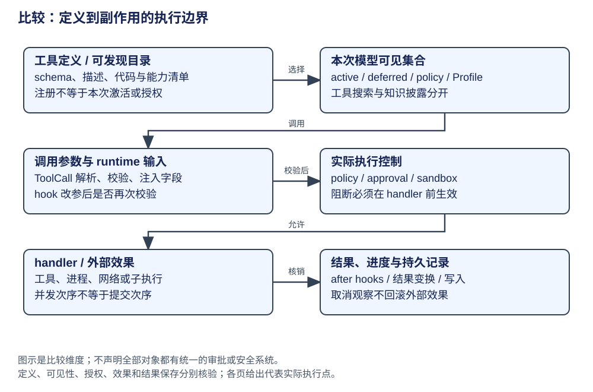

# 比较：工具、扩展与执行边界

工具可发现、参数可受理和效果可执行分别控制。hook 的名字不足以说明职责，必须追到它何时调用 handler、何时返回、读写哪个状态。下表围绕“模型给出一条工具调用”这个共同输入比较。

| 对象与阶段 | 权威状态 owner | 构造与生命周期 | 实际机制与执行点 | 能保证什么 | 不能保证/未核验 | 证据页 |
|---|---|---|---|---|---|---|
| AgentSession，官方默认；`pi-20261009` | AgentSession 资源/runner；Agent 工具循环 | 定义加载后注册和激活；reload 更换绑定 | input/beforeTool/afterTool → prepare/execute/finalize | 调用 hook 可 block，结果 hook 可变换输出 | 不由激活推定完整权限；子 Agent 未穷举 | [Pi](../agents/pi/architecture.md) |
| Pico5，实验；`pi-20261009` | Registry 工具定义；pi.tool Task | 每 invocation 建子 Task，持久 JSON 与代码分开 | beforeTool 后复核参数 → intent → execute → outcome | 保存最终参数及 replay 条件 | 事务不回滚外部效果；完整插件/UI 未核验 | [Pico5](../agents/pi-durable/architecture.md) |
| DeerFlow，应用；`deerflow-20261009` | 产品 policy/middleware；工具 handler | 最终扩展 compose 后绑定图；实例随图复用 | SkillToolPolicy 同时过滤 schema 和包住 handler | 代表阻断路径不调用实际 handler | 不代表全部 policy/sandbox 已审计 | [DeerFlow](../agents/deerflow/architecture.md) |
| Claude，冻结材料；`claude-frozen-documents` | 历史 Tool 定义、executor 与 canUseTool | REPL 绑定权限 UI；deferred schema 按需发现 | 校验/allow-deny-ask → call；安全可并行组 | 历史解释可见性、知识与执行分开 | 原 SHA 未知；显式队友接单链仍有 TODO | [Claude](../agents/claude/architecture.md) |
| Codex，开源 core；`codex-20261009` | ToolRouter/registry；ToolOrchestrator/Runtime | StepContext 给本次请求固定 router；按工具分派 | 审批需求 → sandbox attempt → Runtime.run | 代表执行工具受审批与环境编排 | 工具类型不同；全平台及 nested 审计未完成 | [Codex](../agents/codex/architecture.md) |
| Hermes，原生路径；`hermes-20261009` | toolsets/registry；executor/middleware | AIAgent 配置；单轮分段串行/并行 | handle_function_call → middleware → dispatch | 代表结果按调用顺序回填 | transform_result 错误保留原结果；非统一门禁 | [Hermes](../agents/hermes/architecture.md) |
| LangChain，构图框架；`langchain-20261009` | middleware 定义与 AgentState；ToolNode | create_agent 组合 hooks，wrap 首项外层 | before 正向/after 反向；model/tool request wrapper | 主干组合和 override 顺序已定位 | 应用锁定版本需核对；不自带全部鉴权策略 | [LangChain](../frameworks/langchain/architecture.md) |
| LangGraph，执行框架；`langgraph-20261009` | 图节点/retry policy；应用工具实现 | compile 注册；runner 在超步调度 task | 节点/ToolNode 执行并提交 writes | 负责调度和状态，不替应用解释业务权限 | 节点名不能证明 sandbox 或外部授权 | [LangGraph](../frameworks/langgraph/architecture.md) |
| DeepSeek，developer preview；`deepseek-20261009` | ctx.tools、调用记录与插件 scope | profile 装配；工具批次用受限滚动并发池 | ordered pre-execute → tool/call → handler → result | checkpoint policy 可在效果前设 flush 屏障 | 审批/sandbox 代表消费链已核验，各平台未运行；嵌套非独立 intent | [DeepSeek](../agents/deepseek/architecture.md) |

## 同一输入与观察边界

| 场景 | 静态机制差异 | 比较时保留的限制 |
|---|---|---|
| 工具已注册但不在本次 schema | Pi active loadout、Claude deferred tools、DeerFlow policy 均涉及可见集合 | 找到定义不代表可调用，更不代表授权 |
| hook 拦截调用 | Pi beforeTool 可 block；DeerFlow 代表 policy 可返回 blocked ToolMessage | 要验证实际 execute/handler 未进入，不只读过滤列表 |
| hook 改参数 | Pico5 再校验并提交有效 intent | 不将其他同名 hook 推成相同恢复语义 |
| 多工具同时推进 | Pi 策略；Hermes 分段；DeepSeek 滚动池；图 task 调度 | 并发执行、结果次序、提交次序分别比较 |
| 停止等待或取消 | Pico5 wait 取消与 abort 分开；其他对象有 Op/token/interrupt 等路径 | 观察方结束不等于工具取消，更不撤回外部效果 |
| 看见流事件 | Pi/Codex/DeepSeek 的临时事件，图的 updates/messages 与持久写分开 | 展示、落库与业务成功分别给证据 |

## 子 Agent、扩展与条件化取舍

[委派比较](control-delegation.md)已展开 child 图、线程、AIAgent 和 activation 的生命周期：DeerFlow child checkpointer=False，Codex 先准入并保留容量，Hermes 返回具名 child status，DeepSeek 区分本地多轮 Session 与外部一次 run。Pico5 内核与实验服务暴露范围不同；Claude 仍为冻结转述。**有 task 工具或类名不是统一的多 Agent 协作保证。**

进程内交互扩展可直接绑定会话/UI；可恢复扩展必须把函数定义、持久参数、进度与重放规则分别管理。应用 policy 适合表达用户、技能和环境约束，通用框架负责按既定控制点执行；组合后仍应沿效果点验证控制生效。本版不做插件能力、安全强度或吞吐的无条件排名。
