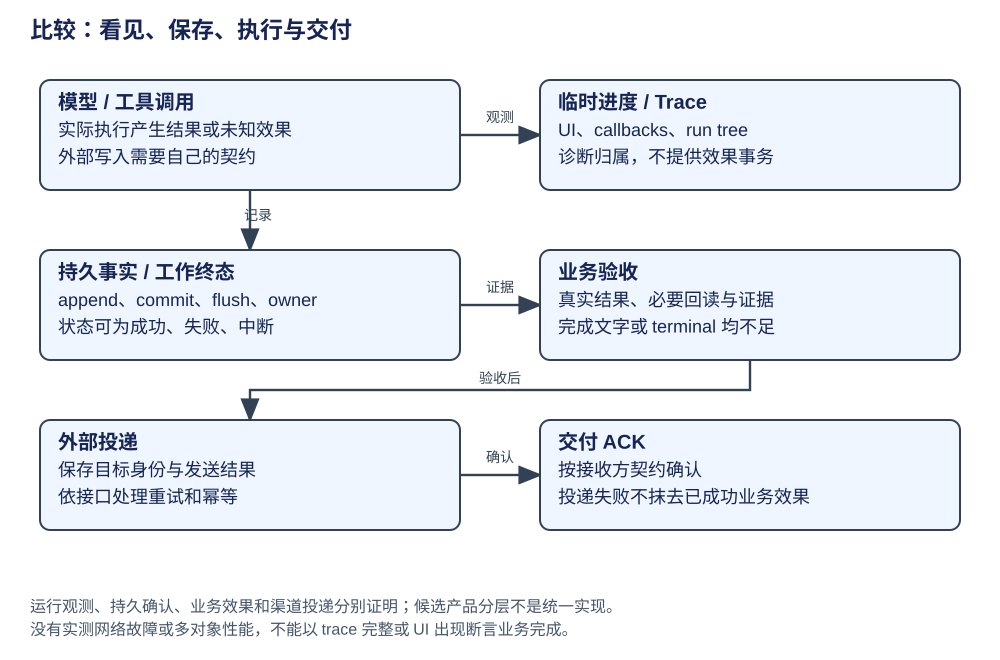

# 比较：观测、终态与交付确认

观测树解释调用归属，持久记录解释可恢复事实，交付确认解释接收方结果。三者分开核验，才能避免“UI 已看到”“模型说完成”或“trace 正常”被当成业务成功。

## 沿正常任务区分四种完成

CSV 修复可以在不同位置出现“完成”：模型生成完成、工具返回完成、运行状态结束、用户目标验收完成。这四种事实有联系，却不能互相代证。

| 观察位置 | 能直接说明什么 | 还需要接上的事实 |
|---|---|---|
| assistant 流结束 | 本次模型响应不再追加内容 | 是否还有工具、队列或结束 hook |
| edit 工具结果 | 本次修改动作返回了相应结果 | 验证、目标覆盖与后续运行 |
| 当前 run / turn 收口 | 本次运行控制进入终点 | 产物和用户目标是否满足 |
| 验证与交付记录 | 指定检查及投递产生相应事实 | 接收方是否确认、业务要求是否完整 |

例如 run 成功结束，却没有针对内部引号的验证结果，不能自动宣布这个目标经过完整验收；界面曾显示修改文本，也不等于后台存储已经确认。观察者需要知道正在看的事实属于哪一层。

## 一份轨迹怎样解释因果

以下是教学轨迹，不是某次实测日志。时间没有用于性能推断；ID 用来说明关联关系：

| 轨迹项 | 上游关联 | 事实 |
|---|---|---|
| work W1 | 用户请求 | 接纳 CSV 修复目标 |
| model M1 | W1、请求输入范围 | 请求读取规则及代码 |
| tool T1/T2 | M1 的 call IDs | 得到项目规则和源码观察 |
| model M2 | 已采用的 T1/T2 结果 | 请求修改 |
| tool T3 | M2 的 edit call | 修改效果与返回 |
| model M3 / tool T4 | 修改结果及验证调用 | 验证动作和结果 |
| final F1 | 当前工作结果 | 说明改动、检查和限制 |

真正有用的 trace 应帮助使用者从结果回到产生它的请求、调用和资料范围。父子 span 可以表达调用关系；event sequence 可以表达记录次序；来源 ID 可以表达模型可见贡献。它们表达的关系不同，不能统一称为一个日志时间轴。

## 验证比“答案看起来不错”多一层

评价本次任务时，先列目标要求：转义规则正确、实现发生、相关验证完成、回答准确说明结果。检查手段可以是确定程序、现有测试、人工阅读或模型评估；不同手段提供不同证据。

模型 critic 可以提出检查意见，但如果没有实际工具观察，它同样可能误判实施情况。确定 schema 校验能证明字段可解析，不能证明源码修复正确。运行测试也要说明测试覆盖什么，不能由一个样例通过推定全部工作都正确。

## 比较性能前先统一工作负载

比较模型调用数、延迟、token 和成功率，需要固定或明确任务、模型、工具、资料、执行政策和验收。固定 RAG、动态检索、子 Agent 与持久恢复的工作可能不同，不宜直接混算。

源码可以推导某个模式多出一步规划或回填，但没有相同负载测量就不能给全局成本排名。一次观察只能说明这个案例；若要建立稳定比较，应分别记录正常任务和特定条件命中的任务，再解释结果适用于哪里。

**演算。** UI 断线以后重新读到历史事件，能否证明原工作仍在执行或已经取消？

参考解答：不能。读到的是已保存事件；工作归属与取消由运行控制及对应存储契约决定。要确认当前状态，应读取相应运行事实，而不是只观察事件补读。

| 对象 | 权威状态与所有者 | 构造与生命周期 | 实际机制与执行点 | 提供的能力 | 机制边界 | 深入阅读 |
|---|---|---|---|---|---|---|
| AgentSession | Agent events、SessionManager、TUI | 运行时事件先消费，历史另 append | stream → UI/hooks；session entry 保存 | 事件和历史职责可追 | 展示事件不保证写入确认或任务验收 | [循环](../agents/pi/loop.md)、[TUI](../agents/pi/platform.md) |
| Pico5，实验 | Task/Session committed state | commit 后进度发布；观察句柄可释放 | DocumentState → Chord snapshot/update | 观察已采用状态，不暴露事务 draft | 不自动证明外部 effect 恰好一次或远端 ACK | [视图](../agents/pi-durable/documents.md) |
| DeerFlow，应用 | RunStore、ThreadEventStore、graph checkpoint | worker 持 owner lease；事件 store 单独写 | seq paging/read-after → store replay；finalize 复核资格 | 数据分页可重读，终态写受 owner 约束 | event batch 是 best effort；重读不续跑模型；业务 ACK 未统一 | [Run/事件](../agents/deerflow/runtime.md) |
| Claude | transcript/UI、Bridge、managed session/events | 会话宿主与托管事件作用范围分开 | query/tool 反馈、远程 Bridge/事件实践 | transport、会话与 UI 各自拥有状态 | Bridge 回报与工具效果耐久完成的关系缺少证据 | [能力](../agents/claude/capabilities.md)、[实践](../agents/claude/practices.md) |
| Codex，core | event sink、RolloutRecorder、Thread | writer 异步排队，flush/persist 单独 ack | AddItems 与持久 writer request 分开 | 可区分发布事件、排队和确认 | writer ack 不证明外部工具业务成功 | [架构](../agents/codex/architecture.md)、[上下文](../agents/codex/context-capabilities.md) |
| Hermes，原生 | SessionDB、平台 callback、cron claim | 消息批次提交成功才置 marker；cron 持 claim | ACP chunks + session append；cron side_effect_fence → delivery | 平台输出与数据库/cron owner 分开解释 | 平台 ACK、消息批次提交与 cron owner 分别判断 | [持久层](../agents/hermes/architecture.md)、[cron](../agents/hermes/capabilities.md) |
| LangChain，构图 | callbacks/tracer run map | config 传回调与 parent；tracing 自动/手工配置 | _configure → manager → BaseTracer._start_trace | parent、trace_id、dotted_order 的归属链可追 | trace 缺父可能成为根；追踪不提供效果事务 | [tracing](../frameworks/langchain/observability.md) |
| LangGraph，执行 | stream events、channels、saver | loop 超步推进与 saver 持久模式分开 | messages/updates stream、pending writes/checkpoint | 图运行资料与流视图可分开 | stream 结束不是业务验收或外部投递 ACK | [checkpoint](../frameworks/langgraph/architecture.md) |
| DeepSeek，preview | Session seq、活动 step 与 storage handle | progress 临时；ordered append；flush 屏障 | session events / repair / checkpoint policy | 未闭合工具结果具名未知，持久屏障可失败阻断 | closed turn 可含未知/中断，不能全部称成功 | [事件](../agents/deepseek/architecture.md)、[压缩](../agents/deepseek/context.md) |

## 同一故障：工具写入成功，回复发送失败

| 可观察事实 | 能得出的判断 | 还缺什么 |
|---|---|---|
| trace/模型生成最终回答 | 生成路径走到某位置 | 实际工具结果、错误分支、业务验证 |
| 工具返回成功并可读回 | 具体写入已生效，条件以工具契约为准 | 回复投递情况 |
| turn/run terminal | 运行所有者核销了本次工作 | terminal 可是 failed/cancelled；需核对状态与结果 |
| 消息 storage confirmed | 本地记录可按当前后端契约恢复 | 外部接收端是否收到 |
| 外部接口接受/ACK | 一次投递被接口接受或确认 | 与业务要求相符的 ACK 定义，可能仍需回读 |

可以在产品层设置业务验收与交付确认：前者检查目标效果，后者保存投递身份和确认结果。是否拆成独立服务，取决于状态生命周期与复用需求。网络重试应依赖接口的幂等或查询契约；trace 和模型语义本身不提供幂等。

## 条件化取舍与未知

开发诊断适合 callback/run tree；产品会话审计需要稳定身份与事件/历史；重启续跑需工作状态；跨渠道交付还要投递记录与确认。选择时先确定要证明哪一个结果，再配置观察点。LangSmith、Langfuse、OpenTelemetry 等名称属于不同后端/集成，不以接入数量排名。

可追踪性帮助找到 append、commit、flush 和所有权检查的位置，却不直接给出可靠性指标。衡量延迟、吞吐和成功率时，需要另外说明工作负载、故障条件与样本范围。