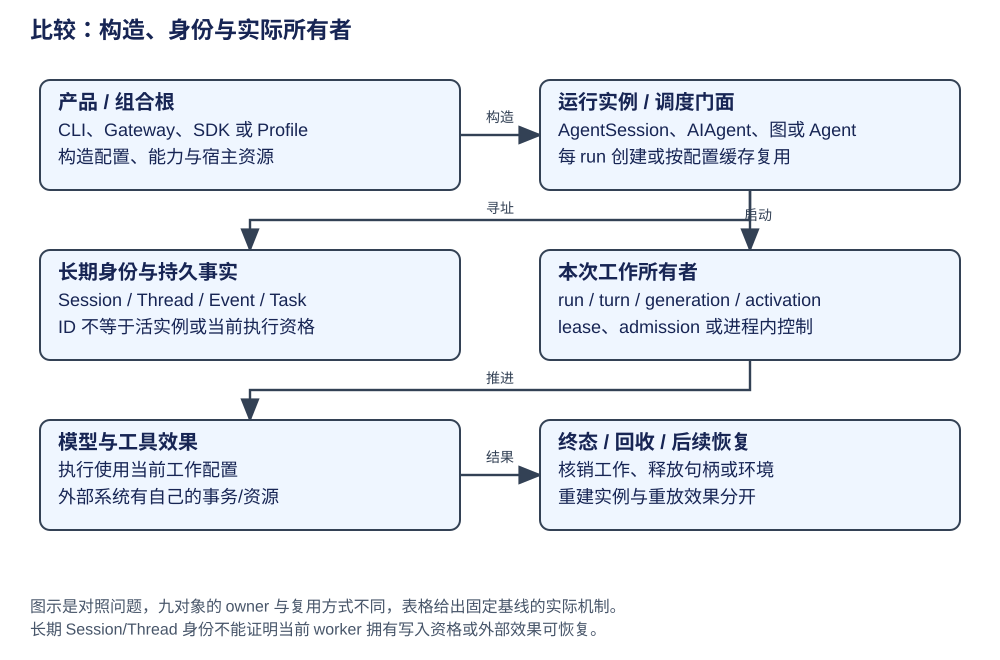

# 比较：所有权与生命周期

长期会话身份、进程活对象和一次执行需要分别管理。多数应用把会话历史和运行句柄分开；Pi Durable 与 LangGraph 又显式保存工作恢复资料，但其可恢复单元不同。比较问题是：第二次输入或进程重启后，哪些对象复用，哪些状态重建？




先按构造、接纳工作、固定请求和收口的顺序找 owner，再比较它们的复用范围。最后改变一个条件——第二次输入或进程重启——检验哪些资料仍有效。所有权不是对象关系图里的箭头名称，而是创建、修改、提交和释放的具体责任。

## 先走一次构造、运行与结束

CSV 修复任务到达之前，宿主通常已经加载部分配置或服务。接纳任务后，它取得会话，构造或复用执行对象，准备本次请求，并在模型与工具循环结束后收口。理解所有权，要把这一条时间轴展开，而不是只给每个名词贴“长期”或“短期”。

以下是职责演算，不假定所有框架都创建同样对象：

| 时间 | 已存在／新建资料 | 谁应负责它 |
|---|---|---|
| 宿主准备 | 模型连接、工具定义、存储、资源加载器 | 组合根及资源持有者负责构造和释放 |
| 会话取得 | 会话身份、历史、工作区及相关配置 | 会话 owner 负责加载与继续使用 |
| 本次工作开始 | 用户目标、运行归属、取消控制 | 当前工作的 owner 负责接纳与终态 |
| 一次模型请求 | 消息范围、工具集合、模型与环境快照 | 请求准备者负责固定本次输入 |
| 工具批次 | 调用参数、效果、结果关联 | 执行器负责完成或具名收口 |
| 工作结束 | 运行结果、历史更新、资源释放 | 各 owner 按自己的生命周期结束或保留 |

一次工作结束以后，会话和模型客户端仍可能保留；请求局部状态却不应混进下一份用户工作。这就是“复用对象”与“复用正在进行的工作”的区别。

## 拥有一个对象，不等于拥有全部状态

代码里 `agent.session` 表示对象引用；它未必说明 agent 拥有 session 的全部写入权、存储耐久性和销毁责任。真正的 owner 要沿四种动作确认：谁创建，谁修改权威资料，谁负责提交，谁结束或释放。

例如 LangChain 工厂创建 compiled graph，应用可以复用它；每次调用的 LangGraph Loop 则另建。checkpointer 的 thread_id 寻址持久资料，并不要求一个 thread 永远绑定一个图对象。DeerFlow Gateway 按 run 构图与嵌入式 Client 缓存图，复用范围因此不同。Hermes Gateway 缓存 AIAgent，也仍需重置本轮状态。

同样，Codex Thread 不是 ModelClientSession：前者表示长活交互，后者管理 turn 内的 provider 请求状态。Pi Durable 的 Task record 不是 TaskRuntime：前者是持久资料，后者是当前 invocation 的运行句柄。先区分事实和句柄，才知道重建时哪些东西需要重新创建。

## 构造与注入为什么值得单独学习

假设工具 handler 要访问工作区、记忆和模型。全部在内部临时创建虽然能跑一个例子，却会让配置、资源释放和实例作用域难以解释。由组合根准备并注入，可明确本次工具使用的环境与共享范围；也便于测试、替换和宿主复用。

但注入不必演变成庞大容器。小系统可以直接传函数与配置，框架可以传 context/runtime/registry。设计要表达真实生命周期，而不是为了统一外形把每个变量都变成独立服务。

**演算。** 一个 Gateway 持有缓存 Agent，多次收到用户输入。哪些资料应跨轮保留，哪些要重新准备？

参考解答：会话身份、有效历史、共享连接和能力配置可以按宿主契约保留；本轮计数、即时状态、取消控制和请求快照需要在相应边界创建或重置。具体字段以实现为准，不能凭实例被缓存就推定所有成员都适合跨轮共享。


## 将同一时间轴映射到实际对象

LangChain 工厂产生可复用 compiled graph，而 LangGraph 每次调用另建 Loop。Pi Durable 的 Registry 长期保存工作定义，Task record 保存持久工作，TaskRuntime 只对应当前 invocation。Codex 又把长期 Session、当前 Turn 和一次 Step 快照分开。这些拆分都在防止长期资源与短期控制混用，保存内容却各不相同。

下面用应用装配代码表达构图与运行的交接，组件是教学占位，代码不是工厂源码节选：

```python
# prepared_chat_model、read_source 等由应用构造并注入。
agent = create_agent(model=prepared_chat_model, tools=[read_source])
first = agent.invoke({"messages": [HumanMessage(content="查看导出实现")]})
second = agent.invoke({"messages": [HumanMessage(content="解释字段转义")]})
```

两个调用复用 graph 对象，但是否延续同一持久 thread 还取决于 checkpointer 和调用 config；以上未配置持久会话。这让“复用计算定义”与“延续交互历史”成为可分别检验的关系。[工厂的 compile 输出](https://github.com/langchain-ai/langchain/blob/34489d61433cbf5044a630de2e7797e361672900/libs/langchain_v1/langchain/agents/factory.py#L892)、[每次图调用的运行资料](../frameworks/langgraph/architecture.md)。

下表把创建者、权威状态、生命周期与执行点保持在固定列中，供横向查阅；阅读重点是每一行怎样回答前面的时间轴。

| 对象 | 权威状态与所有者 | 构造与生命周期 | 实际机制与执行点 | 提供的能力 | 机制边界 | 深入阅读 |
|---|---|---|---|---|---|---|
| AgentSession | AgentSession 编排，Agent 活运行，SessionManager 历史 | CLI/SDK 创建或注入；runtime 可替换 session | prompt → Agent / agent-loop | 会话、执行、历史责任分开 | 历史保存不能证明活工作可恢复 | [Pi](../agents/pi/architecture.md) |
| Pi Durable，实验库 | Session 的 Task record；Registry 提供执行定义 | Harness.open 绑定 Storage/Models/Registry；运行句柄可重建 | scheduler 按 checkpoint 推进 | 持久工作有明确恢复记录 | 按需宿主还需 wake/onWake 接线；定义兼容与外部效果另有约束 | [Pi Durable](../agents/pi-durable/architecture.md) |
| DeerFlow，应用 | RunManager 的 run；图 state 的 thread | Gateway 每 run 构图；Client 配置 key 相同复用 | worker/Client → compiled graph | run、thread、graph instance 分开 | 跨 worker 竞争与扩展实例成员各有作用域 | [DeerFlow](../agents/deerflow/architecture.md) |
| Claude | 会话层与 query 活运行 | REPL/SDK 入口分别持有状态 | query generator、工具 executor | 会话宿主与运行循环分工 | 任意工具效果重放与跨崩溃接单确认未证 | [Claude](../agents/claude/architecture.md) |
| Codex，开源 core | Session 的 history/active_turn；RolloutRecorder 历史 | manager spawn/load Thread；turn 与 step 分别建快照 | submission_loop → SessionTask → run_turn | 长活线程与当次采样配置分开 | 不同 SessionTask 的工作恢复语义不能一概而论 | [Codex](../agents/codex/architecture.md) |
| Hermes，原生路径 | AIAgent 活实例；宿主历史；SessionDB 消息 | CLI 构造；Gateway 条件缓存；turn 局部状态单独建 | run_conversation → native phases | 实例、会话身份、iteration 有不同生命周期 | ACP turn 的所有权不代替平台投递确认 | [Hermes](../agents/hermes/architecture.md) |
| LangChain，构图框架 | 应用提供运行输入；框架定义 AgentState/schema | create_agent 一次构图，可多次调用 | model/tools/hook 节点与路由 | 统一调用协议和编排构造 | 不替应用拥有全部会话、鉴权、部署 | [LangChain](../frameworks/langchain/architecture.md) |
| LangGraph，执行框架 | 每次 Loop 的 channels/tasks；checkpointer 保存快照 | compiled graph 复用，调用创建 Loop；thread 按 config 寻址 | tick → runner → after_tick | 图定义、活执行、持久身份分开 | 并发同 thread 与后端耐久需应用约束 | [LangGraph](../frameworks/langgraph/architecture.md) |
| DeepSeek，developer preview | AgentLoop 工厂、ReactLoopAgent 驱动、Session 事件 | 插件 scope + 可选存储写句柄；卸载先 abort 再收口 | setup/publish → turn/step | 写权与活资源有显式 owner | JSONL lease 不代表每个自定义后端都有跨进程排他 | [DeepSeek](../agents/deepseek/architecture.md) |

## 同一场景与条件化取舍

用户第二次提交输入时，Pi 与 Codex 可继续长活会话/线程，但会创建新的运行或采样边界；Hermes 的复用取决于宿主；DeerFlow Gateway 可重建图而仍用原 thread，Client 则可复用图。**对象复用不等于会话延续，会话延续也不要求对象复用。**

进程重启后，Pi Durable 从 Task record 推进；LangGraph 从 checkpoint 与任务 writes 重建图运行；DeepSeek 修复旧未闭合 turn 再继续后续工作。恢复单元与旧函数栈分别判断，不能统一称“恢复 session”。

如果只需要交互历史重建，应先明确哪些状态必须跨进程保存；需要进行中工作恢复时，再选择显式工作记录或图 checkpoint。后一种选择需要同时管理工作定义的版本、状态兼容和恢复策略，不能只增加一份存储。
