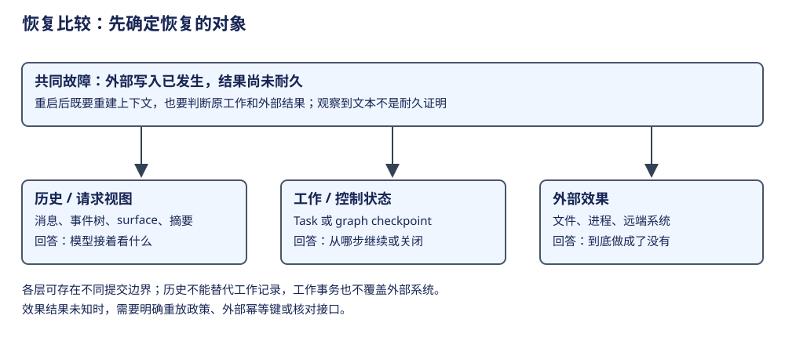

# 比较：上下文、持久化与恢复

“恢复”至少要指定三个对象：消息历史、进行中的工作、外部效果。保存第一层不自动提供第二层；把第二层做成事务，也不能自动使第三层恰好执行一次。上下文则是发送给模型的投影，可能与保存的历史不同。




先沿正常工作辨认状态层次，再从一份等待记录推导谁继续，随后比较各实现保存的恢复资料。外部效果未知的中断案例放在后面：它需要前三步建立的工作身份和提交边界，不能只靠一次“恢复 session”解释。

## 第一步：确认所观察的状态属于哪层

沿 CSV 修复任务，最外层会话可以一直存在，本次工作从接纳到结束，工作内部反复生成与执行工具。代码读取、修改与验证完成时，外层任务未必结束。判断状态前，先确定自己在观察哪一层。

| 所在层 | 要回答的问题 | 本书代表实现 |
|---|---|---|
| 会话／线程 | 哪些历史和配置属于同一交互身份？ | Pi SessionManager、Codex Thread、Hermes session_id |
| 当前工作 | 本次输入是否已经开始、等待或结束？ | DeerFlow run、Pi Durable Submission 与 Task、Lane Operation |
| 推进阶段 | 现在准备请求、等待工具，还是准备收口？ | Pi Durable checkpoint.phase；Hermes 原生阶段；DeepSeek step |
| 请求／效果 | 本次模型与工具使用了哪份输入，结果在哪？ | Codex StepContext、AIMessage／ToolMessage、tool intent／outcome |
| 观察／存储 | 展示的是临时进度、已提交状态还是耐久记录？ | pi.live、流事件、checkpoint、rollout 与 flush |

各对象不必声明相同枚举。Pi Durable 的 pending/running/waiting/sleeping 是调度状态，prepare/request/tools 是 generation 的私有阶段；DeepSeek 的 idle/running/maintenance 表示进程是否有活跃工作。Codex 和 Hermes 可以从控制函数解释主线，不需要为了表格齐整虚构一份统一状态机。[Pi Durable 分层状态](../agents/pi-durable/architecture.md)、[DeepSeek 驱动状态](../agents/deepseek/architecture.md)。

### 先按关联方式认识存储模型 {#storage-models}

状态层次确定后，还要知道底层保存哪些记录、靠什么关联。SQLite 和 JSONL 描述物理形式，无法独自说明这些问题：同一个 JSONL 可以保存历史树，也可以保存带投影操作的事件流；同一个 SQLite 可以同时保存关系索引和 JSON 工作记录。各分册使用同一 CSV 修复任务给出关系图及记录样例，再按自己的读取规则推导消费结果。

| 对象与关系样例 | 需要推导的结果 |
|---|---|
| [Pi：header、异构 Entry 与 parent 树](../agents/pi/context.md#storage-model) | 当前 leaf 选哪些记录；摘要与编辑怎样改变消息贡献 |
| [Durable：Conversation、Submission、Task、Entry、Document 及修订](../agents/pi-durable/documents.md#storage-model) | 从等待任务找到工具结果；同批提交怎样服务调度、模型和界面 |
| [DeerFlow：checkpoint、run 与 event](../agents/deerflow/runtime.md#storage-model) | thread/run/seq 分别定位图状态、工作状态和补读事件 |
| [Claude 冻结源码：transcript 与压缩边界](../agents/claude/context.md#storage-model) | 消息父链、工具配对和 logicalParentUuid 为何是不同关联 |
| [Codex：rollout 类型与活动 history](../agents/codex/context-capabilities.md#storage-model) | 压缩记录怎样替换活动历史；为何不能发送全部日志行 |
| [Hermes：sessions/messages 与归档标志](../agents/hermes/context.md#storage-model) | 相同数据库怎样读出模型历史和展示历史 |
| [LangGraph：checkpoint、blobs 与 writes](../frameworks/langgraph/architecture.md#storage-example) | 按通道版本找值，按任务身份采用未合并结果；LangChain 的图状态由此执行 |
| [DeepSeek：事件身份、来源与 surfaceOp](../agents/deepseek/context.md#storage-model) | 后追加的摘要事件如何替换旧区间，原审计日志为何仍存在 |

这些是不同形状的数据模型，不能压成同一份 messages 表。历史 Lane 的 Session/Lane/Operation 则按[冻结运行模型](../history/pi-lane/runtime.md)阅读，不把它的状态结构代入当前 Durable。

## 第二步：确定需要重建什么

一次修复结束后，下一次提问“刚才修改了哪里”，只要有历史和请求重建就可以接着交流。如果程序在工具过程中停止，问题则变成“同一工作下一步从哪里推进”。这时除了对话内容，还需要描述当前工作和执行阶段的资料。

Pi Durable 将 Task checkpoint 交给当前代码继续调度，LangGraph 将图状态、任务与写入资料交给图执行器。DeepSeek 的恢复修复旧 turn 边界，再承接后续工作。AgentSession、Codex、Hermes 的会话重建路径则首先恢复历史与上下文，不能据此推定任意活跃工具都可续跑。

外部效果还有自己的事实：即使任务状态没保存，文件也可能已经被修改。因而恢复设计需要区分“下一步可定位”与“这个动作是否已经发生”；相同消息可以重新读取，不代表相同写入可以无条件重做。下面的表按三层资料比较实现，再用一个必要的中断案例解释差异。


## 第三步：让恢复资料决定下一执行位置

Pi Durable 可以直接用持久任务资料解释“工具结果回来以后谁继续”。以下是字段节选，ID 是教学命名：

```json
{
  "generation": {
    "id": "G1",
    "state": {"status": "waiting",
      "checkpoint": {"phase": "tools", "assistant": "E2",
                     "tools": ["T1"], "pending": []},
      "on": ["T1"], "policy": "allSettled"}
  },
  "tool": {
    "id": "T1", "owner": "G1",
    "state": {"status": "terminal",
      "outcome": {"status": "completed", "result": {"kind": "model", "entryId": "R1"}}}
  }
}
```

这里 T1 已有终态，G1 的等待条件可以满足。调度器重新认领 G1，按 checkpoint.phase=tools 进入处理代码；结果再参与边界判断。正常续跑可以创建下一 generation G2，G1 自己终止，pi.live.run 的归属移到 G2，用户输入仍等待最终收口。

这份记录同时回答了三个问题：等待谁、恢复进入哪段代码、观察结果在哪里。不能只看 G1 的 status 或只保存一个“工具完成”字符串。[Pi Durable 的任务与移交](../agents/pi-durable/loop.md)。

如果改用图表示，相应问题由节点、channels、版本、pending writes 与 checkpoint 共同回答；如果使用进程内循环，下一次调用位置最初由函数控制流维持。三者的语义可以对照，保存的具体资料不能互相替换。

## 状态为何不应全写成自然语言

模型可以解释“工具完成后继续验证”，但程序在中断后不能只从任意文本里猜哪个具体工具是否已有结果、哪个任务可以被认领。工作身份、结果关联、状态和控制位置需要明确的程序资料。

这并不要求把目标正文也改成固定分类。目标、代码和观察保持开放语义，控制字段让程序可解释地推进。将所有语义提前压成一个 intent 标签，会损失任务变化；将全部控制都留给自由文本，又难以说明实际执行关系。

**演算。** T1 已 terminal/completed，是否意味着用户工作 done？

参考解答：不是。这里只说明一项工具 Task 收口。G1 还要消费结果、决定后续 generation 或结束；Submission 和 run 有自己的结果边界。


## 从资料采用追到执行器

Pi Durable 的等待记录让 scheduler 判断何时重新认领，并由任务定义解释 checkpoint；图运行则由 Loop 的恢复资料重建任务。下面节选 LangGraph 超步入口，后续 runner 和 after_tick 省略：

```python
while loop.tick():
    for task in await loop.amatch_cached_writes():
        loop.output_writes(task.id, task.writes, cached=True)
    # 完整实现随后只执行没有 writes 的任务，再合并超步输出。
```

恢复时先采用已保存输出，再执行仍缺结果的任务。若节点内的外部写操作已发生、结果尚未保存，节点重跑仍需依靠幂等键或结果查询确认该效果。[查看恢复资料参与超步的入口](https://github.com/langchain-ai/langgraph/blob/bfcfea554ed5c7f7be562cebf8825e911b493ab1/libs/langgraph/langgraph/pregel/main.py#L3510)。

下表据此比较历史、工作与效果三种边界。

| 对象 | 权威状态与所有者 | 构造与生命周期 | 实际机制与执行点 | 提供的能力 | 机制边界 | 深入阅读 |
|---|---|---|---|---|---|---|
| AgentSession | SessionManager 历史树 / Agent 消息 | 重建分支 parent 链及模型投影；活动执行在内存 | compaction/context edit 后构造输入；事件与 append 先后分开 | 分支历史与请求上下文关系可追 | 未证明任意活工具跨崩溃续跑或 fsync | [Pi](../agents/pi/architecture.md) |
| Pi Durable，实验库 | Session entries/tasks/documents | Storage 恢复 Task checkpoint，Registry 供当前代码 | commit 后发布进度；tool intent/outcome 分开 | 显式工作恢复点与重放政策 | safe 条件与后端配置限制；外部效果非恰好一次 | [Pi Durable](../agents/pi-durable/architecture.md) |
| DeerFlow，应用 | ThreadState/checkpointer；RunStore/event store | 图可重建，按 thread 寻址；run 终态另存 | graph stream + checkpoint；产品上下文/摘要另处理 | 各存储的职责与身份可区分 | 子 Agent 不带同等 checkpointer；外部效果仍需独立恢复 | [DeerFlow](../agents/deerflow/architecture.md) |
| Claude | 冻结源码的 transcript、请求视图与 memory | 会话恢复与 compact 重建；后台记忆分作用域 | budget/microcompact/collapse/正式摘要分层 | 压缩与记忆有不同作用域 | snip/collapse 算法缺少证据；历史恢复不等于工作续跑 | [Claude](../agents/claude/architecture.md) |
| Codex，开源 core | ContextManager history；RolloutRecorder | InitialHistory 重建；AddItems 与 writer ack 分开 | 内存 history 更新 → 入队；flush/persist 等待确认 | 排队与确认是不同契约 | 摘要质量、后端耐久性和活动工作的恢复是不同问题 | [Codex](../agents/codex/architecture.md) |
| Hermes，原生路径 | SessionDB 消息；Agent 当前请求；memory | 宿主加载历史；DB 批次成功后置成功标记 | append_messages_batch；失败 turn 可另补边界 | 消息批次失败不会写成功标记 | fence/in-place/rotate 管摘要提交，不是任意工具事务 | [Hermes](../agents/hermes/architecture.md) |
| LangChain，构图框架 | AgentState/messages；应用 checkpointer/store | 框架构图后由 LangGraph 执行与恢复 | request.override 与 state 更新分开 | 模型请求视图不自动等同持久 state | 构图框架自身不提供全套耐久保证 | [LangChain](../frameworks/langchain/architecture.md) |
| LangGraph，执行框架 | channels/checkpoint + pending writes | 每次 Loop 装载恢复点；interrupt 重跑节点 | 超步合并，sync 等待提交；按 task 取 resume 值 | 有后端及配置时保存图运行恢复资料 | interrupt 前效果可重复；后端及 async/exit 边界不同 | [LangGraph](../frameworks/langgraph/architecture.md) |
| DeepSeek，developer preview | Session 的事件/surface；persistence handle | 有序 append；flush 是耐久屏障；恢复先修复日志 | 模型/顶层工具效果前 policy flush；repair 补终态 | 区分未开始和结果未知的工具记录 | repair 关闭旧 turn，非程序续跑；flush 保证由后端实现 | [DeepSeek](../agents/deepseek/architecture.md) |

## 等时间、等任务与重开是三件事

Durable 的 waiting 保存依赖 Task，sleeping 保存 until 与下一阶段 checkpoint；后者释放 invocation，宿主可通过 wake/onWake 安排进程再次出现。LangGraph 的图恢复仍按自己的任务与 checkpoint 契约解释，不能仅凭同样存在等待字段就推定相同的宿主唤醒机制。[Durable 宿主链路](../agents/pi-durable/hosting.md)。

持久化频率也要区分状态转移和进度输出：AgentSession 主要在消息完成时追加历史；Lane 已逐 frame 提交；Durable 为回答与工具进度设置默认 100 毫秒的最小提交间隔，阶段转移仍随事件提交。更细的恢复资料不等于每条路径写得更多，比较成本需要相同任务与存储配置。

## 同一故障：外部写入成功，结果尚未耐久

| 机制 | 遇到这一故障时可解释什么 | 应用仍须决定什么 |
|---|---|---|
| Pi Durable tool intent | phase=execute 的记录可恢复；旧与当前 replay 均 safe 才重跑，否则 interrupted | safe 的定义是否覆盖真实效果；是否能查外部结果 |
| DeepSeek 修复 | 已有 tool/call 无 result 记录为 TOOL_OUTCOME_UNKNOWN；关闭旧 turn | 向外部系统核对，或明确接受风险后发新工作 |
| LangGraph checkpoint | 已保存状态/writes 可重建；节点可能再次执行 | 幂等键，拆分效果点，interrupt 前动作能否重复 |
| Pi/Codex/Hermes 的已读消息路径 | 历史与结果可能处于保存/排队中的不同边界 | 未补证前不能断言活工具恢复或统一重放 |
| Claude Code | 描述会话与上下文恢复，不足以覆盖该故障 | 会话恢复不等于副作用重放 |

## 条件化取舍与比较限制

需要延续同一工作状态时，Pi Durable 的 Task 和 LangGraph 的节点/超步恢复更直接；需要保留中断事实并启动后续工作时，DeepSeek 的 repair 明确区分未开始与未知结果。这是语义差异，不是可靠性排名。三者都要额外处理外部副作用与后端耐久性。

上下文成本比较先统一度量：本地历史、发送消息、provider 有效上下文、后台摘要和长期 memory 是不同对象。Claude 的 cached microcompact 在历史材料中不改本地消息；Pi 用历史树投影；DeepSeek 用 surface；Codex 有 ContextManager；DeerFlow/Hermes 的压缩提交机制见[Prompt 与压缩比较](context-compaction.md)。这些路径的覆盖范围与提交规则不同，不能合并成一个“压缩率”，也不能按物理日志时间推定逻辑覆盖。
