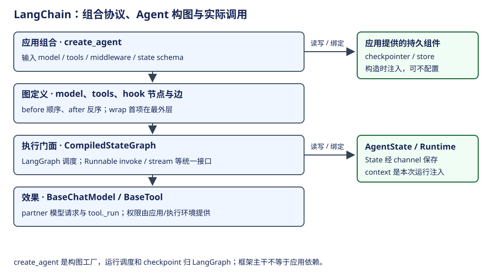
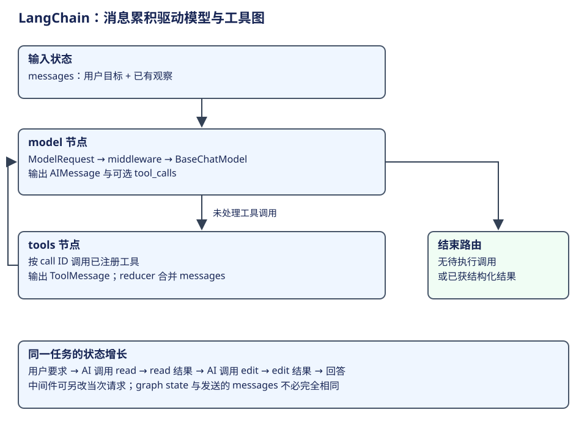
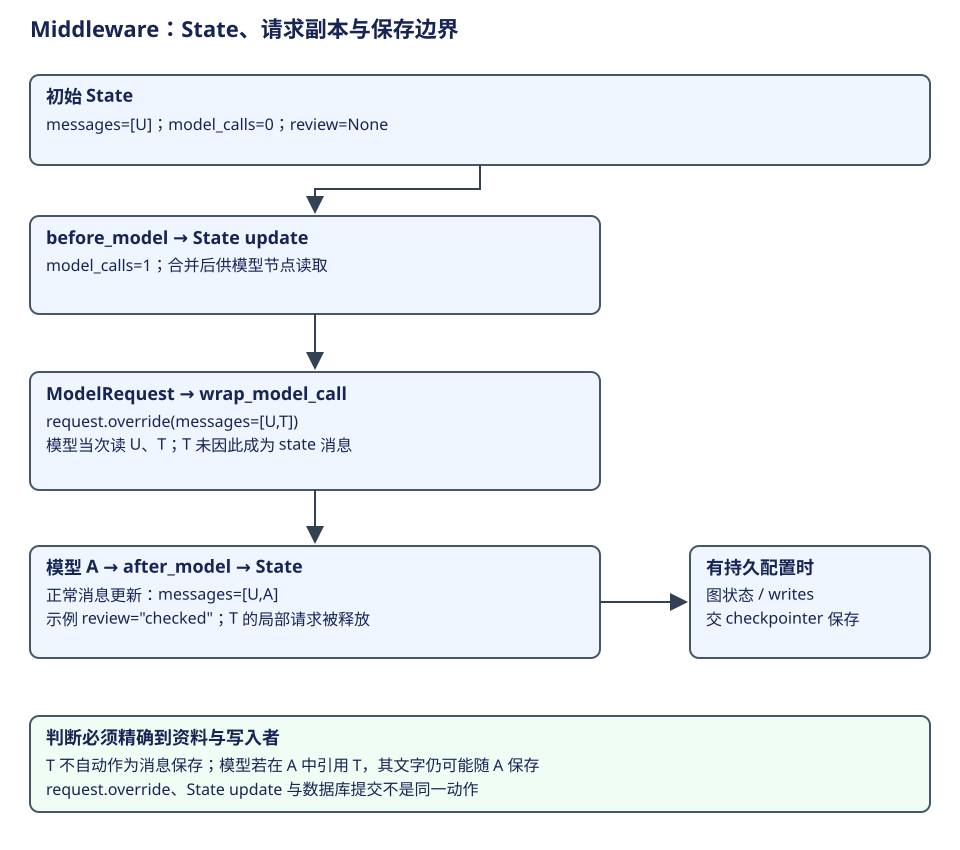

# LangChain：统一调用协议与 Agent 构图

LangChain 是应用组合框架。Runnable 统一调用形态，messages/model/tool 统一协议对象，create_agent 把标准的模型与工具循环编成 LangGraph 图。它没有另建一套独立于 LangGraph 的图调度器。阅读时先区分构图、节点内调用和底层 provider 请求。




本章沿一次图调用展开：第一步由应用提供组件并构图，第二步把当前状态组织成 ModelRequest，第三步消费模型的工具决定并回填观察，第四步依据路由收口。先解释这条正常主线，再把 middleware 放回相应阶段；显式 Plan & Execute 是主线讲完后的组合方式。

## 概念与生命周期

| 概念 | 层次与含义 | owner / 生命周期 | 状态边界 |
|---|---|---|---|
| Runnable / LCEL | 通用 invoke、batch、stream 及组合协议 | 组合时形成对象；调用时传 RunnableConfig | 不自动提供业务会话持久化 |
| BaseMessage / AIMessage / ToolMessage | 带角色、内容及 tool call 关系的协议数据 | 应用、模型与工具节点生产 | content、内容块和纯文本视图不同 |
| BaseChatModel | 模型调用抽象 | 应用构造或 init_chat_model 解析 | provider 的实际网络代码在 partner |
| BaseTool | schema、校验、调用及结果包装 | 应用/工厂注入工具实例 | _run/_arun 执行副作用 |
| AgentState | 图节点共享的业务状态 schema | 工厂合并应用/middleware schema | 通过 LangGraph channels 更新 |
| Runtime.context | 当前调用注入的环境 | 调用者提供 | 与持久 State 分开 |
| AgentMiddleware / ModelRequest | hook 定义 / 当次模型请求 | middleware 在构图时提供；request 每模型节点创建 | override 请求不等于持久修改 State |
| CompiledStateGraph | 构图结果及执行门面 | create_agent 最后 compile 返回 | 运行由 LangGraph 提供 |

依据：[Runnable](https://github.com/langchain-ai/langchain/blob/34489d61433cbf5044a630de2e7797e361672900/libs/core/langchain_core/runnables/base.py#L134)、[ChatModel](https://github.com/langchain-ai/langchain/blob/34489d61433cbf5044a630de2e7797e361672900/libs/core/langchain_core/language_models/chat_models.py#L475)、[BaseTool](https://github.com/langchain-ai/langchain/blob/34489d61433cbf5044a630de2e7797e361672900/libs/core/langchain_core/tools/base.py#L433)、[factory](https://github.com/langchain-ai/langchain/blob/34489d61433cbf5044a630de2e7797e361672900/libs/langchain_v1/langchain/agents/factory.py#L892)。

## 第一步：构造图，再提交输入

create_agent 收集工具、middleware 的额外工具与 schema，形成 ToolNode、model 节点和 hook 节点，添加条件边，注入 checkpointer/store/cache 后 compile。调用 compiled graph 才开始执行；是否跨调用保留状态取决于应用是否配置存储和 thread 寻址。

存储模型也在这里分工：`AgentState.messages` 及 middleware 加入的字段是图状态，由 channels 和 checkpointer 保存及恢复；应用注入的 `store` 承担另外的跨调用资料访问，工具或 middleware 决定其内容；cache 用于复用计算结果。三者不能仅因都能保存 JSON 就合并成一个“会话数据库”。同一 CSV 任务的 messages 如何与通道版本、任务 writes 拼回，请接着读 [LangGraph 存储样例](../langgraph/architecture.md#storage-example)。该样例属于书中独立登记的 LangGraph 基线，不代表每个应用锁定版本的物理 schema。

| 当前位置 | 调用 / 产物 | 控制关系 |
|---|---|---|
| 构图 | create_agent → StateGraph → compile | 不触发模型采样 |
| 输入 | graph.invoke / ainvoke / stream | LangGraph 将输入和恢复状态送给节点 |
| 模型节点 | model_node / amodel_node → ModelRequest | 从 state.messages 取消息，加当次 model/tools/system 信息 |
| 模型包裹 | wrap_model_call 链 → _execute_model_* | 可以改请求、重试、短路；进入最终的 handler 才调用模型 |
| 模型执行 | bind model → invoke / ainvoke | system_message 在此与 messages 组合 |
| 工具与继续 | ToolNode → 包裹调用 → BaseTool | ToolMessage 回填；有工具则通常回 loop_entry_node |
| 结束 | 无工具、结构化响应、return_direct 或跳转 | 不把任何成功 node 等同整个 agent 已结束 |

依据：[模型节点与真实调用](https://github.com/langchain-ai/langchain/blob/34489d61433cbf5044a630de2e7797e361672900/libs/langchain_v1/langchain/agents/factory.py#L1493)、[构图](https://github.com/langchain-ai/langchain/blob/34489d61433cbf5044a630de2e7797e361672900/libs/langchain_v1/langchain/agents/factory.py#L1611)、[工具返回路由](https://github.com/langchain-ai/langchain/blob/34489d61433cbf5044a630de2e7797e361672900/libs/langchain_v1/langchain/agents/factory.py#L2072)。

## 第二步：由状态构造请求，由模型提出动作



用“修复 CSV 导出”说明默认 Agent 图。调用者把用户要求交给 compiled graph，模型节点从 AgentState.messages 读取消息，构造当次 ModelRequest。system_message、工具定义和调用环境也在这一层绑定；运行进入模型的最终 handler 后才调用 provider。

第一轮可以产生读取文件的 AIMessage。它的自然语言 content 解释动作，tool_calls 则承载程序可处理的调用。例如下面的节选表达一个调用，省略其他消息属性：

```python
AIMessage(
    content="先查看导出实现。",
    tool_calls=[{"name": "read_source", "args": {"path": "src/export.ts"},
                 "id": "read-1", "type": "tool_call"}],
)
```

`read_source` 是教学假设的应用工具。工厂不按 content 中的句子解析行动，而依据 tool_calls 及已经存在的 ToolMessage 判断哪些调用尚未执行。当前实现将待执行调用送给 tools；工具返回与 read-1 对应的 ToolMessage，消息 state 经 reducer 更新后，再由路由进入下一次模型节点。[模型节点构造请求](https://github.com/langchain-ai/langchain/blob/34489d61433cbf5044a630de2e7797e361672900/libs/langchain_v1/langchain/agents/factory.py#L1579)、[待执行调用路由](https://github.com/langchain-ai/langchain/blob/34489d61433cbf5044a630de2e7797e361672900/libs/langchain_v1/langchain/agents/factory.py#L2008)。

```python
ToolMessage(content="exportCsv 直接拼接字段，已有验证覆盖普通字段。",
            tool_call_id="read-1")
```

下一轮模型看到原目标、上一次动作和返回事实，可能选择修改，也可能再查测试。**模型决定做什么，图规定怎样承接和反馈这份决定。** 固定的是 model/tools 的协作骨架，工具种类和轮数随任务变化。

| 推进时点 | messages 的新增贡献 | 结构化控制 |
|---|---|---|
| 用户提交 | HumanMessage：目标、条件、资料引用 | 调用配置与 Runtime.context |
| 请求读取 | AIMessage：说明与 tool_calls | 工具名、args、call ID |
| 读取结束 | ToolMessage：代码观察 | tool_call_id 关联原请求 |
| 请求修改与验证 | 新的 AIMessage／ToolMessage | 继续按同一协议组织 |
| 正常回答 | 无待执行调用的 AIMessage | 路由到退出节点，受 middleware 等条件影响 |

这也是自然语言组织方式：框架不把所有正文变成一个固定 intent_class，而用消息角色、内容块和调用关联约束材料的解释。结构化输出又是另一种返回契约；它可以影响工厂结束条件，不能和“工具调用结果”混称。

### 从 ModelRequest 到实际模型调用

请求先经过 wrapper，抵达 `_execute_model_sync` 后才进入真实模型。下面节选最终 handler 的主要路径，省略响应命名及结构化结果包装；异步路径采用相同交接并调用 `ainvoke`。

```python
model_, effective_response_format = _get_bound_model(request)
messages = request.messages
if request.system_message:
    messages = [request.system_message, *messages]
output = model_.invoke(messages)
handled_output = _handle_model_output(output, effective_response_format)
```

`_get_bound_model` 将有效工具和输出约束绑定到模型；`system_message` 在最终调用前才与普通消息组合。输出经 `_handle_model_output` 转成后续状态更新所需的消息与结构化结果，再由 `_build_commands` 交给图执行。这解释了为什么“改当次 request”与“更新 state”需要两个不同入口。[查看模型节点、wrapper 和最终 handler 的交接](https://github.com/langchain-ai/langchain/blob/34489d61433cbf5044a630de2e7797e361672900/libs/langchain_v1/langchain/agents/factory.py#L1493)。

## 第三步：执行工具并把观察交回模型

将任务交给 create_agent，应用仍要提供实际能力；工厂不会凭“修复 CSV”这几个字自动生成读文件和验证代码。为手工演算，定义以下三个应用工具，名字与输出为教学约定：

| 工具 | 输入 | 正常返回的资料 | 实际效果归谁 |
|---|---|---|---|
| read_source | path: str | 指定源码文本及位置 | 应用读取 handler |
| replace_source | path: str、replacement: str | 受影响路径与替换结果 | 应用写入 handler |
| check_source | path: str | 逗号、引号、换行样例的检查结果 | 应用验证 handler |

这些函数可以用 @tool 或 BaseTool 提供 schema、名字和说明。模型由调用者预先构造；工作区、执行政策和验证实现也由应用准备。下面只展示工厂与调用的连接，省略 handler 和模型配置，未执行真实请求：

```python
agent = create_agent(
    model=prepared_chat_model,
    tools=[read_source, replace_source, check_source],
)
result = agent.invoke({
    "messages": [HumanMessage(content="读取导出实现，修复 CSV 转义并验证。")],
})
```

这段调用没有另写主 while 循环。create_agent 已将 model、tools、hooks 和路由组合为 compiled graph；LangGraph 根据输入、节点返回和边推进。普通代码也能实现反馈循环，采用图是工厂的组合选择，不是“工具达到某个数量就必须升级”的规则。[工厂与 compile](https://github.com/langchain-ai/langchain/blob/34489d61433cbf5044a630de2e7797e361672900/libs/langchain_v1/langchain/agents/factory.py#L892)。

### 把完整消息增长列出来

假设本次模型选择如下轨迹。每一行的 AI/Tool 消息都追加到相应 state，call ID 保持关联；实际任务不固定轮数。

| 模型请求前 | 此次响应／工具 | 随后进入 state 的资料 |
|---|---|---|
| U：用户目标 | AI A1 请求 read_source，id=r1 | A1 的 tool_calls |
| U、A1 | 工具读取返回 R1 | ToolMessage(tool_call_id=r1)，含当前实现 |
| U、A1、R1 | AI A2 请求 replace_source，id=w1 | A2 的路径与具体 replacement |
| 再加 A2 | 写入返回 R2 | ToolMessage(tool_call_id=w1)，含修改结果 |
| 再加 R2 | AI A3 请求 check_source，id=v1 | A3 的验证调用 |
| 再加 A3 | 验证返回 R3 | ToolMessage(tool_call_id=v1)，含三类检查事实 |
| U、A1、R1、A2、R2、A3、R3 | AI A4 说明结果，无待执行调用 | 正常回答，按有效路由与 hooks 收口 |

R1 让模型知道实际代码，R2 让它知道动作结果，R3 让它知道验证事实。工厂路由消费 tool_calls、结果关联和有效状态；它不从 A4 的“我已经完成”直接证明测试覆盖或文件效果。

由此可见框架接管了哪些工作：协议对象、工具节点、middleware 组合和图路由。应用仍负责哪些工具有效、handler 做什么、模型与环境怎样准备、目标怎样验收。两层分工明确，才知道自己组装的是 Agent 工作闭环，还是只得到了一份生成建议。

**演算。** 若模型先要求 check_source，再发现需要修改，是否违反工厂流程？

参考解答：不违反。model/tools 的协作骨架保持相同，具体工具与轮数由当次决定和程序控制共同形成。该轨迹可能多出观察和请求，不能从本表的教学顺序推定工厂强制读→改→测。


## 第四步：根据有效路由继续或收口

工具结果更新消息后，路由决定回到模型；没有待执行工具、取得有效结构化响应或遇到 `return_direct` 等条件时，走向收尾。middleware 的允许跳转也参与决定。因而工具 handler 返回只结束这次动作，图路由到 END 才结束本次图调用；应用还需检查任务要求是否满足。

现在主线已经闭合。接下来解释 middleware 为什么能在相同图中改变准备、执行与返回，而不必另写一套驱动循环。

## middleware 怎样改变同一条主线

before_model/after_model 作为图中的节点，可返回状态更新或允许的跳转；wrap_model_call 是模型调用的包裹，可以改当次请求或结果。比如只想为这次请求附上时间信息，可以 override request，而不必把时间永久追加为用户消息。

工具层同理。wrap_tool_call 可以在 handler 之前决定是否调用、怎样调用，或规范化结果。它是实际工具效果路径的一部分；而把某工具移出模型 schema，只影响这次请求的可见性。完整的时间轴与 hook 顺序在后两节展开。

TodoListMiddleware 添加 write_todos 和 todos 状态，工具以 Command 更新清单并返回 ToolMessage。它让任务进度成为结构资料，下一步动作仍由模型与路由决定，不能将清单误读为自动逐项执行的调度器。[Todo 状态更新](https://github.com/langchain-ai/langchain/blob/34489d61433cbf5044a630de2e7797e361672900/libs/langchain_v1/langchain/agents/middleware/todo.py#L140)。

## 一次 middleware 调用的完整资料时间轴



前文区分了 hook 与 wrapper，但要预测下一轮输入，还需要把它们放在同一次调用中。假设应用 schema 添加 model_calls 和 review 字段，初始 State 是：

```python
state_0 = {"messages": [U], "model_calls": 0, "review": None}
```

U 是用户目标。本例 middleware 的三项职责都由应用定义，不是 AgentState 默认就有这些字段：before_model 计数；wrap_model_call 临时附加资料 T；after_model 写入本例的观察标记。T 可以是某次请求才需要的环境说明。

| 时间 | 实际动作 | 下一消费者看见什么 |
|---|---|---|
| before_model 节点 | 返回 update：model_calls=1 | 图合并后，模型节点读取更新后的 State |
| 模型节点构造 ModelRequest | messages 来自 State；另绑定模型、工具、system 与 runtime | wrapper 得到当次 request |
| wrap_model_call | 以 request.override(messages=[U,T]) 调 handler | 模型这次读 U 与 T；State 尚未追加 T |
| 模型返回 A | model response 形成 messages 等 State 更新 | 后续图节点读取 U、A 与其他有效状态 |
| after_model 节点 | 返回 update：review="checked" | 后续状态包含该字段，路由按允许控制决定走向 |
| 有效持久配置的保存边界 | checkpointer 接收相应图状态／写入资料 | 后续恢复依据保存资料；不是保存原 wrapper 局部变量 |

在本例的正常路径下，后续 State 主要是 messages=[U,A]、model_calls=1、review="checked"。临时 T 没有仅因为 override 就独立成为持久消息；如果模型在 A 中引用了 T 的内容，这些文字仍可以随 A 保存。判断要精确到**是哪条消息、由哪个 update 进入了 State**，不能笼统说“临时信息绝对不会出现在历史”。

节点返回 update，也不等于它直接修改了所有节点正在读取的同一个对象。LangGraph 按节点与超步边界应用写入；持久保存还取决于 checkpointer、thread 配置与 durability。图状态、模型请求、provider 连接和后端提交是不同对象。[模型节点与请求](https://github.com/langchain-ai/langchain/blob/34489d61433cbf5044a630de2e7797e361672900/libs/langchain_v1/langchain/agents/factory.py#L1579)、[图编排与 hook 边](https://github.com/langchain-ai/langchain/blob/34489d61433cbf5044a630de2e7797e361672900/libs/langchain_v1/langchain/agents/factory.py#L1715)、[LangGraph 提交主线](../langgraph/architecture.md)。

这种对照可直接用来理解 DeerFlow middleware：一段内容是在改变持久任务资料、生成当次 Prompt，还是包装工具效果，必须按实际职责定位。不要因为都有 middleware 后缀就给它们相同生命周期。

**演算。** 如果只保留 wrapper 的 T，删除 before_model 的计数 update，下一状态的 model_calls 应是多少？

参考解答：仍是 0。请求增加 T 没有自动改变 State 的 model_calls。模型是否在回答中提到 T，是另一项消息内容问题，不会替程序更新这个字段。


## Hook 顺序与状态更新

| Hook | 编排方式 | 列表 A、B 的顺序 | 返回值影响 |
|---|---|---|---|
| before_agent | 入口图节点 | A → B，仅本次 graph 调用入口 | State 更新或允许的跳转 |
| before_model | 每次模型节点前的图节点 | A → B | 可变更下个节点读取的 State |
| wrap_model_call | 包裹最终的模型调用 | A 进入 → B 进入 → 模型 → B 返回 → A 返回 | 当次 request / response；并非独立图节点 |
| after_model | 模型后的图节点 | B → A | State、跳转，决定进 tools 或结束 |
| wrap_tool_call | 工具 handler 包裹 | 首项最外层 | 可短路、重试或规范化工具结果 |
| after_agent | 收尾图节点 | B → A | 在 END 前收口；不是所有工具各跑一次 |

图边决定 after hooks 的反序。hook 返回的 dict 进入状态更新，request.override 则只改变指定请求。依据：[wrap 合成](https://github.com/langchain-ai/langchain/blob/34489d61433cbf5044a630de2e7797e361672900/libs/langchain_v1/langchain/agents/factory.py#L281)、[前后节点边](https://github.com/langchain-ai/langchain/blob/34489d61433cbf5044a630de2e7797e361672900/libs/langchain_v1/langchain/agents/factory.py#L1715)、[after 反序与 compile](https://github.com/langchain-ai/langchain/blob/34489d61433cbf5044a630de2e7797e361672900/libs/langchain_v1/langchain/agents/factory.py#L1855)。

## 用框架组织 Plan & Execute

如果应用要把规划和执行分开，可以定义 Planner 的结构化输出、Executor 接受的步骤，以及 Replanner 消费的完成结果。Planner 本身可以是一次模型调用；Executor 可以是一个 create_agent；外层再用 StateGraph 连接它们。这是框架的组合方式，不是 create_agent 默认主线自动拥有的三个模块。

在本案例中，外层计划可以保存“实现转义”这一项，而 Executor 内部独立读取、修改、测试多次。外层计划项与内层 tool call 是不同粒度。只有将输入输出契约和状态位置写清楚，组合后才不会出现两层都以为对方负责推进的情况。

学习自检：AIMessage.content、tool_calls 与 ToolMessage 各承担什么？如果同一图开始新请求，哪些对象复用、哪些 request 新建？为什么 Runnable 的统一调用接口不等于业务状态机？

## 故障、工具与取舍

框架接受应用传入的策略，工具可发现不等于权限已放行；生产授权要在 wrap/handler 或环境真正效果点执行。节点重试与 interrupt 恢复可能重跑程序片段，幂等由应用或更细的 durable 边界保证。checkpoint/save 与 shell/API 效果不在同一事务。完整语义见 [LangGraph 分册](../langgraph/architecture.md)，这里不拿框架类型名代替存储保证。

LCEL 适合明确的输入输出组合；create_agent 适合模型动态决定工具及继续次数；自定义 StateGraph 适合显式业务状态和分支。选择依据是控制流需求，未做性能排名。

## 组件之间怎样衔接

| 组件层次 | 连接关系 | 机制边界 |
|---|---|---|
| Runnable/LCEL | 本章通用协议；链式与并行组合 | 不把全部 Runnable 的 stream 都看作真正增量生成 |
| Messages/Model/Tool | 本章协议与执行边界 | 内容块、参数校验、injected 参数须读对应类型 |
| RAG | 独有应用模式：先检索再生成，或把检索做成模型工具 | retriever/vectorstore 是检索组件，不自动成为 agent loop |
| Graph/Agent | 独立 LangGraph 分册及本章 factory | 图节点不是必然一个 Agent |
| tracing | RunnableConfig callbacks 形成父子观测链 | trace span 成功不等于外部业务效果成功 |
| partner/包边界 | core 定义协议，langchain 组装，partner 接 provider | 具体 provider 的 SDK/HTTP 路径需单独核验 |

Runnable 提供统一调用接口，create_agent 生成控制图，LangGraph 推进节点；消息、工具和 provider 的契约则约束每个节点如何处理数据。按这条链理解组件，比按包名判断能力更准确。[学习路线](learning.md)给出逐层练习与自检问题。
