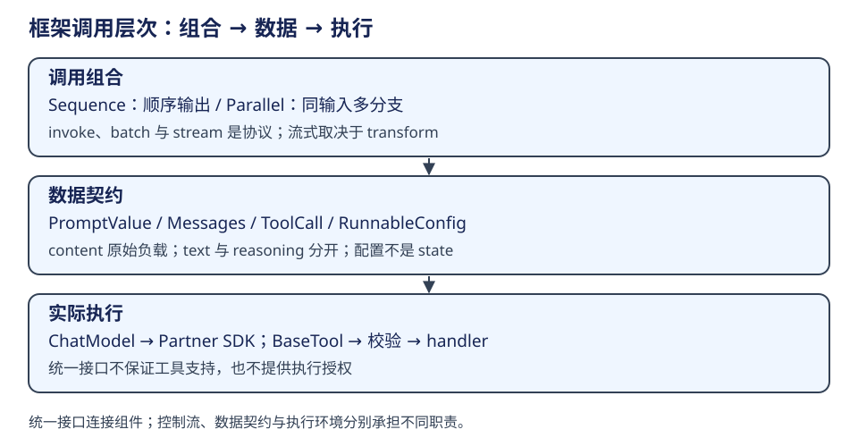

# LangChain / LangGraph：学习路线与常见误区

学习按调用协议、数据契约、检索、图执行、观察和集成推进。每一层都用具体输入检验输出，再追到决定结果的调用点。

| 阶段 | 要回答的问题 | 阅读入口 | 练习方向 |
|---|---|---|---|
| Runnable / LCEL | 谁拥有顺序？流式从哪里开始？ | [组件契约](components.md) | 改变输入形态；去掉 parser；插入缓冲步骤，观察输出类型与流式变化 |
| Messages / Model / Tool | 原始负载与标准视图区别？schema 谁验证？ | [消息与工具](components.md) | 对齐 tool_call_id；检查 text/reasoning；构造 schema 错误；比较模型能力 |
| Retrieval | 谁决定检索？文档来源是否保留？ | [RAG](retrieval.md) | 切块与索引；实现固定检索和工具检索；分别检查召回与回答 |
| Graph / Agent | 并发写如何合并？恢复会重跑哪里？ | [构图](architecture.md)、[状态边界](../langgraph/advanced.md) | 两节点图；并发 reducer；Command；middleware；子图与 interrupt |
| Observability | 谁传 parent_run_id？后端在哪层绑定？ | [回调与 tracing](observability.md) | 查看 trace 树、标签、回调继承；追应用侧注入 |
| Partner | 公共 invoke 最后进入哪个 SDK 分支？ | [Partner](observability.md) | 实现最小模型；补能力测试；追工具绑定、异步与错误处理 |

每阶段用四问自检：对象由谁构造，输入输出是什么，实际执行在哪里，失败或恢复边界是什么。完成一次练习时记录环境、输入、结果与源码位置，解释结果为何发生。

## 用一项任务逐层练习

第一轮只查询 CSV 规则：把问题交给 Retriever，将 Document 格式化为模型请求，检查输出与来源。此时练习的是值怎样跨组件传递，尚不需要模型自主决定工具。

第二轮把检索器包装成工具，再提供读取、修改和验证能力。提交相同任务，手工列出每次 AIMessage 的调用与对应 ToolMessage，解释下一模型请求为什么多了这些资料。若模型先查代码再查规则，也能沿同一反馈关系说明过程。

第三轮将“先规划、后执行、再检查是否完成”定义成外层 StateGraph。给 Planner、Executor 和 Replanner 写清输入输出，区分计划项与 Executor 内部工具调用。然后从一次超步的读视图、节点写入和合并结果解释路由。

第四轮沿同一调用观察回调树，再追到 Partner SDK。能解释“上层 Agent 图已启动、模型调用进入 provider、工具实际返回、任务验收完成”分别需要哪些证据，就把协议、运行、观察和业务效果联系起来了。表中的六阶段是这项练习的下钻入口，不要求同时引入全部组件。

## 容易混淆的机制

| 常见理解 | 实际机制 | 阅读依据 |
|---|---|---|
| RAG 总是固定检索，Agent 才能自主检索 | RAG 可以采用固定、Agentic 或混合控制 | [检索控制权](retrieval.md) |
| LastValue 在同一超步后写覆盖前写 | 同一超步收到多个值会拒绝 | [channel 合并](../langgraph/advanced.md) |
| Command 替代已有条件边 | 动态发送与状态更新不会自动删除现有边 | [Command 与控制流](../langgraph/advanced.md) |
| 每个 middleware 都是图节点 | 状态 hooks 编为节点，wrap hooks 组合调用 | [create_agent 构图](architecture.md) |
| 每个模型都支持 tools 和结构化输出 | 基类不保证绑定，能力由具体 Partner 提供 | [模型契约](components.md) |
| `.text` 能统一解决复杂消息读取 | 它只提取文本；reasoning、工具和其他块有独立结构 | [消息视图](components.md) |
| 存在 Retriever 就代表应用只用向量检索 | 检索组件、资料源和 Agent 控制流是不同层 | [检索链](retrieval.md)、[DeerFlow 能力](../../agents/deerflow/capabilities.md) |

练习之间可以复用组件，但不要复用未经确认的假设。例如从文本调用扩展到工具调用，需要重新检查模型能力和反馈格式；从串行图扩展到并行图，需要重新检查 reducer 和副作用重试条件。

源码定位：[LastValue.update](https://github.com/langchain-ai/langgraph/blob/bfcfea554ed5c7f7be562cebf8825e911b493ab1/libs/langgraph/langgraph/channels/last_value.py#L56)、[Command](https://github.com/langchain-ai/langgraph/blob/bfcfea554ed5c7f7be562cebf8825e911b493ab1/libs/langgraph/langgraph/types.py#L833)、[create_agent 构图](architecture.md)、[bind_tools 基类](https://github.com/langchain-ai/langchain/blob/34489d61433cbf5044a630de2e7797e361672900/libs/core/langchain_core/language_models/chat_models.py#L2366)。
