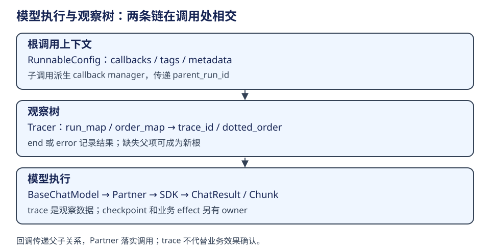

# LangChain：回调树、Partner 与集成验证

追踪树由各层调用传播回调上下文而形成，Partner 则把统一模型协议落实到厂商 SDK。这两条链在实际模型调用处相交；trace 记录调用，不是 checkpoint，也不保证业务效果成功。

| 对象 | 所属层 | 构造与消费 | 生命周期/权威范围 |
|---|---|---|---|
| RunnableConfig | 调用配置 | 调用根配置，子调用继承/patch | tags、metadata、callbacks、并发；不是业务 state |
| CallbackManager | 调用观察 | 组件 configure，生成 run manager 与 child context | start/end/error 事件；handler 可能有本地与可继承范围 |
| BaseTracer | callback handler | 维护 run_map/order_map，子类实现 _persist_run | 观察树，不能替代持久事务 |
| Partner | provider 集成 | init_chat_model 或应用工厂构造 BaseChatModel 子类 | 客户端、参数转换、响应归一、能力声明 |
| standard-tests | 集成质量契约 | 集成类继承测试基类并声明能力 | 有用例不代表此书执行过或厂商全部功能一致 |

## 回调主链路

最外层配置 callbacks/tags/metadata → 组件开始 run → 子组件使用 child callback manager → tracer 按 parent_run_id 查 order_map/run_map → 继承 trace_id 并扩展 dotted_order → end/error 时完成记录。dotted_order 用开始时间与 ID 构成层级排序键，不是提交顺序或因果持久水位。缺少父记录时实现会把该 run 视作根，不能声称所有散落调用都必然自动归树。

`_configure` 检查 tracing 上下文和启用配置；只有需要且还未挂 LangChainTracer 时才补 handler。CI 的 tags/metadata 桥接插件是测试会话内上下文，不是 SDK 读取任意环境变量的保证。

证据：[callback 配置与去重](https://github.com/langchain-ai/langchain/blob/34489d61433cbf5044a630de2e7797e361672900/libs/core/langchain_core/callbacks/manager.py#L2389)、[Tracer 父子与缺失父项](https://github.com/langchain-ai/langchain/blob/34489d61433cbf5044a630de2e7797e361672900/libs/core/langchain_core/tracers/core.py#L150)、[CI tracing 插件](https://github.com/langchain-ai/langchain/blob/34489d61433cbf5044a630de2e7797e361672900/libs/standard-tests/langchain_tests/_langsmith_plugin.py)。

## 模型实际执行点

create_agent 的 model 节点 → BaseChatModel.invoke/ainvoke → prompt/messages 归一与缓存/回调 → partner `_generate/_agenerate` 或流式路径。ChatOpenAI._generate 先构造 payload，再按 response_format、Responses API、Chat Completions 分支调用 SDK，并把响应封装为 ChatResult。因此公开 invoke 对应的 SDK 调用，需要按所选请求分支判断。

工具绑定与结构化输出各自有 provider 协议限制；最小继承 `_generate/_llm_type` 足以实现基础调用，但不是能接入全部 Agent 功能的证明。能力 metadata、usage、流式 chunk 合并、工具 schema、错误和异步均需针对集成检查。[OpenAI 实际请求分支](https://github.com/langchain-ai/langchain/blob/34489d61433cbf5044a630de2e7797e361672900/libs/partners/openai/langchain_openai/chat_models/base.py#L1927)、[工具绑定](https://github.com/langchain-ai/langchain/blob/34489d61433cbf5044a630de2e7797e361672900/libs/partners/openai/langchain_openai/chat_models/base.py#L2494)、[标准测试入口](https://github.com/langchain-ai/langchain/blob/34489d61433cbf5044a630de2e7797e361672900/libs/standard-tests/langchain_tests/unit_tests/chat_models.py#L277)。

## 与 DeerFlow 的组合

DeerFlow 按 `module:Class` 配置 resolve_class，检查是类且继承 BaseChatModel，然后加入产品参数、thinking/profile 与 tracing 配置。类能导入不代表 provider 权限、网络、模型能力都可用；“换厂商只改配置”只描述组合边界，不能承诺协议完全等价。

Tracing handler 应明确放在图调用根或模型层哪一处。DeerFlow 对已有根 tracing 的场景提供 attach_tracing 开关，避免重复 span；metadata 随 RunnableConfig 下传。Langfuse 与 LangSmith 可共享 callback 入口，但后端的发送、采样和保存协议不是同一个实现。

证据：[动态类解析](https://github.com/bytedance/deer-flow/blob/b842e06be19f04280a9e5e12f90da04d0c6f09a5/backend/packages/harness/deerflow/reflection/resolvers.py#L73)、[模型工厂](https://github.com/bytedance/deer-flow/blob/b842e06be19f04280a9e5e12f90da04d0c6f09a5/backend/packages/harness/deerflow/models/factory.py)、[tracing 构造](https://github.com/bytedance/deer-flow/blob/b842e06be19f04280a9e5e12f90da04d0c6f09a5/backend/packages/harness/deerflow/tracing/factory.py)。

## 学习练习的落点

学习 tracing 时，可以依次观察父子树、标签和跨链回调继承，再追 DeerFlow 如何注入调用上下文。学习 Partner 集成时，从公共 invoke 设置断点，追到 `_generate` 或流式路径，再用能力测试检查工具绑定、结构化输出与错误处理。两组练习分别关注观察关系和真实调用契约。