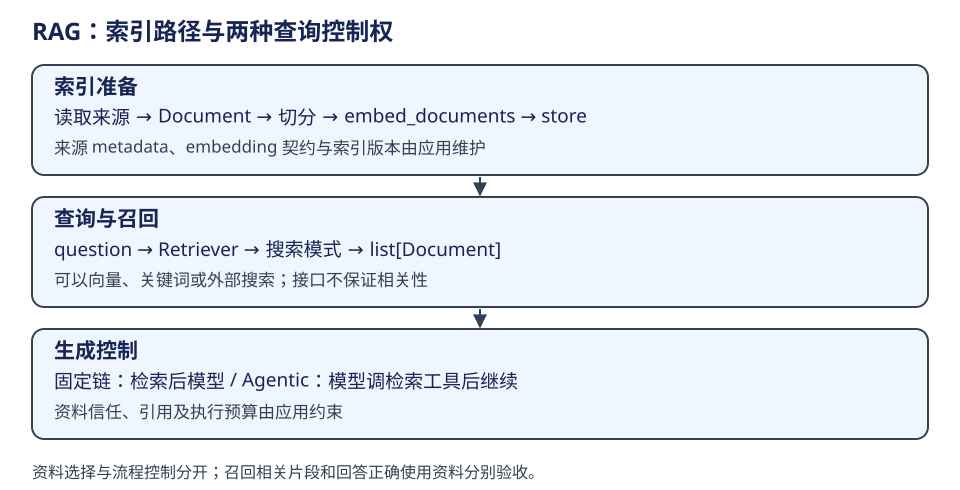

# LangChain：检索链与 Agentic RAG

RAG 是把外部资料选入模型上下文，既可由固定流程控制，也可由 Agent 调工具控制。它不必使用向量库，也不等于只检索一次；原稿把“RAG=写死检索、Agent=自主检索”对立起来过于窄。

| 概念 | 所属层与输入输出 | owner / 生命周期 |
|---|---|---|
| Document | 内容值：page_content + metadata | 读取/切分阶段生产；来源信息要随 chunk 保留 |
| TextSplitter | 建索引前把长文转为块 | 调用者决定切分规则；不是模型上下文预算管理器 |
| Embeddings | 文档批次或查询 → 向量 | embed_documents / embed_query 分开，允许两侧编码策略不同 |
| VectorStore | 文档和向量的存取/查询 | backend 管理索引；是否持久取决于具体实现 |
| Retriever | 查询 → list[Document] 的 Runnable | 可以包装向量、关键词、混合或外部搜索 |
| 生成 | 问题+检索片段 → AIMessage | 调用者决定引用、权限和资料信任边界 |

## 从建索引到回答

先加载文档并保留来源，再切分、embed_documents、写入索引。查询时由 embed_query 与 store 的搜索策略选择候选；`as_retriever` 返回 VectorStoreRetriever，按 similarity、阈值或 MMR 等模式调用 store。Retriever.invoke 建立 retriever 回调 run，然后调用 `_get_relevant_documents`，成功返回文档、失败发 error 回调并抛出。

同一 embedding 契约、索引版本和 metadata 过滤必须由应用约束；Runnable 不校验“这些片段是否属于当前用户”。召回和答案质量也没有由接口自动保证。证据：[Embeddings 双入口](https://github.com/langchain-ai/langchain/blob/34489d61433cbf5044a630de2e7797e361672900/libs/core/langchain_core/embeddings/embeddings.py)、[Retriever 调用与回调](https://github.com/langchain-ai/langchain/blob/34489d61433cbf5044a630de2e7797e361672900/libs/core/langchain_core/retrievers.py#L179)、[as_retriever 与模式](https://github.com/langchain-ai/langchain/blob/34489d61433cbf5044a630de2e7797e361672900/libs/core/langchain_core/vectorstores/base.py#L905)。

| 方案 | 谁决定检索时机 | 主链路与失败边界 | 适用取舍 |
|---|---|---|---|
| 固定两阶段 | 应用 | 问题 → 检索 → 组 prompt → 模型；检索失败由链向外传播 | 查询约束明确时容易控制步骤和成本 |
| Agentic | 模型提出调用，运行时执行 | 模型 → 检索工具 → ToolMessage → 下一轮；可能跳过或多次检索 | 开放研究更灵活，但需预算、工具权限与证据约束 |
| 混合 | 应用限定阶段，局部模型决策 | 先确定范围，再允许局部检索循环 | 控制确定性边界，同时保留局部探索 |

DeerFlow 的搜索工具可以提供检索资料，但一次网页搜索不自动拥有向量 RAG 的建索引/召回语义，也不能据旧材料推断整个当前产品“没有向量库”。与本书 [DeerFlow 能力层](../../agents/deerflow/capabilities.md) 的工具发现分开阅读。

## 最小学习与验证口径

教学链可表达为“Parallel 分别得到 context 与 question → Prompt → Model → Parser”；若 context 是 Document 列表，必须先明确格式化及来源保留，不能依赖隐式字符串化。Agentic 练习将同一 retriever 包成工具，再检查 call/result 配对以及模型是否实际使用结果。

原稿的切块、内存 store、两类 RAG 练习已转成上述学习问题，没有执行嵌入/模型/外部服务。后续实测需分别报告切分与索引是否成功、相关资料是否召回、答案是否引用正确；不能用“模型有回复”替代三项结果。
