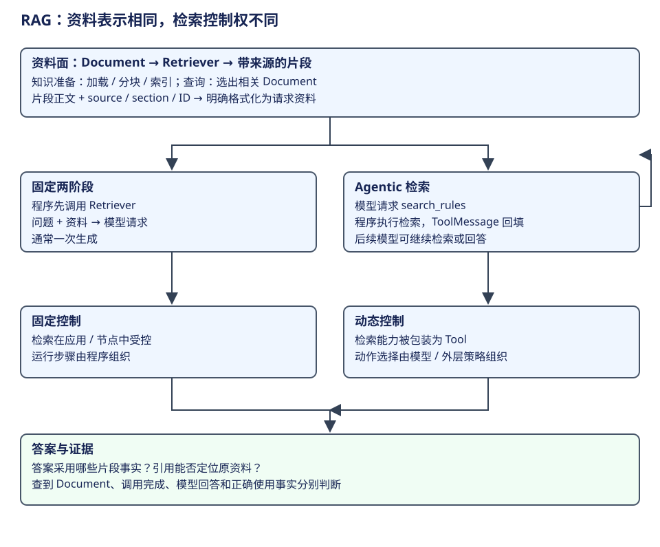

# LangChain：检索链与 Agentic RAG

RAG 解决的是**模型如何获得当前任务需要的外部资料**。它将检索结果组织为请求上下文，再生成答案；不改模型权重，也不必采用向量库。Agentic RAG 则把检索时机及查询选择交给模型或局部 Agent 策略，检索器与资料表示仍可以复用。

本章继续使用 CSV 修复任务。先确定要找的知识，再把 Document 逐步变成有来源的模型输入；最后比较固定链和 Agent 工具两种控制方式。RAG 在[共同架构](../../comparisons/common-model.md)中承担资料获取与请求装配；固定链和 Agent 工具分别决定何时调用这项能力。



## 第一步：确定需要哪些资料

用户要求修复导出程序，但项目可能有自己的规范：字段包含哪些字符时需要引号、怎样处理内部引号、换行是否保留。模型的通用知识未必等于这个项目的约定。应用因此需要读取并选择相关资料，把它们交给当前请求。

这个需求可以通过直接读文件、关键词搜索、向量搜索或组合检索满足。RAG 描述“借助外部资料生成”的模式，VectorStore 描述一种存取与搜索组件。将两者等同，会让一个简单的规则查询无端引入完整索引系统，也会误把所有网页搜索都称为同一套向量召回。

先回答两项问题：资料从哪里来，以及谁决定何时获取。前者决定检索器及数据准备，后者决定固定流程或动态工具调用。两项决定可以独立变化。

## 第二步：保存正文与来源

假设我们读取到项目的三条规则。下面是教学数据，不是某个公开 CSV 标准的全文；metadata 字段由应用定义，Document 不替应用指定命名。

```python
Document(
    id="rule-1",
    page_content="字段包含逗号、双引号或换行时，用双引号包住整个字段。",
    metadata={"source": "docs/csv-rules.md", "section": "2.1"},
)
Document(
    id="rule-2",
    page_content="字段内的一个双引号写成两个双引号。",
    metadata={"source": "docs/csv-rules.md", "section": "2.2"},
)
Document(
    id="rule-3",
    page_content="回归验证至少包含逗号、双引号和换行三类字段。",
    metadata={"source": "docs/export-tests.md", "section": "examples"},
)
```

page_content 是模型可能需要阅读的正文；metadata 与 id 帮助应用保留来源和定位。后面如果再切成块，来源仍应跟着相应内容，而不能只剩一组孤立字符串。[Document 的内容与 metadata](https://github.com/langchain-ai/langchain/blob/34489d61433cbf5044a630de2e7797e361672900/libs/core/langchain_core/documents/base.py#L288)。

### 分块解决的是检索粒度

长文档常同时讨论导出、编码、部署和 UI。把整篇文档都当作一个检索单元，可能把大量无关内容带入请求；切得过细，又可能只留下“写成两个”而丢掉前面的“字段内双引号”。分块需要让一块内容既容易被找到，又能独立解释必要语义。

TextSplitter 负责这种数据准备。它不负责选择这一次模型还应保留哪些聊天消息，也不自动建立权限边界。项目可以按章节、自然段或自己的结构分块；具体策略应根据资料和检索任务验证，不能把某个固定 chunk 数值当成所有 Agent 的标准。

## 第三步：准备索引，并在任务中查询


如果采用向量检索，准备阶段会将 Document 正文交给 embed_documents，得到文档向量并写入 VectorStore；查询阶段将用户查询交给 embed_query，再按搜索策略取出 Document。两项方法分开，允许模型或后端对文档与查询采用不同编码方式。

| 阶段 | 输入与输出 | 为什么分开 |
|---|---|---|
| 资料加载 | 文件或外部内容 → Document | 保存正文和来源 |
| 资料分块 | 长 Document → 小 Document | 确定检索的语义粒度 |
| 文档编码与写入 | 内容批次 → 向量／索引记录 | 可以在查询之前准备和增量更新 |
| 查询编码与搜索 | 查询 → 候选 Document | 当前问题可能每次不同 |
| 请求装配 | 问题 + 所选资料 → 模型输入 | 选择的资料还需要格式与角色 |
| 生成与解释 | 模型输出 → 答案及来源关系 | 检索完成不等于答案已正确使用资料 |

应用还要对齐编码方式、索引内容版本和查询范围。向量维度或检索接口匹配，只证明数据可以进入对应计算，不证明问题会召回正确资料。[Embeddings 双入口](https://github.com/langchain-ai/langchain/blob/34489d61433cbf5044a630de2e7797e361672900/libs/core/langchain_core/embeddings/embeddings.py)。

### Retriever 为什么是另一层

Retriever 的共用契约是“查询进来，list[Document] 出去”。它可以包装向量、关键词、混合搜索或外部服务，调用者无需因为搜索方式变化就改写答案生成流程。

VectorStore.as_retriever 创建 VectorStoreRetriever；其搜索方式可以是 similarity、带阈值的相似度或 MMR 等。BaseRetriever.invoke 管理调用配置与 retriever 回调，再进入具体 `_get_relevant_documents`。返回值仍是资料列表，不是已经组织好的模型消息。[Retriever 执行点](https://github.com/langchain-ai/langchain/blob/34489d61433cbf5044a630de2e7797e361672900/libs/core/langchain_core/retrievers.py#L179)、[VectorStoreRetriever 的搜索分派](https://github.com/langchain-ai/langchain/blob/34489d61433cbf5044a630de2e7797e361672900/libs/core/langchain_core/vectorstores/base.py#L1046)。

检索接口还承担观察边界。以下节选 `BaseRetriever.invoke` 的 handler 与返回路径，省略配置准备和错误分支：

```python
kwargs_ = kwargs if self._expects_other_args else {}
if self._new_arg_supported:
    result = self._get_relevant_documents(input, run_manager=run_manager, **kwargs_)
else:
    result = self._get_relevant_documents(input, **kwargs_)
run_manager.on_retriever_end(result)
return result
```

具体检索器输出 Document；回调报告这次检索；下一层格式化代码接收 result。三个角色各有输出，检索器无需先知道最终模型请求的文本模板。[查看检索分派与成功、错误回调](https://github.com/langchain-ai/langchain/blob/34489d61433cbf5044a630de2e7797e361672900/libs/core/langchain_core/retrievers.py#L179)。

## 第四步：将 Document 组织为请求上下文

设查询为“CSV 的逗号、引号和换行怎样转义”，Retriever 返回上述三份 Document。直接调用 str(docs) 虽然能得到字符串，却把关键的生成契约藏在对象输出格式里。应用应明确决定怎样展示正文、来源和引用标识。

以下格式化函数是本章自己的教学约定，使用 `[R1]` 等临时引用标识，并保留到原始位置的映射：

```python
def format_documents(docs):
    sections = []
    references = {}
    for index, doc in enumerate(docs, start=1):
        ref = f"R{index}"
        references[ref] = {
            "id": doc.id,
            "source": doc.metadata["source"],
            "section": doc.metadata["section"],
        }
        location = f"{references[ref]['source']}#{references[ref]['section']}"
        sections.append(f"[{ref}] {location}\n{doc.page_content}")
    return "\n\n".join(sections), references
```

这段函数的输入是 list[Document]，输出包含两份资料：一份给模型阅读的 context 文本，一份给调用者定位来源的 references。它不执行检索，也不假定资料正文能够给执行器授权。

得到的 context 例如：

```text
[R1] docs/csv-rules.md#2.1
字段包含逗号、双引号或换行时，用双引号包住整个字段。

[R2] docs/csv-rules.md#2.2
字段内的一个双引号写成两个双引号。

[R3] docs/export-tests.md#examples
回归验证至少包含逗号、双引号和换行三类字段。
```

角色、标签和来源让资料更容易解释，但它们不会自动提供安全隔离。程序的执行政策仍须放在工具或效果路径；模型的引用是否正确，还需要结合正文判断。

## 路线一：由程序安排检索与生成

固定路线由程序安排查询与生成。它不要求模型先决定“该不该搜索”，适合这一阶段确定需要依据项目规范的场景。

下面假定 retriever 和 model 已由调用者构造；代码表达资料交接，不包含供应商配置或实际模型实验：

```python
docs = retriever.invoke(question)
context, references = format_documents(docs)
request = [
    SystemMessage(content="依据提供的项目资料回答，区分资料事实和推断，标出引用。"),
    HumanMessage(content=f"问题：{question}\n\n项目资料：\n{context}"),
]
answer = model.invoke(request)
```

程序在请求模型之前已得到资料，因此这条简单路线通常包含一次检索和一次生成。这里的 model 可以由 LangChain 的模型接口提供；流程可以写成普通代码、LCEL 或图节点，不必因为使用 Runnable 就增加独立 Agent loop。

对于 CSV 案例，预期答案可以解释：“包含逗号、双引号或换行的字段需要整体加引号 [R1]；内部双引号翻倍 [R2]；验证应覆盖三类特殊字段 [R3]。”这些答案句子各有支持事实，并不是仅把三个引用标识附在任意生成文字后面。

如果用户只问规则，这条路线已足以回答。如果目标还包含修改和运行验证，RAG 只完成了**资料获取**这一段；后续要把规则与代码观察交给工作执行器，继续动作与验证。不能将“生成了带引用的建议”当作文件已经修复。

## 路线二：由模型请求检索工具

动态路线复用 Retriever，但在外面提供一个模型可调用的工具。工具接受查询，调用 retriever，然后把格式化资料返回。比如应用工具名为 search_rules；模型可见的输入只有 query，而检索器、来源存储与权限范围由宿主绑定。

```python
# 教学应用定义的工具 handler；retriever 由宿主绑定。
def search_rules(query):
    docs = retriever.invoke(query)
    context, references = format_documents(docs)
    return {"context": context, "references": references}
```

真实工具包装还要决定输出序列化和结果消息。本例下一步按 JSON 内容展示结果；也可以用内容／artifact 分开保留资料，见[工具契约](components.md)。

模型的第一轮可能先请求：

```json
{
  "name": "search_rules",
  "args": {"query": "CSV 逗号、双引号、换行字段的规则和回归验证"},
  "id": "search-1",
  "type": "tool_call"
}
```

运行时执行 handler，返回与 search-1 配对的 ToolMessage。ToolMessage 的 content 包含上述 context 和 references 的序列化表示；工具执行资料随后进入 messages state，再由下一模型节点读取。

| 轮次 | 模型看到什么 | 动作与反馈 |
|---|---|---|
| 第一次 | 用户修复目标与工具定义 | 选择查询规则或先读取代码 |
| 搜索结果回填 | 原目标、search-1、带来源资料 | 解释规则，或继续查遗漏条件 |
| 获取代码后 | 规则与当前实现同时可用 | 形成具体修改，而不只复述规则 |
| 修改与验证后 | 规则、动作、工具观察 | 结合验证事实说明结果 |

模型可以多次检索，也可能在某个请求中直接回答；应用也可以通过外层策略要求先检索。这些选择影响控制权，不改变 Document、格式化和来源保留的基本关系。Agentic 不表示检索器自己变成了一个会思考的 Agent。

如果这次任务只问规则，动态路线可能需要“先生成工具调用、执行检索、再生成回答”两次模型请求。固定路线可省掉决定搜索的模型请求；若问题需要不断揭示新条件，动态路线又能依据观察改变查询。这里解释的是控制步骤，不是对延迟或准确率的实测排名。

## 将两条路线放回共同架构

固定 RAG 把资料获取放在程序或节点的确定步骤，Agentic 把同一能力暴露成工具，让模型参与时机和查询选择。两者都需要将检索内容组织成模型可以解释的资料，再把生成结果与证据联系起来。

| 职责 | 固定 RAG | Agentic RAG |
|---|---|---|
| 接纳目标 | 应用取得 question | Agent 宿主取得用户目标 |
| 获取资料 | 程序直接调 Retriever | 模型请求检索工具，程序执行 Retriever |
| 装配请求 | format 后与问题一起进入请求 | ToolMessage 回填后进入下一请求 |
| 决策与继续 | 外层代码定义顺序 | 模型反馈与程序控制配合 |
| 结果解释 | 回答与 references | 回答、工具轨迹及 references |

这解释了组件之间的互补：LangChain 提供协议和组合能力，LangGraph 可以组织需要显式状态的工作，应用决定是否把检索作为工具，以及资料范围、执行目标和验收。RAG 不需要取代这些层，也不能代替它们。

DeerFlow 的网页搜索、项目文件读取和技能知识可以提供任务资料，但它们各有来源和请求装配方式。不能因都返回自然语言，就把网页索引、向量库、工具发现和 Skill 加载视为同一个组件。[DeerFlow 能力层](../../agents/deerflow/capabilities.md)。

## 检查资料、回答和实际动作

最小验证不是只观察“Agent 有回复”。在本案例中，至少要分别解释三段事实：

| 检查面 | 足够具体的问题 | 只看最后一句会漏掉什么 |
|---|---|---|
| 检索 | 三类规则是否在返回 Document 中，来源是否保留？ | 没查到资料却生成了看似熟悉的答案 |
| 生成 | 答案中的具体规则是否由相应片段支持？ | 找到了正确资料，但回答混入另一套约定 |
| 任务效果 | 修改和验证是否实际发生，结果是什么？ | 带引用的方案被误称为完成实现 |

引用标识能帮助检查，但不能自行证明答案真实。检索质量、生成利用质量和工具效果分别需要证据；接口可以记录资料和执行轨迹，最终判断仍依赖明确的任务要求。

## 演算与参考解答

**问题一。** Retriever 返回 rule-1/2/3，为什么 model 不能直接把 Document 对象当作最终答案？

解答：Document 是资料容器；还需要问题、资料格式和回答契约。答案要解释任务所问的规则，references 才能让读者定位具体支持资料。检索结果不是已经完成的业务回复。

**问题二。** 固定路线和动态路线使用同一份检索结果，哪项能力发生了变化？

解答：变化的是检索控制与反馈路径。固定路线由程序先查询，动态路线由模型提出动作并经工具结果回填。Retriever 与 Document 可以相同，不必因此建立第二份知识系统。

**问题三。** 模型查询后只拿到规则，回答“修复已完成”。目前能确认什么？

解答：至多确认检索工具返回了规则；还没有代码读取、实际修改和验证事实。检索增强回答不能代替执行闭环。

**问题四。** 为什么把来源只放在后端数据库里、不传给请求和结果消费者，可能影响教学案例？

解答：模型难以形成可定位的引用，调用者也难以把答案句子追到具体条目。需要把资料正文转换成请求上下文，同时保留引用标识到原始位置的映射。

**问题五。** 检索是否一定需要 embeddings？

解答：不一定。Retriever 的共用契约允许其他搜索方式；是否用向量取决于资料和查询需求。把 VectorStore 与 RAG 分开，才能按问题选择组件。
