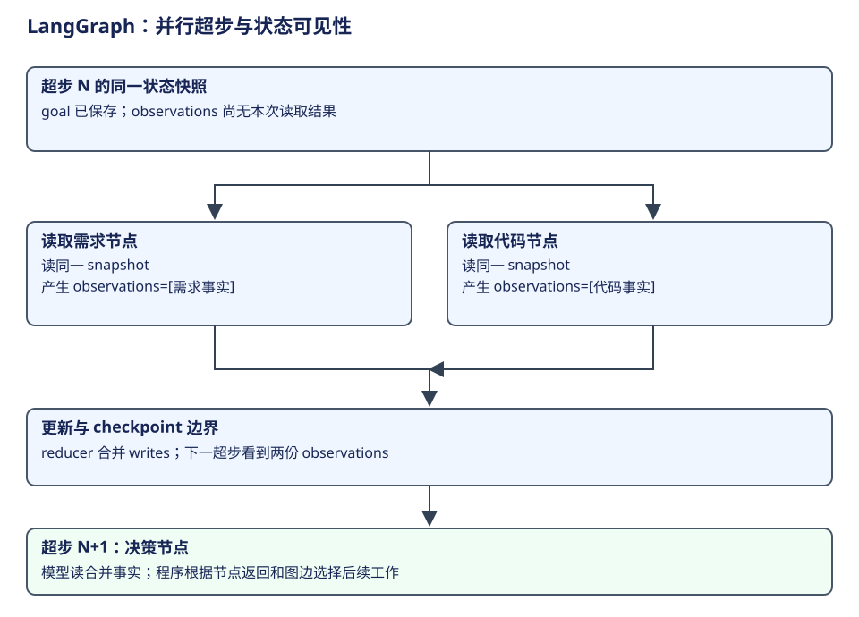

# LangGraph：超步、通道、checkpoint 与恢复

LangGraph 负责把图定义变成可执行的状态计算。StateGraph 是构图器，CompiledStateGraph 是运行门面，PregelLoop 是一次调用的驱动状态。持久 thread 按配置寻址，不对应唯一图对象；多次调用可以使用同一 thread，也可以从一个 checkpoint 创建分支。


## 概念与层次

| 概念 | 所属层与含义 | 创建者 / 生命周期 | 状态边界 |
|---|---|---|---|
| StateGraph / schema / reducer | 定义节点、边和字段合并规则 | 应用构造，compile 前编辑 | 定义本身不执行 |
| CompiledStateGraph / Pregel | 可调用图及运行配置 | compile 输出，应用可复用 | 不是一次 run 的全部可变状态 |
| PregelLoop | 一次 stream/astream 的驱动状态 | 每次调用创建并关闭 | channels、任务、step、checkpoint 等活动视图 |
| channel / versions_seen | 字段值容器 / 节点已见版本 | 从 schema 与 checkpoint 初始化 | 决定读写、合并和调度 |
| superstep | 共享稳定读视图的一批计算步骤 | loop.tick / runner 驱动 | 更新在下一超步才可见 |
| task / pending writes | 节点执行单元 / 尚待整体合并的输出 | 调度器选择与记录 | 已完成节点输出可用于恢复 |
| checkpointer / checkpoint | 保存后端 / 一份恢复快照 | 应用注入，loop 写入 | thread_id + checkpoint_ns + id 寻址 |
| store / Runtime.context | 跨调用数据 / 本次注入环境 | 应用提供 | 不等于 channel_values |
| interrupt / Command | 暂停并向宿主求值 / 状态与控制更新 | 节点产生；宿主提交 resume | 恢复重跑节点，不恢复 Python 栈 |

依据：[compile](https://github.com/langchain-ai/langgraph/blob/bfcfea554ed5c7f7be562cebf8825e911b493ab1/libs/langgraph/langgraph/graph/state.py#L1177)、[Loop](https://github.com/langchain-ai/langgraph/blob/bfcfea554ed5c7f7be562cebf8825e911b493ab1/libs/langgraph/langgraph/pregel/_loop.py#L163)、[checkpoint schema](https://github.com/langchain-ai/langgraph/blob/bfcfea554ed5c7f7be562cebf8825e911b493ab1/libs/checkpoint/langgraph/checkpoint/base/__init__.py#L95)。

## 一次调用与提交

| 当前位置 | 调用链 | 读写 / 返回 |
|---|---|---|
| 构图 | StateGraph.compile | 校验图并绑定 channels、checkpointer、store 等 |
| 调用 | Pregel.astream → AsyncPregelLoop | 从 config 与 checkpoint 建立一次运行 |
| 选任务 | loop.tick → prepare_next_tasks | 按通道版本、触发和恢复资料决定节点 |
| 执行 | runner.atick | 并行/重试受节点策略控制；产生 task writes |
| 观察 | stream 的 messages/updates/values/custom 等 | 每种事件描述不同层，不能统一叫 checkpoint |
| 合并 | loop.after_tick | 应用写入到 channels，形成下一超步状态 |
| 持久 | checkpointer 的 writes 与 put | sync 模式等待 checkpoint future 后继续 |

依据：[异步执行主线](https://github.com/langchain-ai/langgraph/blob/bfcfea554ed5c7f7be562cebf8825e911b493ab1/libs/langgraph/langgraph/pregel/main.py#L3426)、[超步与 sync 等待](https://github.com/langchain-ai/langgraph/blob/bfcfea554ed5c7f7be562cebf8825e911b493ab1/libs/langgraph/langgraph/pregel/main.py#L3504)、[任务选择](https://github.com/langchain-ai/langgraph/blob/bfcfea554ed5c7f7be562cebf8825e911b493ab1/libs/langgraph/langgraph/pregel/_loop.py#L623)。同一超步内节点读稳定通道值；一个节点完成不表示同行节点立刻读到它的更新。

## 超步：先用一个并行读取例子理解



假设应用定义三个节点：读取需求、读取代码、根据两份结果决定修改。前两个可以在同一个超步执行。它们读到的是该超步开始时的稳定状态；读代码节点不会因为读需求节点先完成，就在本次调用中自动看到它的新输出。

每个节点返回 writes，runner 管理这批任务。超步结束后，loop.after_tick 将 writes 按 channel 规则合并；下一超步的决策节点才读取合并后的状态。这个边界让并发读取的含义明确，不依赖哪个网络请求先返回。[超步不可变读视图](https://github.com/langchain-ai/langgraph/blob/bfcfea554ed5c7f7be562cebf8825e911b493ab1/libs/langgraph/langgraph/pregel/main.py#L3504)。

下面是应用状态的教学定义。节点名及字段来自案例，非 LangGraph 内置业务字段；伪代码只表达 schema 与 reducer 的分工：

```python
class WorkState(TypedDict):
    request: str
    observations: Annotated[list[str], operator.add]
    decision: str
```

初始状态的 observations 为空；需求节点返回 `["字段可能包含逗号、引号、换行"]`，代码节点返回 `["当前直接连接字段"]`。因为 observations 声明了列表合并规则，下一状态可以同时保留两份观察。若两个并行节点写同一个无合并规则的单值字段，就不能靠“最后完成的一方”默默决定业务结果。

| 时点 | 可读状态 | 新产生的资料 | 谁可以看到 |
|---|---|---|---|
| 超步 N 开始 | request、旧 observations | 尚无本步写入 | 两个读取节点共享稳定起点 |
| 节点 A 完成 | 仍是 S_N | 需求观察 writes | 流可以报告更新，同行节点读视图不变 |
| 节点 B 完成 | 仍是 S_N | 代码观察 writes | 同上 |
| after_tick 合并 | 形成 S_N+1 | reducer 应用两份写入 | 后续超步读取新值 |
| 超步 N+1 | 两份观察都可用 | decision 节点产出行动 | 再按图边推进 |

这个“超步”是执行框架概念，既不是一次用户输入，也不必等于一次模型请求。一个模型循环可以跨多个超步，多个非模型节点也可以处于同一超步。[任务选择 tick](https://github.com/langchain-ai/langgraph/blob/bfcfea554ed5c7f7be562cebf8825e911b493ab1/libs/langgraph/langgraph/pregel/_loop.py#L623)。

## 状态图怎样表达动态模型选择

StateGraph 注册节点与边；compile 后运行才开始计算。节点可以是程序、工具或模型，也可以调用一个子图。应用定义条件边，根据节点产出的状态选择下一节点；Command 可以结合状态更新与控制。这些机制提供路由能力，业务语义仍来自应用。

如果 decision 节点调用模型，并把结果解析为“继续读取／修改／结束”，图就能表达动态策略；如果应用写死“读取→转换→测试”，就是固定流程；如果连接 plan、execute、replan，则是显式规划执行。框架不会因节点叫 plan 就验证它形成了有效计划，也不会替应用决定哪个结果足以交付。

在 LangChain create_agent 的模型／工具图中，条件路由主要处理 tool_calls 与返回结果。学习两套代码时，先把 LangChain 视为图的生产者，再把 LangGraph 视为状态推进者，避免将它们理解为两套串联的 Agent loop。

## 把超步结果交给一条可预测的路由

前面的并行读取例子说明了状态合并，现在把合并结果接到实际走向。本例所有字段与节点均为教学应用定义；模型节点的返回先按应用契约转换成有限的控制字段，图并不直接从任意自然语言句子猜路由。

```python
S_N = {"request": "修复 CSV 转义", "observations": [], "decision": ""}
A = {"observations": ["项目要求特殊字段加引号"]}
B = {"observations": ["当前代码直接拼接字段"]}
# After merging the two writes, show A/B in this teaching order:
S_next = {
    "request": "修复 CSV 转义",
    "observations": A["observations"] + B["observations"],
    "decision": "",
}
```

这里展示的列表次序用于演算，不从网络完成先后推定一般合并次序。共同事实是两份观察都进入下一超步。随后 decision 节点读取 S_next，调用模型或确定程序，再输出本例定义的 decision="modify" 或 "done"。

应用给出明确映射：

```python
def route_decision(state):
    return state["decision"]

builder.add_edge(["read_rules", "read_code"], "decide")
builder.add_conditional_edges(
    "decide", route_decision,
    {"modify": "edit", "done": END},
)
```

列表形式的边用于本例的汇合：两个读取节点完成后再进入 decide；条件映射说明 decide 的返回怎样决定 edit 或 END。节点函数、模型输出解析和工具效果未在这段构图节选里实现，不能把它当作完整可运行程序。[StateGraph 的边与构图](https://github.com/langchain-ai/langgraph/blob/bfcfea554ed5c7f7be562cebf8825e911b493ab1/libs/langgraph/langgraph/graph/state.py)。

正常任务有两种可解释的走向。若观察表明当前实现需要修改，decision=modify 选择 edit；若该任务已经有满足目标的结果，decision=done 选择 END。程序提前规定了可到达节点，具体决定由应用的 decision 实现根据当前事实作出。**图的固定结构不等于任务必须按一条固定路线执行。**

LangChain 的 create_agent 为标准工具循环生成另一份具体路由：它主要检查 AIMessage 的待处理工具调用与结构化结果。两者同样使用图执行机制，决策字段与消费者却不同。学完通用状态和路由，再分别读工厂源码，才不会把框架运行能力和特定 Agent 策略混在一起。

**演算。** 两个读取节点都已完成，observations 不为空，是否能直接知道下一步会修改？

参考解答：不能。还要知道 decision 节点怎样使用观察、产生什么字段，以及条件边怎样映射。合并结果提供决定的输入，不会仅因为“数据已经非空”就自动选择一个业务动作。


## checkpoint 为什么需要值与版本

checkpoint 不只是保存一个 messages 数组。channel_values 让运行重建数据，channel_versions 与 versions_seen 帮助判断哪些节点已经消费哪些更新，pending writes 保存已经产生的节点输出。图对象保存定义，checkpoint 保存恢复资料，PregelLoop 在一次调用中将二者结合。

例如，一个超步中需求节点成功、代码节点失败，已经保存的 pending writes 可以让恢复区分“已经有结果”和“仍需执行”。这不同于恢复 Python 栈；节点 interrupt 后恢复同样可能从节点开头重跑。副作用的幂等和保存时机因此属于应用设计，而非 checkpoint 字段自动解决。

学习自检：同一超步的节点为何不能立即读取同行输出？自然语言观察与 reducer 的职责各是什么？从 checkpoint 恢复时，程序凭什么知道下一批可执行任务，而不只看状态字段是否非空？

## 状态 schema 与持久单元

| 字段 / 资料 | 含义 | 使用者 |
|---|---|---|
| channel_values | 各 channel 的序列化快照 | 恢复状态；不只 messages |
| channel_versions | 通道当前版本 | 触发与下个任务选择 |
| versions_seen | 节点已处理的通道版本 | 避免仅凭节点名无条件再跑 |
| checkpoint metadata | input/loop/update/fork 来源、step、parents 等 | 追溯与恢复 |
| pending_writes | 某 checkpoint 下已产生的任务输出 | 整个超步尚未全部成功时保留进度 |
| checkpoint_ns / id | 子图命名空间及具体恢复点 | 多层图与历史寻址 |

messages 若使用 add_messages reducer，会有 ID 替换/删除等语义；不能将所有 channel 都看作 append-only list。Overwrite、DeltaChannel 等又有额外替换和稀疏历史规则，本章先定位，[进阶章](advanced.md)再解释合并与恢复边界。依据：[checkpoint 类型](https://github.com/langchain-ai/langgraph/blob/bfcfea554ed5c7f7be562cebf8825e911b493ab1/libs/checkpoint/langgraph/checkpoint/base/__init__.py)、[消息 reducer](https://github.com/langchain-ai/langgraph/blob/bfcfea554ed5c7f7be562cebf8825e911b493ab1/libs/langgraph/langgraph/graph/message.py)。

## 同一个故障案例：节点发请求后暂停或崩溃

| 位置 / 条件 | 恢复行为 | 应用责任 |
|---|---|---|
| 节点 interrupt(value) | GraphInterrupt；宿主用 Command(resume=...) | 提供有效 resume 值并保留寻址 config |
| resume 同一个 interrupt | 从节点开头重跑；按该 task 内调用次序取 resume 值 | interrupt 前的副作用要幂等或拆成独立步骤 |
| 超步部分任务成功 | 已保存 pending writes 可参与后续恢复 | 后端是否真正保存成功与运行日志分别确认 |
| 工具效果成功但结果未耐久 | 图快照不能原子覆盖外部系统 | 幂等键、效果查询或未知结果处理 |
| durability 为 async/exit | 写入等待时机与 sync 不同 | 不用“启用 checkpoint”推定每个步骤同步耐久 |
| 没配置合适后端 | 图可运行；恢复保证受限 | 明确 checkpointer 是否存在以及其存储契约 |

依据：[interrupt 实现与契约](https://github.com/langchain-ai/langgraph/blob/bfcfea554ed5c7f7be562cebf8825e911b493ab1/libs/langgraph/langgraph/types.py#L903)、[pending writes 与提交排序](https://github.com/langchain-ai/langgraph/blob/bfcfea554ed5c7f7be562cebf8825e911b493ab1/libs/langgraph/langgraph/pregel/_loop.py#L203)。取消与异常也会进入运行收口，具体耐久边界由 saver 和持久模式决定。

## 取舍与独有内容

显式 graph/channel 能表达多节点状态与恢复点，代价是 reducer、task 重跑和存储寻址必须成为应用契约。它提供运行机制，不自动替应用决定 prompt、工具授权或长期记忆。create_agent 负责生产模型与工具图，middleware 与子 Agent 的产品策略由上层定义；本分册研究超步、通道、checkpoint、Command 和 interrupt 如何推进这些定义。
