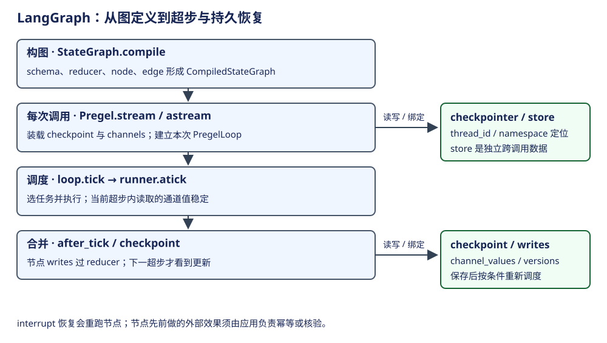

# LangGraph：超步、通道、checkpoint 与恢复

LangGraph 负责把图定义变成可执行的状态计算。StateGraph 是构图器，CompiledStateGraph 是运行门面，PregelLoop 是一次调用的驱动状态。持久 thread 按配置寻址，不对应唯一图对象；多次调用可以使用同一 thread，也可以从一个 checkpoint 创建分支。

## 概念与层次

| 概念 | 所属层与含义 | 创建者 / 生命周期 | 状态边界 |
|---|---|---|---|
| StateGraph / schema / reducer | 定义节点、边和字段合并规则 | 应用构造，compile 前编辑 | 定义本身不执行 |
| CompiledStateGraph / Pregel | 可调用图及运行配置 | compile 输出，应用可复用 | 不是一次 run 的全部可变状态 |
| PregelLoop | 一次 stream/astream 的驱动状态 | 每次调用创建并关闭 | channels、任务、step、checkpoint 等活动视图 |
| channel / versions_seen | 字段值容器 / 节点已见版本 | 从 schema 与 checkpoint 初始化 | 决定读写、合并和调度 |
| superstep | 共享稳定读视图的一批计算步骤 | loop.tick / runner 驱动 | 更新在下一超步才可见 |
| task / pending writes | 节点执行单元 / 尚待整体合并的输出 | 调度器选择与记录 | 已完成节点输出可用于恢复 |
| checkpointer / checkpoint | 保存后端 / 一份恢复快照 | 应用注入，loop 写入 | thread_id + checkpoint_ns + id 寻址 |
| store / Runtime.context | 跨调用数据 / 本次注入环境 | 应用提供 | 不等于 channel_values |
| interrupt / Command | 暂停并向宿主求值 / 状态与控制更新 | 节点产生；宿主提交 resume | 恢复重跑节点，不恢复 Python 栈 |

依据：[compile](https://github.com/langchain-ai/langgraph/blob/bfcfea554ed5c7f7be562cebf8825e911b493ab1/libs/langgraph/langgraph/graph/state.py#L1177)、[Loop](https://github.com/langchain-ai/langgraph/blob/bfcfea554ed5c7f7be562cebf8825e911b493ab1/libs/langgraph/langgraph/pregel/_loop.py#L163)、[checkpoint schema](https://github.com/langchain-ai/langgraph/blob/bfcfea554ed5c7f7be562cebf8825e911b493ab1/libs/checkpoint/langgraph/checkpoint/base/__init__.py#L95)。

## 一次调用与提交

| 当前位置 | 调用链 | 读写 / 返回 |
|---|---|---|
| 构图 | StateGraph.compile | 校验图并绑定 channels、checkpointer、store 等 |
| 调用 | Pregel.astream → AsyncPregelLoop | 从 config 与 checkpoint 建立一次运行 |
| 选任务 | loop.tick → prepare_next_tasks | 按通道版本、触发和恢复资料决定节点 |
| 执行 | runner.atick | 并行/重试受节点策略控制；产生 task writes |
| 观察 | stream 的 messages/updates/values/custom 等 | 每种事件描述不同层，不能统一叫 checkpoint |
| 合并 | loop.after_tick | 应用写入到 channels，形成下一超步状态 |
| 持久 | checkpointer 的 writes 与 put | sync 模式等待 checkpoint future 后继续 |

依据：[异步执行主线](https://github.com/langchain-ai/langgraph/blob/bfcfea554ed5c7f7be562cebf8825e911b493ab1/libs/langgraph/langgraph/pregel/main.py#L3426)、[超步与 sync 等待](https://github.com/langchain-ai/langgraph/blob/bfcfea554ed5c7f7be562cebf8825e911b493ab1/libs/langgraph/langgraph/pregel/main.py#L3504)、[任务选择](https://github.com/langchain-ai/langgraph/blob/bfcfea554ed5c7f7be562cebf8825e911b493ab1/libs/langgraph/langgraph/pregel/_loop.py#L623)。同一超步内节点读稳定通道值；一个节点完成不表示同行节点立刻读到它的更新。

## 状态 schema 与持久单元

| 字段 / 资料 | 含义 | 使用者 |
|---|---|---|
| channel_values | 各 channel 的序列化快照 | 恢复状态；不只 messages |
| channel_versions | 通道当前版本 | 触发与下个任务选择 |
| versions_seen | 节点已处理的通道版本 | 避免仅凭节点名无条件再跑 |
| checkpoint metadata | input/loop/update/fork 来源、step、parents 等 | 追溯与恢复 |
| pending_writes | 某 checkpoint 下已产生的任务输出 | 整个超步尚未全部成功时保留进度 |
| checkpoint_ns / id | 子图命名空间及具体恢复点 | 多层图与历史寻址 |

messages 若使用 add_messages reducer，会有 ID 替换/删除等语义；不能将所有 channel 都看作 append-only list。Overwrite、DeltaChannel 等又有额外替换和稀疏历史规则，本章仅定位，完整兼容/分支语义尚未核验。依据：[checkpoint 类型](https://github.com/langchain-ai/langgraph/blob/bfcfea554ed5c7f7be562cebf8825e911b493ab1/libs/checkpoint/langgraph/checkpoint/base/__init__.py)、[消息 reducer](https://github.com/langchain-ai/langgraph/blob/bfcfea554ed5c7f7be562cebf8825e911b493ab1/libs/langgraph/langgraph/graph/message.py)。

## 同一个故障案例：节点发请求后暂停或崩溃

| 位置 / 条件 | 恢复行为 | 应用责任 |
|---|---|---|
| 节点 interrupt(value) | GraphInterrupt；宿主用 Command(resume=...) | 提供有效 resume 值并保留寻址 config |
| resume 同一个 interrupt | 从节点开头重跑；按该 task 内调用次序取 resume 值 | interrupt 前的副作用要幂等或拆成独立步骤 |
| 超步部分任务成功 | 已保存 pending writes 可参与后续恢复 | 后端是否真正保存成功与运行日志分别确认 |
| 工具效果成功但结果未耐久 | 图快照不能原子覆盖外部系统 | 幂等键、效果查询或未知结果处理 |
| durability 为 async/exit | 写入等待时机与 sync 不同 | 不用“启用 checkpoint”推定每个步骤同步耐久 |
| 没配置合适后端 | 图可运行；恢复保证受限 | 明确 checkpointer 是否存在以及其存储契约 |

依据：[interrupt 实现与契约](https://github.com/langchain-ai/langgraph/blob/bfcfea554ed5c7f7be562cebf8825e911b493ab1/libs/langgraph/langgraph/types.py#L903)、[pending writes 与提交排序](https://github.com/langchain-ai/langgraph/blob/bfcfea554ed5c7f7be562cebf8825e911b493ab1/libs/langgraph/langgraph/pregel/_loop.py#L203)。取消与异常也会进入运行收口，但没有运行故障注入，不能声称实测了所有后端。

## 取舍与独有内容

显式 graph/channel 能表达多节点状态与恢复点，代价是 reducer、task 重跑和存储寻址必须成为应用契约。它提供运行机制，不自动替应用决定 prompt、工具授权或长期记忆。旧 Stage 4 中 create_agent、middleware 和 subagent 的产品例子分别归回 LangChain 与应用；本分册保留超步、通道、checkpoint、Command 和 interrupt 的运行层分析。
