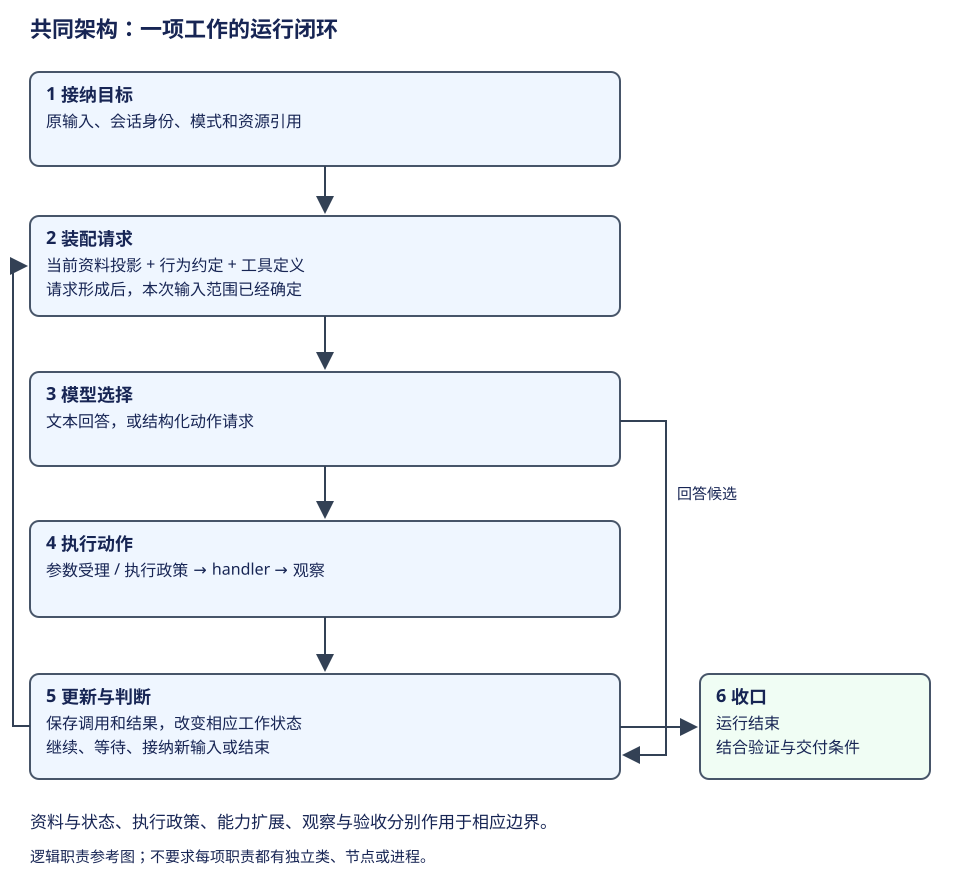

# 学习路径：建立统一认知，再阅读真实实现

本书的学习目标是：遇到一套新的 Agent 实现，能够解释它怎样获得目标与资料、怎样选择和执行动作、怎样保存工作，以及怎样继续和交付。框架名会变化，围绕职责与数据交接形成的理解更容易迁移到其他实现。

读者需要基础编程知识，可以理解函数、对象、列表、字典和异步调用。无需先会某个 Agent 框架，也无需先运行真实模型；主线案例和练习首先要求手工预测资料与控制变化。具体对象的源码阅读放在这些概念之后。

学习时先用图里的一个完整闭环回答“本次任务怎样继续”，再对照图，找到每种实现中对应的真实对象。下文通过学习阶段、实现路线和练习，依次讨论共同问题、真实机制和可推导的结果。

## 一、先学闭环，再学组织方式

| 学习阶段 | 读完应具备的能力 | 阅读与演算 |
|---|---|---|
| 一次调用到动作反馈 | 区分模型输出、工具请求、实际效果和观察；能列出下一请求的新增资料 | [共同架构](../comparisons/common-model.md)的完整任务与练习 |
| 资料到请求 | 区分自然语言正文与程序字段、来源、角色和可见范围 | [上下文](../comparisons/context-compaction.md)；用[RAG](../frameworks/langchain/retrieval.md)演算 Document 到答案 |
| 动态选择与显式控制 | 区分反馈循环、计划消费、固定编排和执行拓扑 | [执行模式](../comparisons/execution-modes.md)；演算 plan、Executor 输入和重规划 |
| 状态与生命周期 | 指出谁拥有交互、当前工作、请求和效果；分开历史与持久控制 | [所有权](../comparisons/ownership.md)、[状态与恢复](../comparisons/state-recovery.md) |
| 能力与协作 | 解释定义、受理、授权、执行和结果；知道父子工作怎样交接 | [执行边界](../comparisons/execution.md)、[委派](../comparisons/control-delegation.md) |
| 观察与完成 | 用调用、结果、状态和目标验证解释一次工作 | [观测与交付](../comparisons/observability-delivery.md) |
| 组合成业务服务 | 分开对话资料、运行进度和业务事实，选择控制方式并解释验收交接 | [架构归纳与设计取舍](../comparisons/agent-in-business.md)；演算 CSV 服务的产物与同版本验证 |

每阶段增加一种解释能力，下一阶段使用已学的接口与边界。例如还没区分 State 与 request 时，直接背 middleware 的方法名，容易把临时资料误当持久消息。

## 二、用三条实现路线检验共同认知

先选代表对象学透，再横向阅读其他分册。不同路线是在解释控制表示，并不是将所有 Agent 分成互斥门派。

**路线一：进程内反馈与历史投影。** 先读 Pi AgentSession 的构造、循环和[历史上下文](../agents/pi/context.md)。它让人看到用户工作、多次模型调用、工具结果、历史树与请求视图分别在哪里。随后阅读 Codex 的 Thread/Turn/Step 和 Hermes 的宿主/iteration，检查相同职责怎样被重新切分。

**路线二：图状态及应用装配。** 先读 LangChain 的模型、工具与 middleware，再读 LangGraph 的 State、reducer、超步和路由。最后读 DeerFlow，解释产品工厂、图运行与平台 run 的分工。这里不能把应用与两个框架当成三套互斥系统，也不能把图内一个节点自动称为完整 Agent。

**路线三：持久工作与事件资料。** 对照 Pi Durable 的 Submission、Task、Entry、Document 与 DeepSeek 的 phase、turn/step、event、surface。两者都能记录工作事实，但当前推进、投影和恢复采用不同表示。将这些表示放回共同问题，比按同名 Task/Session 作类比更可靠。

Claude 以已注明范围的历史研究阅读，Lane 在历史附录中提供另一个控制设计的参照。具体研究版本与证据范围只查[版本说明](baselines.md)。

## 三、每读一种实现，都回答相同的六个问题

1. 一份用户输入由谁接纳，交互身份与工作身份是什么？
2. 每次模型调用获得哪些资料，工具定义在哪一步绑定？
3. 模型的动作输出由谁解释，最终由谁执行？
4. 工具结果、当前工作状态和原始历史分别写到哪里？
5. 继续、等待、取消与结束由什么程序条件决定？
6. 如果替换一层组件，哪些输入输出与生命周期必须保持一致？

这些问题用来定位职责。具体回答仍要使用实现的真实类型、构造边界和执行点；共同模型不能成为将所有源码强行改写成同一套类名的理由。

## 四、把理解变成可以推导的结果

复述“有上下文、有工具、有状态”只是起点。真正的理解应能做三种推导：

| 推导 | 给读者的资料 | 应得到的结果 |
|---|---|---|
| 消息演算 | 目标、一次调用、工具结果、投影规则 | 下一请求实际多了什么，哪些资料没有进入 |
| 状态演算 | 当前状态、节点/任务结果、更新规则和路由 | 谁继续、等待什么、哪个字段或记录变化 |
| 设计选择 | 同一任务及业务约束 | 选择哪些职责与组件，组合成本和明确边界 |

例如 RAG 的 Document 样例应能转换成有来源的 context，再解释答案引用；Pi 的分支样例应能计算当前路径、摘要保留与编辑贡献；Plan & Execute 的例子应能判定当前步骤完成以后，是下一项、修订还是整个目标结束。

源码链接供读者复核输入、更新规则和采用位置。遇到推导断点时，回到对应构造或调用处，补齐缺少的资料与规则。

## 五、完成一次跨框架练习

设你要提供一个通过 HTTP 接收 CSV 修复请求的产品。任务需要多轮工具反馈，当前只要求保存对话以便后续提问；以后可能要求进行中的工作跨中断继续。

先画职责关系：接入与身份、运行控制、模型、工具、历史与请求投影、执行政策、观察与结果。再分别考虑：

- 已有反馈循环怎样被宿主接入，避免收到请求就启动重复工作？
- 当前历史恢复能回答什么，为什么不自动恢复仍在执行的工具？
- 若增加持久控制，哪个对象成为推进事实源，原宿主怎样等待和取消？
- 检索、子 Agent、middleware 或图执行分别填补什么职责，是否真的需要？

参考思路：先复用明确的主控制与会话身份，按真实需要组合接入和存储。后续引入持久 Task 或图恢复时，需要设计控制资料、存储和效果契约；加一层数据库或 Gateway 本身不会完成这些工作。具体选型看[共同架构的互补检查](../comparisons/common-model.md)。

练习不要求给所有框架排分数。做完练习后，应能判断自己缺少哪些职责，按接口选择组件，并解释组合后哪些事实已成立、边界在哪里。
