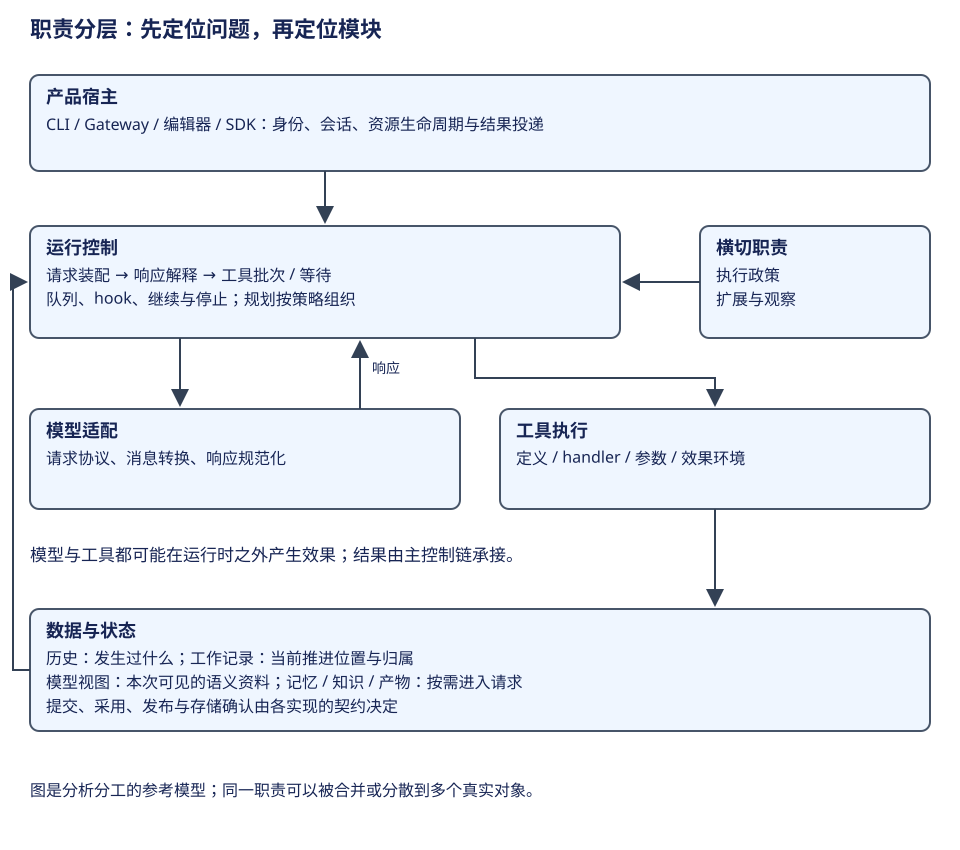

# 研究对象与阅读地图

应用、框架和持久运行内核承担不同职责。先看[横向比较](../comparisons/index.md)，再按感兴趣的问题选择分册；比较时以同一层次的能力为单位。

这张职责图是选择分册的坐标。如果想理解一次工具反馈怎样继续，先读进程循环；想理解多节点输出怎样合并，进入框架执行层；想理解跨中断保存推进位置，再读持久工作。下面的对象表把这些学习问题接到各分册。

| 对象 | 研究侧重 | 入口 |
|---|---|---|
| Pi AgentSession | 交互会话、模型循环、历史树与扩展绑定 | [分册](../agents/pi/index.md) |
| Pi Durable / pi-durable | 持久 Task、事务、Document 与副作用恢复 | [分册](../agents/pi-durable/index.md) |
| DeerFlow | 产品装配、Gateway/Client、中间件、工具与子 Agent | [分册](../agents/deerflow/index.md) |
| Claude Code | query 循环、权限、分层压缩、记忆与交互宿主 | [分册](../agents/claude/index.md) |
| Codex | Rust core 的线程、轮次快照、工具执行与 rollout | [分册](../agents/codex/index.md) |
| Hermes | CLI/Gateway/ACP 宿主、原生循环、提交控制与平台能力 | [分册](../agents/hermes/index.md) |
| LangChain | Runnable、消息/模型/工具协议与 Agent 构图 | [分册](../frameworks/langchain/index.md) |
| LangGraph | 图状态、超步调度、checkpoint 与恢复 | [分册](../frameworks/langgraph/index.md) |
| DeepSeek Harness | 插件装配、AgentLoop、会话事件与执行屏障 | [分册](../agents/deepseek/index.md) |
| Lane Harness | 处理道、Operation/Drive 状态机与跨进程协作 | [历史附录](../history/pi-lane/index.md) |

## 分册的阅读顺序

先理解定位与能力边界，然后认识概念、所有权和生命周期。接着沿一次输入追到模型或工具的执行点，再研究历史与模型视图、权限与扩展，以及并发、中断和恢复。遇到自造术语时回到词典，确认它指的是内存对象、持久记录、一次调用还是一个模型轮次。

LangChain 与 LangGraph 可以连续阅读：前者解释如何构造组件和 Agent，后者解释图如何执行并保存状态。DeerFlow 则提供应用层如何组合这些能力的案例。
