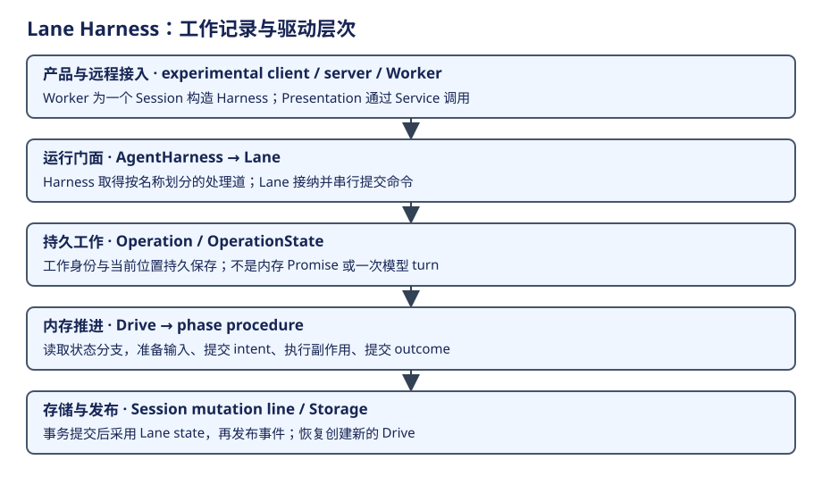

# Lane：概念层次与一条工作主线

Lane 模型把持久工作的身份与进程内推进分开：Operation 保存“什么工作、执行到哪”，Drive 决定这次进程怎样继续。读流程前先区分这两者。




先把五层连成一次任务：Worker 持有运行环境，Harness 提供会话门面，Lane 接纳命令，Session 提交 Operation，Drive 按已提交位置推进模型和工具。图中的存储层与 Drive 分工，是后面所有嵌套概念的出发点。下面先定义对象，再按接纳、提交、驱动、反馈四步走完整条链。

| 术语 | 层次 / owner | 生命周期与关系 |
|---|---|---|
| AgentHarness | Session 的运行门面 | 一个 Harness 可取得多条命名 Lane |
| Lane | 一个处理道的进程内 actor | 拥有 tip、配置、inbox 与当前 operation 的投影；命令经 Session 串行提交 |
| Operation | 持久工作身份 | run、compaction、navigation 等工作，跨进程恢复；不等于一个模型 turn |
| OperationState | 持久推进位置 | 保存直接状态分支，如 assistant.effect_pending、tools |
| Drive | 内存执行器 | Lane 拥有，推进当前 Operation；进程丢失后新建，不持久保存 Promise |
| Session / mutator | 事务与存储边界 | 提交 entries 与工作状态；负责存储一致性 |

## 第一步：由 Worker 建立 Harness 与 Lane

Worker 打开 Session，注入运行策略与服务，再通过 Harness 取得命名 Lane。Lane 是这一处理道的进程内门面；它持有已提交状态的投影，以及当前 Drive、输入队列等活动资源。Operation 则是某项工作的持久身份，一条 Lane 可以先后推进多项 Operation。

## 第二步：命令形成提交决定

| 当前位置 | 上层 | 下层 | 状态归属 |
|---|---|---|---|
| Lane 命令 | Controller / Harness 使用者 | Session.mutate 与 planner | commit 后采用 Lane.state |
| Drive 分派 | Lane 当前工作 | phase procedures | 检查当前 operation，不另建第二套权威存储 |
| effect procedure | Drive | model/tool | intent 前后分开；outcome 未知须恢复 |

createAgentHarness 恢复 Session 并返回 open operations，本身不启动模型、工具、hook 或计时副作用。命令接纳进入 Session mutation，planner 形成提交决定；mutator.commit 完成后更新 Lane.state，再发相应事件。

## 第三步：Drive 根据已提交位置分派

Drive 根据当前状态选择 startRun、checkpoint、generation、tool batch、deferred polling、summary 或 navigation 的过程。过程先准备输入、提交 intent，再做 effect 和提交 outcome。恢复重新走持久状态指定的路径，不靠之前 JavaScript Promise 的完成值。

## 第四步：效果结果核销后进入下一边界

模型生成和工具执行发生在提交边界之外，返回后才将结果与后续位置写入 Session。新的已提交 OperationState 交回 Drive，它重新读取再分派。因而“准备参数、保存意图、实际执行、核销结果”是一次效果的四次交接；Drive 的循环只负责选择下一个过程，具体效果由过程层实现。

以读取源码为例：用户目标先成为输入 Entry；模型阶段生成工具调用；工具过程保存读取意图并执行；读取结果成为消息贡献；checkpoint 再决定是否需要下一次生成。自然语言资料回答任务是什么，持久 state.at 回答程序应推进到哪里，两种资料在同一工作中协作。

Lane 的命令采用点可直接看源码。下面节选 planner 给出 commit 决定后的分支，省略其他决定、等待条件、事件交付与错误处理：

```ts
const commit = await mutator.commit(decision.writes, context);
this.state = decision.next;
this.signalStateChange();
const result = decision.materialize(commit);
```

`decision.writes` 交给存储提交，成功后才更新 Lane 的投影，并从提交结果形成命令返回值。通知者和下一 Drive 读取已采用状态；它们不消费尚未提交的 planner 草稿。完整方法还检查 materialize 必须同步。[查看 Lane.command 的提交与采用](https://github.com/earendil-works/pi/blob/6671c604766b3670ed95f405aa7856835d0ca702/packages/agent/src/harness/runtime/lane.ts#L328)。

证据：[Harness 构造](https://github.com/earendil-works/pi/blob/6671c604766b3670ed95f405aa7856835d0ca702/packages/agent/src/harness/runtime/harness.ts)、[Lane 命令提交](https://github.com/earendil-works/pi/blob/6671c604766b3670ed95f405aa7856835d0ca702/packages/agent/src/harness/runtime/lane.ts#L328)、[Drive 分派](https://github.com/earendil-works/pi/blob/6671c604766b3670ed95f405aa7856835d0ca702/packages/agent/src/harness/runtime/drive.ts#L33)。[运行专题](runtime.md)进一步解释 Drive 状态分派与跨进程交接。
