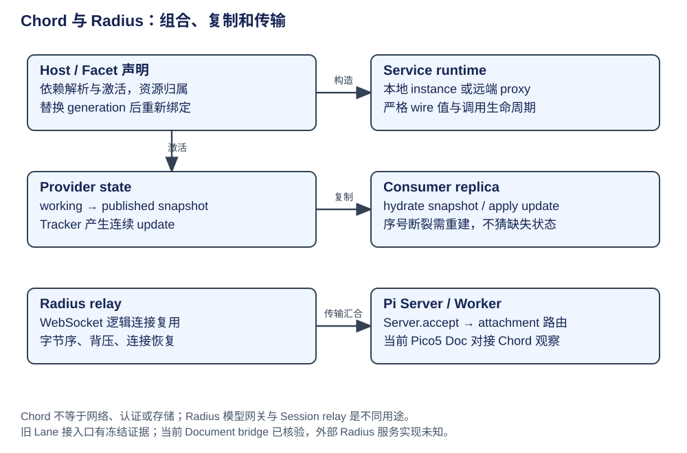

# Chord 与 Radius：组合、复制与远程传输

Chord 负责应用组合和 Service 状态语义，Radius relay 负责可选远程字节运输。Chord 是进程内运行库，不是监听服务；Radius 模型网关与 Session relay 是两个用途，不能把它们都叫 Agent 执行器。

| 概念 | 层次 / owner | 创建与生命周期 |
|---|---|---|
| Facet / Host | 进程内装载与组合 | setup 同步声明依赖/提供；onActivate 异步初始化，Host 逆序释放 |
| Service token | 类型化身份 | defineService 只定义 token；provide/use 或 provideMany/observe 建依赖图 |
| singleton / keyed | 服务实例模式 | 同一 token 不混用；keyed 还以 generation 区分重建实例 |
| stable handle | consumer 的稳定引用 | 绑定 provider 改变而引用身份不变；未就绪调用仍需失败处理 |
| Context | 调用范围与取消 | 尾部控制参数不作为业务 JSON 序列化 |
| ReplicatedState | 提交/发布视图 | Provider 可写状态，Consumer 不可变 revision；不是数据库复制 |
| Radius logical connection | relay transport | 一条 host WebSocket 承载多 client ID，应用协议保持 opaque |

## Facet 组合与远程 Service

setup 内实际调用 use/observe/provide/provideMany，Host 据此记录依赖，不反射已擦除的 TypeScript interface。声明结束后检查缺失/重复 provider、模式冲突与依赖环；provider 先激活、consumer 后激活，own 的资源与 Host 关闭逆序释放。热替换也要先验证新的声明和依赖，再切换实现，不是任意替换全局对象。

可远程 Service 仅允许方法与 ReplicatedState，参数/结果是严格 JSON，尾部 Context 属控制面；local Service 可保存本地对象。应用 Adapter 负责把 Chord 信封放进 Pi RPC、关联响应与选择 route/认证。远程成员 metadata 与 keyed generation 防止把迟到调用交给同名新实例，不能替代网络登录或业务授权。

证据：[当前 Host 依赖/激活](https://github.com/earendil-works/pi/blob/f1b2e77f5b13b2a199b1052cb79c235451afe7d7/packages/chord/src/facets/host.ts#L340)、[历史 Service 契约](https://github.com/earendil-works/pi/blob/6671c604766b3670ed95f405aa7856835d0ca702/packages/chord/src/types.ts)。

## Snapshot + Update 的四份状态

| 持有者 | 值 | 何时改变 |
|---|---|---|
| Provider 工作 state | 可写 proxy | 业务 mutation 同步发生，dirty paths 被记录 |
| Provider published value | 上次发布完整不可变值 | publish flush 成功后采用 |
| Tracker baseline | 生成差异的内部参照 | flush 推进，不是额外持久快照 |
| Consumer replica.value | 客户端完整不可变 revision | snapshot hydrate，随后连续 update；断线/序列缺口回 unready |

publish 无实际差异不推送；有差异则 sequence 加一。订阅先拿包含根替换的 base ops，再激活后续 updates，防 snapshot 与更新超车。Consumer 要求 sequence 连续，缺口不是“跳过一帧继续”，必须重新 hydrate。

路径 ops 表达从旧发布值到新值：r 替根、s 设字段、d 删除、a 追加字符串、t 裁字符串前部、p 数组 splice。decoded paths 与压缩 wire paths 是两层，codec 绑定具体订阅/实例/state member，replacement 与断线重建。对脏子树的 diff 仍可能昂贵，不能笼统承诺每次常数时间。

[历史 Provider/Replica 序列](https://github.com/earendil-works/pi/blob/6671c604766b3670ed95f405aa7856835d0ca702/packages/chord/src/services/state.ts#L6)、[订阅与传输](https://github.com/earendil-works/pi/blob/6671c604766b3670ed95f405aa7856835d0ca702/packages/chord/src/services/provider.ts)、[当前 Delta tracker](https://github.com/earendil-works/pi/blob/f1b2e77f5b13b2a199b1052cb79c235451afe7d7/packages/chord/src/delta/tracker.ts)。Pico5 [DocumentState](../../agents/pi-durable/documents.md) 直接从已提交 Document 建观察源；旧 Harness event→transcript bridge 是产品投影，事件原文不是 Chord delta。

## Radius：连接恢复到哪里

Host start 建立 WebSocket，认证/注册 relay host，收到 logical client 后构造字节 transport 交 Server.accept；client 先连接 gateway，再走 Pi hello、list/attach 和 Chord。逻辑连接 ID 复用不共享 Client 的业务上下文。有序写与背压防止字节乱序/无限缓冲，不能由此证明所有 tool result 会跨断线到达。

断线后 host 重连，client reconnect，再重新 attachment/订阅得到 snapshot；未完成请求失败，旧应用 mutation 不自动重放。存活 Worker 可以继续持有 Operation，但远程使用者须重新查询确认结果。Radius 地址/凭证变化与模型 OAuth refresh 是不同层。

[Host 与 Client reconnect](https://github.com/earendil-works/pi/blob/6671c604766b3670ed95f405aa7856835d0ca702/packages/coding-agent/src/experimental/radius-relay.ts#L104)、[Radius 认证适配](https://github.com/earendil-works/pi/blob/6671c604766b3670ed95f405aa7856835d0ca702/packages/coding-agent/src/experimental/radius-auth.ts)。外部 Gateway 的源码、部署副本数、HA 和具体鉴权实现未获得可验证资料，明确为未知。不能以“未见源码”证明永久闭源，或以重连代码证明没有单点。

## 可以复用什么

多宿主插件可以复用 Facet/Service 与 snapshot/update；应用仍要提供认证、路由、存储与运行恢复。bundle 的 CommonJS 输出解决同步 setup 装载与产物分发，不是进程隔离。没有远程视图/生命周期需求的简单单体，不必为形式引入 Host；需要数据库级共识复制也不能直接用 Chord 替代。
