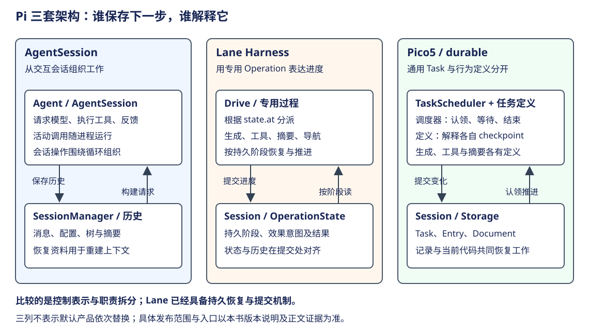

# Pi：持久架构路线与产品入口

按本书口径，官方 Agent 默认生产使用才叫转正。Lane 没转正；当前默认仍是 AgentSession。下面区分库导出、实验前端和实际默认三种事实。



本章先确定发布与入口，再比较三套架构如何保存“下一步”，最后解释各自适用的场景与成本。它们共享模型、工具、观察反馈的工作方式，变化主要发生在工作控制和状态组织上。跨框架的业务设计归纳见[从 Agent 循环到业务系统](../../comparisons/agent-in-business.md)。

## 先区分三个发布层次

库默认导出说明使用者能通过公开 API 接入；实验前端说明上游在验证产品组合；官方默认入口才说明普通用户启动时实际采用。三者可以在不同时间发生。下面按这三条证据阅读时间线，便能解释为什么 API 提升后，Lane 仍未成为默认生产主线。

| 观察点 | 已验证事实 | 不能推定 |
|---|---|---|
| 0.84.0，2026-08-06 | Session/AgentHarness 从 experimental 提升到 pi-agent-core 默认导出；tag 的 index.ts 与 changelog 一致 | 官方 pi CLI 已迁 Lane；当时未完成的分支到 9 月仍未完成 |
| 0.85.1，2026-09-16 | 正式 cli.ts 到 main→AgentSession；远程前端被 build 与发布检查排除 | 不能说 Lane 没有代码/不能自集成；也不能说存在官方产品部署入口 |
| 1.0.0，2026-10-01 | 旧 Harness 从 agent-core 删除；durable 成独立包；实验 TUI/worker 改用 Pico5 | 正式默认已切 durable，或能力完整等价 |
| 2026-10-09 | 正式 main 仍构造 AgentSession；实验 Worker 使用 durable | 未来切默认的日期与承诺 |

源码证据：[提升 API 的提交](https://github.com/earendil-works/pi/commit/44289550aa06750542c0ace8ab4bac0c7e68ce54)、[0.84.0 tag 对应源码](https://github.com/earendil-works/pi/blob/a5f43bf8aff3c55752432655f7334e3dafd1e256/packages/agent/src/index.ts)、[旧正式入口](https://github.com/earendil-works/pi/blob/6671c604766b3670ed95f405aa7856835d0ca702/packages/coding-agent/src/main.ts#L816)、[旧发布排除](https://github.com/earendil-works/pi/blob/6671c604766b3670ed95f405aa7856835d0ca702/packages/coding-agent/package.json)、[旧消费者检查](https://github.com/earendil-works/pi/blob/6671c604766b3670ed95f405aa7856835d0ca702/scripts/coding-agent-consumer.mjs#L79)、[最新 main](https://github.com/earendil-works/pi/blob/f1b2e77f5b13b2a199b1052cb79c235451afe7d7/packages/coding-agent/src/main.ts#L841)。

架构调整的上游说明见 [删除旧 Harness](https://github.com/earendil-works/pi/commit/7fd478a2e888ebc28869566f33a186303d372838) 和 [移植实验 client/server](https://github.com/earendil-works/pi/commit/48dd1e2f0f9dc7a767d7e5ee693bc85a4d6db38c)。

## 架构表示怎样改变

沿同一项 CSV 修复任务比较：模型需要读源码、提出修改、运行验证，再决定是否继续。三套实现都能组织这类反馈，区别在于程序怎样知道当前在哪里，以及中断后根据什么继续。

| 观察点 | AgentSession | Lane Harness | Pico5 / durable |
|---|---|---|---|
| 主要组织单位 | 交互会话与 Agent 运行 | 处理道中的专用 Operation | Conversation、Submission 与不同种类 Task |
| 下一步由什么表示 | 活动循环与调用结果 | 持久 OperationState 的阶段 | Task 的状态与 checkpoint |
| 谁解释下一步 | Agent / AgentSession 的控制函数 | Drive 分派到专用过程 | 通用调度器认领，各任务定义解释阶段 |
| 保存哪些资料 | 消息、配置、会话树和摘要等 | 工作阶段、效果意图、结果及历史 | Task、Entry、Document |
| 恢复需要什么 | 历史重建及新的运行对象 | 持久阶段与对应过程代码 | 记录、Registry 定义及版本兼容 |

### AgentSession：用直接控制流组织交互

SDK 先构造 Agent，再将它交给 AgentSession；SessionManager 负责历史等资料。输入进入后，Agent 按模型响应执行工具，将观察加入后续请求，AgentSession 协调会话操作和产品事件。这条路径便于理解“用户发起一次交互，进程连续推进，最后返回”。[构造 Agent 与 AgentSession](https://github.com/earendil-works/pi/blob/f1b2e77f5b13b2a199b1052cb79c235451afe7d7/packages/coding-agent/src/core/sdk.ts#L411)与[完整执行链](../../agents/pi/loop.md)给出实际对象。

在 CSV 任务中，已读源码、调用和结果可以成为历史；正在等待的工具仍属于活动执行。重开历史能帮助模型继续分析，却不等于旧调用从原位置恢复。这种选择适合以人机交互为主的生命周期：结构直接，已有会话功能集中；长任务自动恢复则需额外机制。

### Lane：将工作位置写进专用状态机

Lane 把“当前工作进行到哪里”保存为 OperationState，进程内 Drive 根据 `state.at` 调用过程。下面按源码整理分派骨架，保留代表阶段，省略取消处理、其他阶段及无进展检查：

```typescript
const state = currentOperation(lane, drive).state;
switch (state.at) {
  case "assistant.ready":
  case "assistant.retry_wait":
    result = await runGeneration(lane, drive, state);
    break;
  case "assistant.effect_pending":
    result = await recoverAssistantGeneration(lane, drive, state);
    break;
  case "tools":
    result = await runTools(lane, drive, state);
    break;
  // 省略：摘要、导航、延后工作等阶段。
}
```

这段分派位于驱动循环内部，每轮重新取得当前持久状态。生成和工具执行会提交进度，再由下一轮按新状态继续。[完整 Drive 分派](https://github.com/earendil-works/pi/blob/6671c604766b3670ed95f405aa7856835d0ca702/packages/agent/src/harness/runtime/drive.ts#L29)与[历史运行章](runtime.md)解释了过程如何返回继续、等待或收口。

因此 Lane 已经提供持久工作阶段、效果恢复与状态历史的提交边界。它相对 AgentSession 的变化，在于将活动工作的控制资料显式保存。代价是生成、工具、摘要、导航等行为共同进入一套专用状态体系；扩展运行行为时，需要理解它们与主 Operation 的关系。本书据此判断，复杂度容易集中到主控制模型，但没有通过维护成本实验为三者排序。

### Pico5：通用调度与任务行为分别解释状态

Pico5 将生成、工具和摘要表示为不同 Task。调度器处理 pending、running、waiting、completing 和 terminal 等通用状态；各任务定义处理自己的阶段。一个 generation 等待工具 child Task，读取其结果，再把同一用户工作交给后续 generation。这些身份与完成层次详见[Pico5 词典](../../agents/pi-durable/glossary.md)。

状态由通用调度器和任务定义共同解释。调度器重开时会将遗留 running 改回 pending，并保留 checkpoint；认领后从 Registry 取得对应定义。下面是重开路径的源码节选，省略扫描和事务外围：

```typescript
if (record.state.status === "running") {
  tx.setTask(withState(record, {
    status: "pending",
    checkpoint: record.state.checkpoint,
  }));
}
```

它使旧进程的认领失效，并不把运行推进到任意新阶段。`open` 本身也不派发工作；启用调度后，当前定义才从 checkpoint 继续。[调度器重开](https://github.com/earendil-works/pi/blob/f1b2e77f5b13b2a199b1052cb79c235451afe7d7/packages/durable/src/harness/scheduler.ts#L238)与[阶段运行](../../agents/pi-durable/loop.md)分别解释这两步。

对于 CSV 任务，用户工作可以跨多个 generation 与工具 Task，Entry 保存观察，Document 保存可变资料。通用调度器无需把 CSV 验证或摘要的具体策略写进自己的状态枚举。我的工程判断是，这比继续扩大专用 Operation 更适合增加后台工作和新的任务种类；收益来自职责划分，并非来自状态数量更少。

## durable 的收益需要与成本一起判断

与 AgentSession 相比，durable 增强了进行中工作的表示与恢复；与 Lane 相比，更显著的变化是通用调度、任务策略和数据职责的分开。Lane 已具备持久恢复和提交，不能把这些能力都算作 durable 首创。

| 需求或成本 | 对三套架构的判断 |
|---|---|
| 以前台交互为主，失败后允许用户继续 | AgentSession 的直接控制流仍有价值，无需仅因新架构出现就替换 |
| 进行中的工作跨重启继续 | Lane 与 durable 有明确阶段资料；恢复行为还要看效果、代码与存储契约 |
| 增加不同任务、后台工作及所有权关系 | durable 的通用 Task 与定义拆分更便于表达；这是模型对照的工程判断 |
| 代码升级 | 持久输入与 checkpoint 约束新代码，Registry 定义可能需要版本迁移 |
| 外部操作 | 保存执行意图不能自动使外部效果恰好一次，需要安全重放、幂等或结果查询 |
| 延迟与吞吐 | 提交路径与存储配置会影响成本；没有相同任务测量，不作性能排名 |

工具恢复说明了持久性边界：Pico5 在真正执行前保存最终参数及 replay 政策，恢复时只有历史与当前定义都标为 safe 才重跑；否则以中断结果收口。外部操作若已成功、结果尚未提交，系统仍需表达不确定性。[工具意图与恢复](https://github.com/earendil-works/pi/blob/f1b2e77f5b13b2a199b1052cb79c235451afe7d7/packages/durable/src/harness/tool.ts#L104)。

代码兼容也是新责任。调度器按 kind/version 查找定义；版本变化时需要有效迁移，把旧 input 与 checkpoint 转成新表示。持久化保存的是资料，不会同时保存旧函数的执行环境。[定义解析与迁移](https://github.com/earendil-works/pi/blob/f1b2e77f5b13b2a199b1052cb79c235451afe7d7/packages/durable/src/harness/scheduler.ts#L827)。

## 哪些动机有说明，哪些属于本书归纳

官方发布说明将长时间运行、不同交互入口及终端之外的应用列为 durable 的目标，同时明确保留 coding agent 的定位。这支持“用途扩展需要新的运行底座”的解释，不能证明普通 CLI 已经切换。[Pi 1.0 发布说明](https://earendil.com/posts/pi-1-0/)、[Pi Durable 设计说明](https://earendil.com/posts/pi-durable/)。

“为什么具体放弃 Lane”仍缺少完整的上游决策记录。旧 runtime-simplification 文档说明作者此前在削减复杂度；Pico5 规范则讨论移除固定 rewindable/sticky、namespace router、semantic view events 与手工 Chord bridge，改用类型化 Document、结构化 conversation watch 和统一 Submission。这些可以支撑接口变化，但不能还原全部决策动机。

“通用 Task 有助于把 Agent 能力接入业务服务”是本书基于上述机制的归纳。模型仍可按观察自由选择动作，程序则为已接纳的工作建立状态、等待、取消与恢复契约；业务规则由应用提供。跨框架的共性与组合条件在[业务系统承接篇](../../comparisons/agent-in-business.md)展开，这里保留 Pi 自身的机制证据与取舍。
