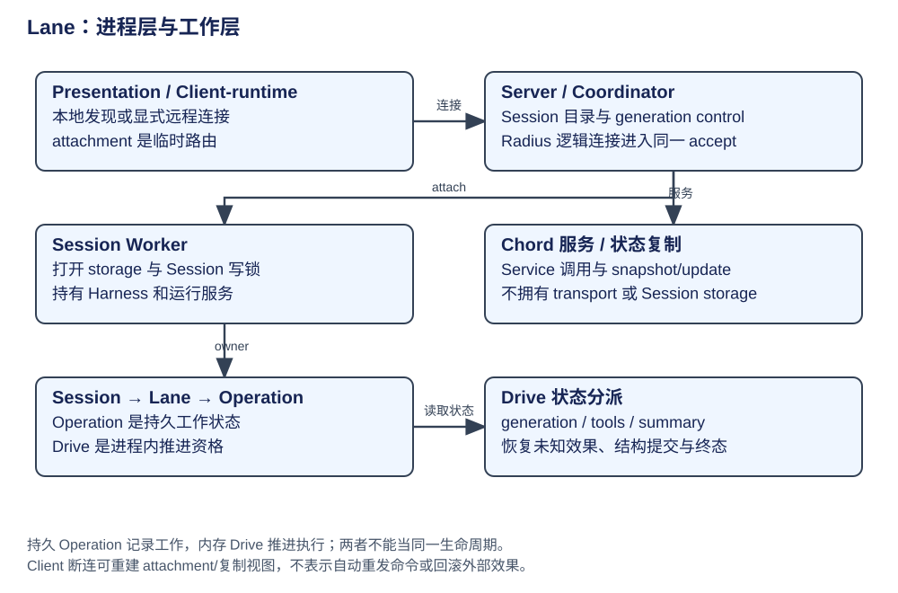
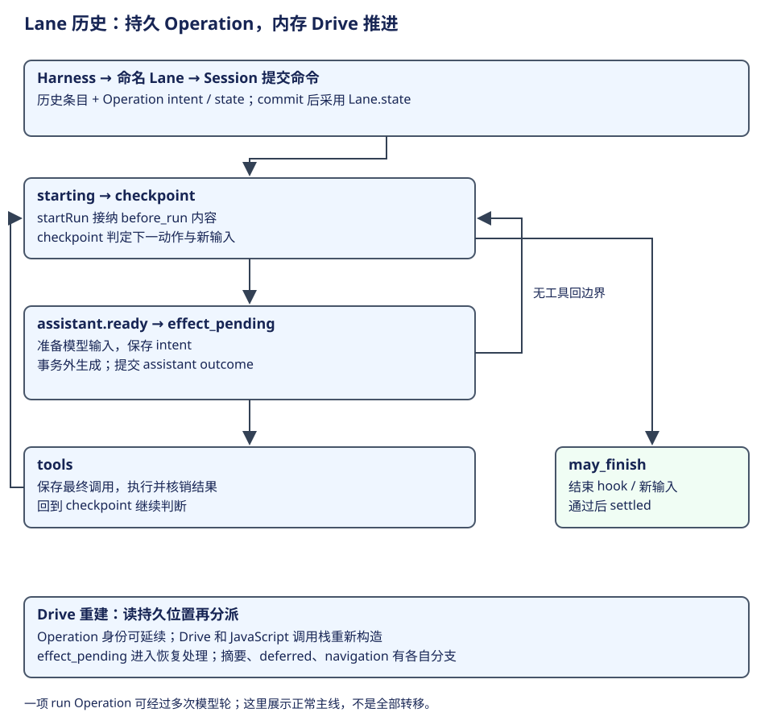

# Lane 历史：状态分派、进程链与恢复边界

旧 Lane 的持久状态由 Session/Lane/Operation 所有，Drive 只拥有本进程的推进权。远程 Client 不能把 JavaScript Harness 对象搬到自己进程；它通过服务命令和复制视图观察 Worker。




全章有内外两条线：Worker 内部从当前 Operation 读取位置、分派过程、提交结果，再回到位置检查；外部 Client 经 attachment 发送命令并订阅视图。先走内部一项 run 的正常推进，再看分派表中的支路，最后解释 Client 怎样到达这个 Worker。

| 运行对象 | 构造与 owner | 权威状态 / 生命周期 |
|---|---|---|
| Session | Worker 打开 storage 与写锁 | 持久 Lane/Operation/transcript；单 owner 写入 |
| Harness | Worker 的运行容器 | 包装一个 Session 的策略与运行服务 |
| Lane | Session 内命名会话分支 | 已提交投影、open Operation |
| Operation | accept 后的用户意图 | 持久状态机；跨 Drive 重建 |
| Drive | 本进程认领 Operation | gate、取消与执行控制；不持久化代码栈 |
| Turn | 一次模型轮次 | 一个 Operation 可有多轮；不等同输入命令 |

## 第一步：输入提交为 run，进入起始位置



以 CSV 修复为例，外部调用者通过 Harness 取得命名 Lane，再提交用户输入。Session 接纳 run 意图与历史条目，Operation 获得可持久引用的身份。Drive 是本进程推进者；它先确认自己对应 Lane 当前的 Operation，再反复读取已经提交的 state.at，调用相应处理过程。

starting 的 startRun 读取输入条目、调用 before_run，将注入消息与初始 checkpoint 一起提交。checkpoint 是阶段交接处：接纳待放置输入、判断摘要是否需要、决定继续 assistant 或进入结束检查。普通情况下 need_assistant 转入 assistant.ready，模型生成阶段保存请求意图，再执行外部请求；有调用时进入工具处理，结果核销以后重新回 checkpoint。

| 位置 | 对同一任务的意义 | 哪一层负责 |
|---|---|---|
| 命令提交 | “请修复 CSV”被接纳为 run 意图 | Session mutation 与 planner |
| checkpoint → assistant | 固定当前历史与下一次生成依据 | 已提交 Operation；Drive 调用边界过程 |
| assistant → tools | 模型选择读取、修改或验证 | 模型产生调用；程序保存调用并执行 |
| tools → checkpoint | 新观察已核销，决定后续生成 | 工具过程与下一持久边界 |
| may_finish → settled | 无新工作且收口条件通过 | 结束 mediation/hook 与提交 |

上述走向来自正常主线；重试、摘要、deferred 和 navigation 各有额外分支。`checkpoint` 这个名称在这里表示 Operation 推进边界，不是 LangGraph 的整图快照，也不是 Pico5 每种 Task 私有的 checkpoint 数据。先确认归属，再解释同名概念，才不会把不同架构混在一起。[开始与 checkpoint 判定](https://github.com/earendil-works/pi/blob/6671c604766b3670ed95f405aa7856835d0ca702/packages/agent/src/harness/runtime/drive/checkpoint.ts#L25)。

## 第二步：每次分派前重读持久位置

`driveOperation` 先核验 Drive 对应当前 Operation，运行 before_drive，循环 reread 已提交状态，再分派。每次 handler 返回后重新检查，不能拿第一次读出的 operation 一直推进。

| Operation state | 实际处理器 | 解释 |
|---|---|---|
| starting | startRun | 固定开始配置与接纳消息 |
| checkpoint | runCheckpoint | 判定是否继续模型、工具或结束 |
| assistant.ready / retry_wait | runGeneration | 生成/重试等待 |
| assistant.effect_pending | recoverAssistantGeneration | 外部请求结果未知后的恢复 |
| tools | runTools | intent → effect → settlement，不把调用体放事务内 |
| deferred.suspended / effect_pending | runDeferred | 暂停与外部 deferred 结果边界 |
| summary.deciding / ready / effect_pending / retry_wait | structural decision/generation/recovery/retry | 结构性摘要同样需要恢复状态 |
| navigation.ready_to_commit | commitNavigation | 分支导航的提交阶段 |
| 状态与控制需协调 | reconcileOperation | 先核验当前状态/意图；不是无条件重跑 |

证据：[Drive 状态分派](https://github.com/earendil-works/pi/blob/6671c604766b3670ed95f405aa7856835d0ca702/packages/agent/src/harness/runtime/drive.ts#L29)、[工具准备/执行/结算](https://github.com/earendil-works/pi/blob/6671c604766b3670ed95f405aa7856835d0ca702/packages/agent/src/harness/execution/tools.ts#L78)。工具执行前固定最终参数和意图，结束后核销；中断后的未知效果不直接重做。steer、followUp、nextRun 分别作用于运行/轮次/下一 run 边界，abort 结束工作、finish 完成终态、resume 重建推进权，不能互换。

分派的源码骨架如下，保留主要正常与恢复位置，省略 before_drive、取消协调及摘要、导航支路。这些省略分支的位置已在上表列出。

```ts
for (;;) {
  operation = currentOperation(lane, drive);
  const state = operation.state;
  // 完整实现先处理 cancel_requested，再按 state.at 分派。
  switch (state.at) {
    case "starting": result = await startRun(lane, drive, state); break;
    case "checkpoint": result = await runCheckpoint(lane, drive, state); break;
    case "assistant.ready":
    case "assistant.retry_wait": result = await runGeneration(lane, drive, state); break;
    case "assistant.effect_pending":
      result = await recoverAssistantGeneration(lane, drive, state); break;
    case "tools": result = await runTools(lane, drive, state); break;
  }
  if (result.kind === "settled") return { kind: "settled", outcome: result.outcome };
  if (result.kind === "waiting") return result.outcome;
  // 完整实现还检查过程确有进展；随后再次读取已提交位置。
}
```

这个 switch 消费 OperationState，handler 负责推进并提交新的位置。返回 continue 时重读；waiting 交出在线推进；settled 返回本项工作的结果。因此读 handler 时要沿它的输入状态与提交后的 state.at 回到本段，不能把一个下层函数误当作整个 Operation 的循环。

## 第三步：核销结果，交回下一次分派

最内层仍是模型根据消息和工具观察选择下一动作；外层多出来的是工作身份、提交边界、恢复位置及进程协作。自然语言输入和工具结果保存在 Entry 的消息贡献中，state.at 与 continuation 则让程序知道“目前需要生成、执行工具还是可以结束”。前者解释任务，后者解释怎样安全推进当前工作。

Drive 丢失以后，新的 Drive 依据 Operation 重新分派；若位置为 effect_pending，需要恢复判断，不能把旧 Promise 的结果当作仍在内存。再外一层的 Chord 提供调用与状态复制，Radius 处理连接和传输；它们都不替模型规划任务，也不拥有 Session 中的持久 Operation。

这说明“持久运行”增加的是任务推进的可重建表示。它可以承载反馈循环，也能容纳其他操作种类；持久 Operation 本身不等于显式 Planner/Executor。后续 Pico5 如何换成通用 Task、Entry 与 Document，见[架构路线](evolution.md)。

学习自检：为什么一个 Operation 内会有多次模型轮次？谁保存当前推进位置，谁执行它？Chord 的状态复制为什么不能当作 Session 存储？

## 外层接入：从 Client 到持有 Session 的 Worker

历史 server 入口确保 Coordinator，持有启动锁与逻辑 serverId，创建 generation Backend、SessionWorkerManager、服务 Host，监听并注册，再接管已有 Worker、发布 Session 目录。两个锁分别协调本机服务启动和 Session 写入，不提供跨主机共享 storage 的高可用。

Client-runtime 先解析 routes：显式 connect 单 route；自动发现只找本地 Unix servers，可冷启动独立 Server 子进程。连接所有候选后选择 session 并 attach。非交互 client 完成一次结果即 dispose；TUI 长期持有复制状态与重新 attachment。旧非交互路径没有 TUI 的 continue/resume 选择语义，不能凭同名 CLI flag 推断等价。

| 协议层 | 拥有 | 不应解释为 |
|---|---|---|
| Radius relay | WebSocket 逻辑连接复用、字节序与背压 | Agent/Operation 协议 |
| Pi protocol | hello/version、CBOR frame、request correlation、cancel、subscription | 工具或业务命令语义 |
| Client / Server attachment | 临时 Session 路由与租约 | Session 对象跨进程共享 |
| Chord | Service call/catalogue 与 state snapshot/update | transport、认证或存储 |
| Coordinator private control | generation、peer、Worker 交接 | 公共 Pi RPC 或数据库 |

本地与远程在 RadiusRelayHost 调同一 Server.accept 时汇合，随后复用 attachment 与 Worker 路由。[历史 Server 组合根](https://github.com/earendil-works/pi/blob/6671c604766b3670ed95f405aa7856835d0ca702/packages/coding-agent/src/experimental/server.ts)、[Client-runtime](https://github.com/earendil-works/pi/blob/6671c604766b3670ed95f405aa7856835d0ca702/packages/coding-agent/src/experimental/client-runtime.ts)、[远程汇合点](https://github.com/earendil-works/pi/blob/6671c604766b3670ed95f405aa7856835d0ca702/packages/coding-agent/src/experimental/radius-relay.ts#L262)。

## 故障与资源回收

| 事件 | 持久事实 | 可重建/未知部分 |
|---|---|---|
| Client 断开 | Operation 仍可能在 Worker 推进 | attachment 与 state replica 重建，不自动重发旧命令 |
| Server generation 替换 | Worker/Session 可继续持有 | peer、目录、demand 与 Chord proxy 重新绑定 |
| Worker 崩溃 | 最后成功 commit | 模型/工具 effect 未核销结果可能未知 |
| Session 锁被占用 | 单写者约束 | 新 Worker 拒绝并行打开，不自动抢锁 |
| 所有 hold 消失 | 没有新工作 | idle/orphan grace 后关闭，活动 Operation 仍是 hold |

ServerLifetime 与 WorkerLifecycle 综合连接/活动工作/临时 hold；不是无前台就立刻退出。插件按 session/tui 分别构建与加载 bundle，各 Host 有独立实例；manifest/hash 校验不等于插件代码 sandbox。旧版本的计时默认值留在固定源码，不提升成跨版本契约。

Lane 的持久 Operation 与内存 Drive 分工，为恢复提供了明确的状态边界。它与后续持久路线的关系见 [架构路线](evolution.md)。
