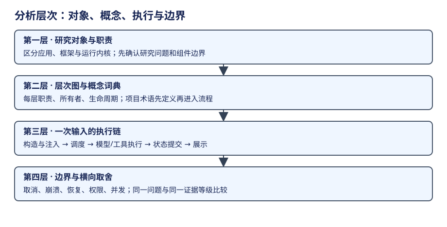

# 增量更新与换机流程

更新以“哪些结论受到变化影响”为单位，不能只把日期和 SHA 改成今天。后续 agent 接到本页即可开始，历史原稿从仓库 archive/ 读取。

## 教学深化计划

当前正文建立了对象地图、固定源码引用和代表机制摘要，尚不足以作为完整培训教材。后续工作先在已登记版本上深化主线，再跟踪上游变动；两类工作分别说明范围。书籍继续按“横向比较、对象分册、历史附录”组织，维护计划留在本目录。

读者按具备基础编程知识、首次系统学习 Agent 实现来设定。贯穿案例采用“读资料、形成方案、调用工具完成任务、根据结果继续或结束”，在各对象中复用相同目标；每个实现使用自身的真实对象和控制机制，不强行统一函数名或状态机。

已确认的教学要求包括：整体层次与概念先行；重要状态机和流程图配合正常任务讲解；自然语言信息组织与非固定模型决策都展开；ReAct、Plan & Execute 等执行模式说明原理、实际入口和支持程度；源码细读解释设计原因；边界案例只服务于理解主线。

| 补充顺序 | 主要学习内容 | 交付与完成判断 |
|---|---|---|
| 横向主线与执行模式 | Agent 循环的控制骨架，ReAct/工具反馈循环、Plan & Execute、模型动态选择与固定编排；非结构化内容和结构化运行状态的关系 | 在现有比较章先讲概念和同一任务，再补支持方式矩阵；读者能区分执行策略、协作拓扑、持久性和产品模式 |
| Pi AgentSession 与 Pico5 样章 | 会话、循环与历史树；Task/Entry/Document 的层次、接纳与调度、模型和工具阶段、主要提交与观察过程 | 改写现有概念、架构、执行和上下文章；先总图后局部流程/状态图，消息/记录样例与源码对应；读者能独立复盘一次正常任务 |
| DeerFlow 与 LangChain/LangGraph | 产品装配、middleware、模型与工具节点、图调度/超步、消息和状态变化；应用与框架的协作 | 从用户请求逐层追到执行，以实际依赖组合解释应用；框架独立主干另有研究范围；对照模型循环和图编排的主线 |
| Codex、Hermes、DeepSeek 与 Claude | Codex 的 Thread/Turn/Step；Hermes 的宿主和原生阶段；DeepSeek 的插件装配、事件/surface；Claude 的 query、工具发现与上下文层次 | 各自围绕同一任务深化状态、执行模式、非结构化内容与扩展机制；Claude 延续已有历史范围，不补造缺失实现 |
| Lane 历史附录 | Session/Harness/Lane/Operation/Drive 的关系及主要状态推进，Chord 的观察与通信职责 | 保留完整教学层次与历史比较价值；不扩入当前正文比较对象 |

每完成一个对象，同步补充消费其结论的横向章节；比较页可先有代表案例，再逐步充实其他对象。上述顺序是建议实施顺序，不表示正文已经深化完成，也未建立定时任务。

既有材料按学习目标逐项检查。有效的机制解释、完整流程、图示、数据样例和独有专题需要进入教材；旧版本结论先对照固定源码，失效内容不直接复用。检查覆盖时说明哪些教学问题已经被正文回答，不能仅登记来源存在或主题名称被提及。保留原文不替代正文讲解。

完成标准不采用字数或页数：读者可以据图复述一次任务，解释主要对象与状态的区别，说明模型决策和程序控制如何配合，并沿引用找到关键实现。无显式状态机的循环按阶段和决策流程讲解，不能编造状态枚举。已读测试只作为契约证据，不写成已经运行；目标 Agent 和真实模型实验仍按任务授权范围处理。

深化建议沿用当前会话模型，源码与教学主线用 xhigh；措辞整理可用 high。只有具体架构争议需要时再提高 effort，不因篇幅多就全程使用 ultra。

执行模式的概念参考：[ReAct 论文](https://arxiv.org/abs/2210.03629)、[LangChain 官方 Plan-and-Execute 说明](https://www.langchain.com/blog/planning-agents)。理论模式与旧示例用于建立学习模型，各研究对象的支持程度仍以固定源码和真实入口为证据。

## 主干更新流程



1. 阅读 README、AGENTS、contracts、对象分册与依赖比较页；判断目标是跟踪主干、冻结材料补证还是新对象分析。
2. 通过 AGENT_SOURCE_ROOT 或本机 .source-map.json 找源码。先记录 branch、HEAD、remote、staged/unstaged/untracked；更新必须已有授权，只使用 fetch 与可安全 fast-forward，不清理用户改动。
3. 锁定 fetch 后的完整 SHA。脏 checkout 用 `git show <sha>:<path>` 读上游，不把本机修改带入结论。主干分叉、网络失败或文件冲突必须具名报告，不自动 stash/reset。
4. `git diff --name-status <old> <new>` 定位影响路径，再阅读相关构造、调用、存储及测试。架构改名同时核验“同一机制改名”还是“新模型重写”。
5. 新增不可变基线 ID。对核验过的章节迁移 baselines；没有检查的正文留在旧基线。更新词典、层次图、主链路和边界表，再更新消费这些结论的 comparisons 页面。
6. 新对象先补 subject、repo、基线和分册入口，再按统一模板建章，给所有比较维度添加该对象；未分析单元格写待核验。
7. 运行 `npm run check`、`npm run build` 和门禁反例检查；展示变更检查中文搜索、英文符号、浅深主题。报告已解决、未解决、未验证，注明源码静态分析是否有运行验证。

整理历史原稿时，先按 migration.json 的 ID、路径和 SHA-256 核对 archive/ 文件，再逐章提炼并与对应源码基线比对。全文归档不等于结论已经核验，不能因此把 migrated-unverified 改为 verified-source。重要结论、独有内容、学习目的和未知完成整理后，在 coverage 登记覆盖章节与边界，将 migration_status 改为 digested，并清空材料整理的 remaining_scope；缺失实现、运行边界和只保留归档的取舍写入 known_limits。只有正文已不再引用该原稿时，才可删除文件并将 archive.state 改为 removed，保留校验值供 Git 历史追溯。

初版未建立任何定时任务。后续调度器只负责触发一次更新任务；更新逻辑由此仓库控制。建议按对象分配任务，每次生成一个可评审 diff；同一本书同时更新时，各自限定对象章节，比较页串行汇总，避免多人改基线和目录。

换机仅重新 clone 本书和目标源码、安装 Node、设置本机根路径，再 `npm ci --ignore-scripts`。全局不保存机器路径；.source-map.json 不入 Git。

```sh
export AGENT_SOURCE_ROOT=/your/new/community-root
npm ci --ignore-scripts
npm run sources
npm run build
npm run preview
```

`sources` 只读本地与缓存的 origin ref，不联网、不更新源码。定时任务需要明确包含授权更新动作；若仅授予监测权限，先报告差异，不实施 merge。

可复用委托提示：

> 更新 agent-insight 中指定对象的研究。遵循 AGENTS.md 与本页。以登记基线为旧版本，核验授权范围内的官方主干。先列影响章节，逐页检查构造/注入/生命周期/入口到执行点/存储边界；更新词典与层次图，然后更新依赖比较页。未经核验保留原基线与状态。禁止把未找到当不支持，禁止把规范当实现。交付范围、证据、门禁结果和未验证项。

分析建议用当前会话模型的 xhigh；格式整理可用 high；跨架构争议再增加独立核验。无需仅因资料多就使用 ultra。
